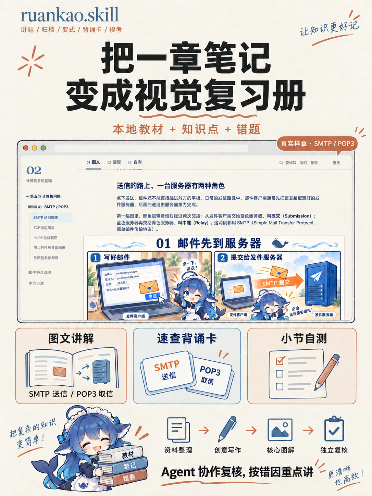
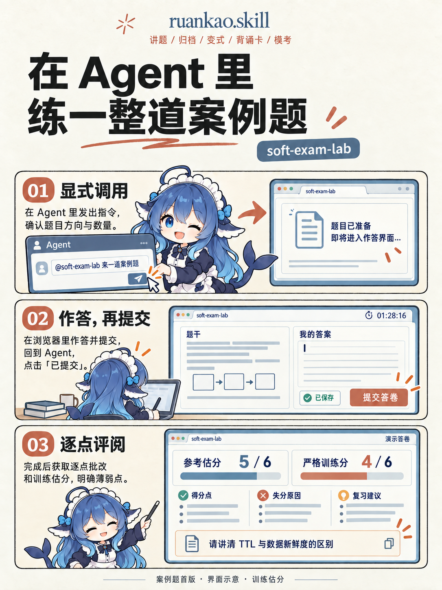

# 安装与使用

[返回首页](../README.md) · [独立学习资料](https://github.com/Goodyzhang/ruankao.skill/releases/tag/materials-v1.0.0)


## 先看三种使用方式

<p>



</p>

以上是宣传示意；复习册图中包含现有 SMTP／POP3 样章截图，作答实验室布局以实际页面为准。

### 讲题、练习和归档


发一张完整题图，告诉它“我选 B，请解析”。讲解会围绕题目考查的知识、推理过程和选项边界展开。有需要时继续做变式练习，看看条件改变后还能不能判断；未作答或只想快速听解析，也可以跳过练习。

普通讲题后可确认归档；明确要求“只讲解”时直接结束。确认归档后，Agent 将本题的知识点与错题记录整理到对应章节，并回读核验。省下手动复制和排版的时间，下一次能找到当时的错因。本题已有明确归档授权时直接沿用；用户明确授权第 1–3 题及目标时，逐题执行并记录结果，范围之外的新题重新确认。


### 一章学完：知识点二次蒸馏


复习册按教材小节连续展开，正文解释机制，大图表达关系，速查保存判断线索，自测检验条件迁移。相似名词放在同尺度图中比较，通信采用时序图，计算用小黑板与逐步演算；经核验反复出错或用户点名的考点详细讲解。

创意写作优先交给 Antigravity（`agy`）中的 Gemini，Claude Code 作为后备；Codex 核验并制作核心图，Grok 可制作少文字的辅助图。CLI 找不到时填写位置或跳过，无需全部安装。生图前两轮提示词复核、tutor 方法复核，生成后实际看图，再在内建浏览器检查页面。原始教材和笔记保留，局部修订不重置无关自测。

```text
使用 soft-exam-review-book，将系统架构设计师高级第三章“信息系统基础知识”做成图文、速查与自测复习册。重点比较 TPS、MIS、DSS、ES、OAS、ERP；按小节完成，整章结束后统一审阅。
```

### 题库整理：准备题干、清晰图表与解析

在内建浏览器中打开题库并登录，直接点名 `soft-exam-bank-ingest`，指定题号或整理剩余题目。Agent 保存题干和原图，合并同案例的小问，补上考场答案、采分要点与详细解析；论文生成完整应试模拟范文，整理中断后可续接。

```text
@soft-exam-bank-ingest 为我完成当前打开页面 79～85 题的案例题和论文题整理。
```

需要能实际看图的模型、浏览器工具与本地保存能力。首次资料位置不明确时，从真实目录候选中选择。只读取题目、展开解析和导航，答案保存本地，不代填网站或交卷。详见 [题库整理说明](../docs/soft-exam-bank-ingest.md)。

## 快速开始：完整初始化

需要 Python 3.9 或更新版本。脚本仅使用标准库，无需安装 Python 依赖。

### 1. 获取发布包

从 [v1.0.0 Release](https://github.com/Goodyzhang/ruankao.skill/releases/tag/v1.0.0) 下载 `ruankao-toolkit-v1.0.0.zip` 并解压。该包保留八个 Skill、实验室运行资源、既有初始化种子与 SMTP／POP3 样章；完整高级学习材料在独立资料 Release 中下载，视觉复习册在线阅读。包内排除 `materials/` 与 `artifacts/`。也可以获取相同版本的完整 Git 仓库（包含知识库）：

```sh
git clone --branch v1.0.0 --depth 1 https://github.com/Goodyzhang/ruankao.skill.git
cd ruankao.skill
```

以下命令在解压目录或仓库根目录中运行。`../RuankaoVault` 是目标 Vault，可替换为自己的路径；目标应与发布包目录分开。

### 2. 安装到 Antigravity 工作区

macOS / Linux：

```sh
python3 scripts/init_toolkit.py --vault "../RuankaoVault" --platform antigravity --dry-run
python3 scripts/init_toolkit.py --vault "../RuankaoVault" --platform antigravity
```

Windows PowerShell：

```powershell
py -3 scripts/init_toolkit.py --vault "../RuankaoVault" --platform antigravity --dry-run
py -3 scripts/init_toolkit.py --vault "../RuankaoVault" --platform antigravity
```

脚本将八个完整 Skill 放入 `.agents/skills/`，将资料放入 `个人资料/笔记/软考/`。已有文件默认保留，并列出跳过的文件；重复运行不会清空错题和进度。

在 **Antigravity 中打开目标目录并新建会话**；使用 Obsidian 时，也将这个目录作为 Vault 打开。普通学习资料目录同样可用。发现目录与加载行为见 [Antigravity 官方说明](https://antigravity.google/docs/skills)。

### 可选：超长上下文 Harness

Antigravity 用户可以安装 [可选 Harness](../integrations/antigravity-harness/README.md)。它仅在已确认的软考单题会话中提醒卡片续接、约束工具并拦截讲题后裸退；普通图片、文档和其它 Agent 不受影响。

### 3. 首次使用

```text
当前工作区就是我的 Obsidian Vault。
软考知识库位于“个人资料/笔记/软考”。
我准备系统架构设计师高级，请读取 soft-exam-architect-prep，
先了解我的考试批次、基础与每周学习时间，再给本周计划。
不要把模板或虚构论文案例当成我的真实经历。
```

中级学习换成 `soft-exam-prep`。计划、进度和项目底稿由使用者提供事实后填写。

### 安装后初始化 prompt（可复制）

安装后在目标工作区新建会话，复制下面的 prompt。将 `{请在这里填写你的工作区或 Vault 路径}` 替换为你的路径；已经在目标工作区中时，也可改为 `.`。Skill 根目录由 Agent 探测，无需照抄作者的本机路径。

```markdown
请执行软考学习导师（Soft Exam Tutor）初始化流程。
我的工作区或 Vault：{请在这里填写你的工作区或 Vault 路径}

请先确认该目录存在，将以下路径均相对于它解析。读取现有的最新 SOP、契约与规则，作为后续执行依据；本次仅初始化，不启动讲题、案例题场次、复习册制作或归档。

1. 【探测权威目录与分工】
   - 如存在 AGENTS.md，完整读取其软考入口、路由与方法学；不要假定安装包一定提供这个文件。
   - 优先遵循工作区已声明的权威目录。如 .agents/skills/ 或 .trae/skills/ 中只是发现桥接，继续读取其指向的完整源文件。
   - 独立安装时，核对 .claude/skills/、.agents/skills/、.trae/skills/、.zcode/skills/ 中实际存在的 soft-exam-question-tutor，以完整且已声明的源作为 SKILL_ROOT。存在多个冲突版本时先说明差异，不能静默任选或混用。
   - 确认八个 Skill 的分工：单题由 soft-exam-question-tutor 负责；学习计划和周期复习由对应级别的 prep 负责；完整历史导入由 organizer 负责；章节复习册由 soft-exam-review-book 负责；soft-exam-lab 只接受用户显式点名，初始化中提及名称不算启动；题库整理 soft-exam-bank-ingest 同样只接受显式调用。

2. 【运行时与终止保护】
   - 如存在 GEMINI.md、.agents/rules/soft-exam-suspension.md，读取相关规则；缺失时如实报告，不伪造加载结果，也不自行安装 Hook。
   - 卡片必须通过当前会话实际提供的原生提问工具调用，不能在正文输出伪 JSON 或调用文字冒充卡片。
   - 卡片待答时等待真实返回，不重复弹卡；预选、空回复和超时不当作用户作答或授权。
   - 识别带 (Recommended)、[推荐]、选项编号的真实终止选择；用户选择结束本题、已完成等待下一题或不归档时正常结束，不能循环补卡。
   - 核对已有归档授权与实际写入、回读结果；已经完成的步骤不重复执行，不能仅凭模型声称“已归档”判断完成。

3. 【完整读取单题核心契约】
   - SKILL_ROOT/soft-exam-question-tutor/SKILL.md
   - SKILL_ROOT/soft-exam-question-tutor/references/first-use.md
   - SKILL_ROOT/soft-exam-question-tutor/references/runtime-interaction.md
   - SKILL_ROOT/soft-exam-question-tutor/references/knowledge-base-contract.md
   - SKILL_ROOT/soft-exam-question-tutor/references/grill-diagnostic-contract.md
   - 后续只按实际任务加载其它 Skill 的完整 SOP，不让单题规则限制章节制作或实验室。

4. 【资料位置】
   - 检查已有本地绑定及工作区默认资料目录，已有有效绑定直接复用。
   - 必要位置不明确时，用实际可用的追问卡提供 1～2 个真实候选，或请我手动填写绝对路径；没有候选就说明没有探测到。没有卡片工具时说明限制，并按契约处理。
   - 选择位置不等于同意归档本题，不创建虚构做题记录，不把初始化扩展为批量归档授权。

【完成汇报】
1. 列出实际读取的核心契约相对路径；版本、哈希或修改时间只报告实际可核验的信息，缺失文件另列。
2. 简述五项守则：输入 Gate 补齐、五段式讲解、基于真实作答的 Grill 门控、授权范围内章级归档与回读、终止与中断保护。
3. 核心契约齐全且工具检查完成后回复：“软考辅导环境已就绪，请上传软考题目图片、截图或文本开始。”未完成时说明缺口，不声称就绪。
```

需要案例题时，初始化后另发显式调用：

```text
$soft-exam-lab 为我来一道系统架构设计师软件系统设计案例题真题，就做一道。先确认题库和练习档案位置，使用自由计时。
```

### 首次使用：先检查，再引导

不用事先把每个目录都改成示例中的样子。Skill 会先检查你明确提供的位置、已有绑定，以及工作区中的默认资料布局；已有有效配置直接沿用。

需要选择时，会出现位置卡片：点击探测到的资料目录，或直接输入你自己的**绝对路径**。候选会显示实际路径；没有候选就请你填写。选择保存位置不等于同意归档某一道题，单题仍按本题授权执行。

- **只想讲题**：可以先讲解，归档前再确定目标科目与位置。
- **已有笔记**：沿用现有章级文件和命名，不另造一份平行错题本。
- **制作复习册**：需要协作时才查找对应 CLI；找不到可填写可执行文件位置或跳过，由后备角色继续。
- **没有 Obsidian 或卡片工具**：普通资料目录也能使用；环境配置可用简短文字问答，单题练习与归档仍遵守其实际交互规则。

已选择的位置与跳过项按本地续接约定复用；换机器或路径失效后再核验。工具探测不会自动安装软件、修改 PATH 或替换你的模型配置。

## 其它安装方式

### 其它 Agent

```sh
python3 scripts/init_toolkit.py --vault "../RuankaoVault" --platform codex
python3 scripts/init_toolkit.py --vault "../RuankaoVault" --platform claude
python3 scripts/init_toolkit.py --vault "../RuankaoVault" --platform trae
python3 scripts/init_toolkit.py --vault "../RuankaoVault" --platform zcode
```

| 参数 | 目标目录 |
|---|---|
| `antigravity` / `codex` | `.agents/skills/`（共用一份） |
| `claude` | `.claude/skills/`（Claude Code / Claudian） |
| `trae` | `.trae/skills/` |
| `zcode` | `.zcode/skills/` |

`--platform antigravity claude` 可同时安装。结构化提问工具以当前会话实际暴露的能力为准；脚本不会安装或伪造工具。

### 只安装 Skills

把 `skills/` 下八个目录完整复制到平台目录，或使用 [Skills CLI](https://github.com/vercel-labs/skills)：

```sh
npx skills add Goodyzhang/ruankao.skill -a antigravity
```

在选择界面选齐八个 Skill。此方式只安装 Skill；知识资料仍需通过初始化脚本或手动复制 `vault/` 的内容取得。

### 已有权威源与发现桥接的工作区

若已有 `.claude/skills/` 权威源与 `.agents/skills/` 发现桥接，应沿用该组织方式，将公开包合并到权威源，再维护桥接。不要用 `--upgrade-skills` 覆盖发现桥接。通用初始化面向独立 Vault，不负责迁移已有多端同步配置。

## 日常使用

- **讲题**：提供完整题图后说“我选 B，请解析”。Agent 先复原题目、说明考点、解题链和选项边界，再询问是否 Grill。未作答或明确快速讲时跳过 Grill；明确要求直接归档时沿用授权写入。
- **Grill**：“开始 Grill”。生成变式含一个正确项和两个干扰项；复用原题时按宿主能力保留完整选项。选择后先反馈，再决定下一题，最多三轮。“结束”或“换题”结束当前题。
- **归档**：“将本题归档到高级”。授权只用于本题；写入章级知识点和错题本后回读核验。下一题重新建立状态与授权。
- **章节复习册**：“第五章已经学完，请制作图文速查复习册”。按小节取材、写作、生图、复核，整章完成后统一审阅；也可指定某个专题或局部修订。
- **复习**：“今天有哪些 D1/D7/D21 到期？”依据实际完成日期计算，空日期不会被当作今天到期。
- **论文**：“按题干逐项批改这篇论文，并改成完整考场稿”。先给出原文的扣题证据、技术问题与具体改法，再写完整摘要和正文；用户已明确的真实经历或应试模拟口径持续沿用。模拟写作允许合理设计技术与结果，正文保持完整表达，设定说明另存。详见 [论文写作与批改](../skills/soft-exam-architect-prep/references/paper-review.md)。
- **历史导入**：“请用高级 organizer 整理下面这份完整历史对话”。只导入明确提交的材料；题干、选项或必要图片缺失时先补齐。

## 更新与保留个人资料

下载新版到独立目录，运行初始化，默认只补充缺少的文件。需要更新 Skill 时使用：

```sh
python3 scripts/init_toolkit.py --vault "../RuankaoVault" --platform antigravity --upgrade-skills --dry-run
python3 scripts/init_toolkit.py --vault "../RuankaoVault" --platform antigravity --upgrade-skills
```

`--upgrade-skills` 会覆盖所选平台的同名 Skill 文件，包括手工定制的内容。它始终保留已有知识点、错题本、计划与论文底稿。知识资料升级需人工比较、合并；不要用公开模板覆盖个人记录。

已安装旧版可选 Harness 的 Antigravity 工作区，还需从新版发布包根目录单独更新 Hook 与脚本。先预览，再执行：

```powershell
py -3 integrations/antigravity-harness/install_harness.py --workspace "D:\YourVault" --force --dry-run
py -3 integrations/antigravity-harness/install_harness.py --workspace "D:\YourVault" --force
```

macOS / Linux 把 `py -3` 换成 `python3`。`--force` 只替换同名 Harness Hook、脚本和规则，保留其它 Hook；更新后在 Antigravity 中重新打开工作区并新建会话验收。

## 常见问题

<details>
<summary>展开安装、卡片与归档排查</summary>

| 现象 | 处理 |
|---|---|
| 已确认归档，但 `read_file` / `edit_file` 被 Hook 拒绝 | 升级到 v0.10.1，并从新版包运行 Harness 安装器加 `--force`；仅更新 Skill 不会替换旧 Hook。自定义过同名脚本时先备份、核对差异 |
| 没发现 Skill | 确认打开的是目标 Vault，检查 `.agents/skills/soft-exam-question-tutor/SKILL.md`，再新建会话 |
| Lab 只有卡片、没有作答入口 | 升级到 v0.8.4 完整 Lab Skill；正文先显示已核验的 127 链接，默认打开页面并等待真实交卷。索要 URL 时直接重发正文链接，不再弹状态卡 |
| 只讲题、不弹卡 | 升级到 v0.3.7 并用 `--force` 更新可选 Harness。PostInvocation 在每轮回复后检查漏卡并要求自动补发；以真实工具事件判断是否成功，正文中的调用文字不能替代卡片。工具未暴露时检查所选 Agent 的工具配置 |
| 对话变长或回复“？”后再次漏卡 | v0.3.7 按当前题和真实卡片返回续接，不再依赖反馈标题；大段工具结果不会按 256 KiB 截断题目上下文。升级后重开工作区以加载新 Hook；执行结果见会话产物目录下 `soft-exam-card-events.jsonl` |
| Grill 收尾后没有归档确认卡 | 提前达到掌握证据可以结束追问，但仍需本题的归档确认。v0.3.6 的 Stop Hook 会在已确认的单题流程中尝试补发原生归档卡；用户已明确结束、拒绝或确认归档时不重复发卡 |
| Grill 收尾时出现 `call:default_api:ask_question` 文字 | 这是正文文本，没有真实卡片。升级可选 Harness 后新建会话验证；已显示的乱码无法由 Hook 撤回 |
| 卡片已弹出，正文却夹着调用参数 | 直接点选已出现的卡片，不根据正文重复作答或重发；升级 Skill 与可选 Harness 后新建会话复测 |
| Hook 路径出现 `.agents/.agents/scripts` | 升级到 v0.3.2 并用 `--force` 更新可选 Harness；Hook 脚本路径应相对于 `.agents/` 写成 `scripts/...` |
| 等待卡片 | 先完成已有卡片；没有返回结果不能当作同意 |
| 工具缺失或报错 | Agent 应报告阻塞位置；用户明确选择文字交互后才能改用文字问答 |
| 对话中断 | 发送“继续当前题”，核对最近工具结果与写入状态后续接 |
| 缺图或 OCR 损坏 | 补齐原题，不根据解析反推题干 |
| 提示保留已有文件 | 属于默认保护行为；Skill 可显式升级，资料人工合并 |

</details>

## 验证

```sh
python3 scripts/validate_toolkit.py
python3 -m unittest discover -s tests -v
# 开发验证：若已有支持 node:test 的 Node.js
node --test tests/test_review_quiz_state.cjs
```

本版打包与资料检查见 [v1.0.0 发布说明](releases/v1.0.0.md)。本次未改变 Agent 交互流程，历史功能验证保留在各版本说明中。

