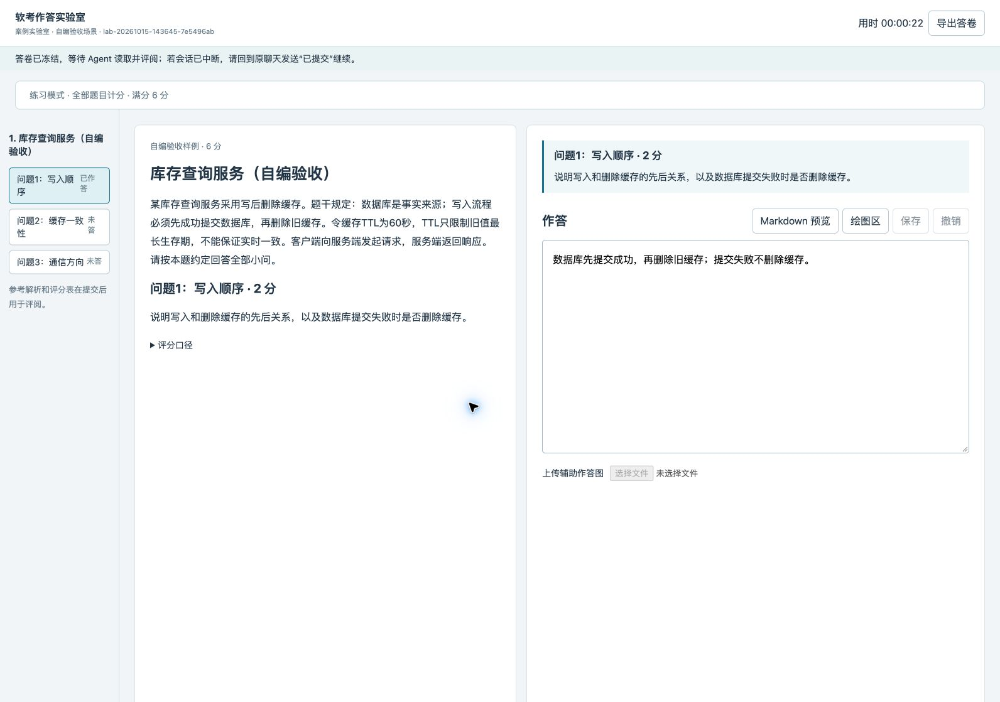

# v0.8.4 — Lab 正文入口与交卷监听

发布日期：2026-10-15。

## 修复卡片有了、作答入口缺失

原流程在页面准备后立即要求弹“已提交 / 继续作答”卡，没有明确要求先在正文展示本机 URL。用户索要链接时，Agent 可能继续弹状态卡，网页也要求交卷后再次回聊天确认。

现在，Lab 准备完成后先发正文，说明试卷、状态和可点击的实际 `http://127.0.0.1:端口` 地址。用户索要 URL 时直接重发已核验入口。工具输出、思考、卡片标题不能替代正文；必要卡片同轮也须先有正文，已有页面时附入口。

## 默认打开页面并等待交卷

`serve` 默认请求系统浏览器打开实际回环地址；内建浏览器使用 `--no-open` 后由 Agent 打开同一地址，避免重复弹窗。打开失败仍保留链接。`status` 新增 `url` 字段，仅在服务可达且场次身份匹配时返回地址。

新增 `wait --session ... --timeout 25`，在当前会话有时限地检查交卷状态。草稿超时继续等待，不弹状态卡，不评分；真实冻结答卷通过身份与哈希校验后接续阅卷。服务不可达会返回明确状态，要求恢复同一场次并重发入口。停止练习和归档后结束轮询。

网页交卷成功后显示等待 Agent 读取与评阅，不再要求例行点击聊天卡。离线导出仍须把实际 JSON 文件交给 Agent。会话中断且没有真实调度时，需要回到原聊天发送“已提交”恢复检查；本版不安装常驻调度器。

## 升级

下载 `ruankao-toolkit-v0.8.4.zip`，按 README 使用 `--upgrade-skills` 更新完整 Skill，包括 Python 运行器和预构建页面。无需用户安装 npm。WORKLOG 使用权威源与发现桥接，更新 `.claude/skills/soft-exam-lab/` 即可；无需把桥接文件改成第二份完整 SOP。

旧会话可能缓存旧指令，升级后新开聊天或明确要求重读完整 Skill 与 runtime.md。已有练习从原场次续接，旧服务需使用新版运行器重启后才能提供健康检查；保留草稿、冻结答卷和旧报告。本补丁未修改单题 tutor 的卡片门控及可选 Antigravity Hook。

## 验证

- 128 项 Python Lab、计分、来源、路由和题库测试通过，其中新增 12 项入口与监听测试。
- 38 项 Antigravity Harness 回归、6 项安装升级测试和 13 项前端批注测试通过；前端按锁定依赖重新构建。
- macOS / Edge 实测默认打开实际 127 地址、填写保存、网页交卷、只读提示和等待器返回 `submitted`；新版页面再次交卷通过。样例全部为隔离自编题。
- 9 项包校验回归、Skill 格式、公开包链接与隐私检查通过；解压安装另行验证。

Antigravity 及其它 Harness 的完整模型对话未逐一实测，自动测试不代表其真实聊天卡片验收。Windows、Linux 桌面自动打开及跨会话唤醒未测。
