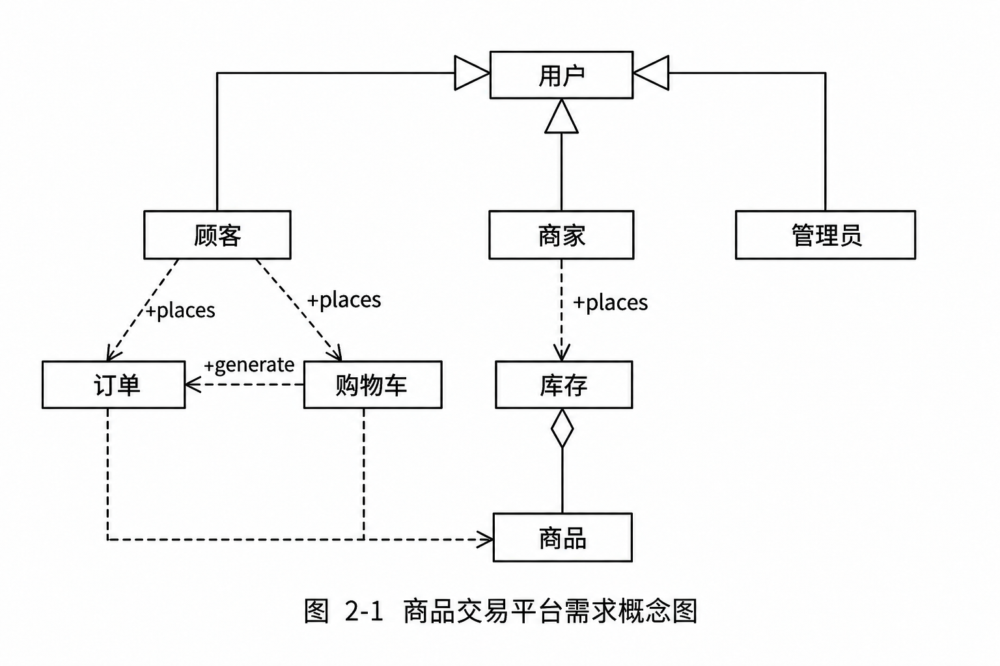

# 商品交易平台分析类图（题库题目 75–77）

## 题干（原题抄写）

题库章节练习“第二章 计算机系统基础知识（新第2版）/第六节 计算机语言”，题目 75–77，共用案例：

> 某畜牧饲料公司建设面向互联网的商品交易平台。平台用户分为商家、顾客、管理员；商家注册后获得店铺，店铺拥有库存，库存中存放商品记录；商家添加商品或追加库存，设置商品上下架和库存数量。顾客可以浏览商品并直接下单，也可以先把商品加入购物车，再用购物车生成订单。

## 小问与分值

| 题号 | 分值 | 要求 |
|---|---|---|
| 题目 75 | 10 分 | 说明分析类与设计类的差异，判断图 2-1 中的类属于分析类还是设计类，并说明二者主要在哪些生命周期阶段产生 |
| 题目 76 | 8 分 | 指出图 2-1 中出现的 UML 类关系，并说明各自含义 |
| 题目 77 | 7 分 | 根据详细描述为图 2-1 添加合适的类，并为图中类添加适当属性 |

## 考场答案（题库参考答案）

- **题目 75**：分析类描述应用领域概念，从需求中识别；设计类描述软件设计层的接口与协作，是分析类的细化和改进。图中为**分析类**。分析类主要在需求分析和架构设计中产生；设计类主要在概要设计阶段产生。
- **题目 76**：顾客、商家、管理员与用户之间为**泛化**，表示继承；商家与库存之间为**依赖**，表示实现需要另一个类协助；库存与商品之间为**聚合**，表示整体—部分且部分可独立存在。
- **题目 77**：可补充**店铺**类。商品属性：标识、名称、描述、单价；库存属性：标识、库存明细（商品标识、库存数量）；订单属性：标识、订单明细（商品标识、订购数量）、订单金额；购物车属性：用户标识、购物车明细（商品标识、数量）。

## 图

- **需求概念图（清理水印并按题图关系重绘）**：

## 采分要点与解析

- 分析类是需求领域模型，抽取业务概念；设计类进一步体现可供软件设计与开发使用的接口和协作。
- 识别类关系时看端点与箭头/菱形：继承采用泛化（空心三角指向父类），类使用关系为依赖，库存与商品为聚合（菱形在整体端）。
- 补充类及属性应可追溯到案例业务名词和数据：店铺由“商家注册后获得店铺”得出。

## 来源解析与详细解析

- 知识点合并版：[知识点/02 案例三](https://github.com/Goodyzhang/ruankao.skill/blob/main/materials/%E7%B3%BB%E7%BB%9F%E6%9E%B6%E6%9E%84%E8%AE%BE%E8%AE%A1%E5%B8%88/%E7%AC%94%E8%AE%B0/%E7%9F%A5%E8%AF%86%E7%82%B9/02-%E8%AE%A1%E7%AE%97%E6%9C%BA%E7%B3%BB%E7%BB%9F%E5%9F%BA%E7%A1%80%E7%9F%A5%E8%AF%86.md)。
- 错题本原条目：错题本/02 题目75–77。

## 知识点链接

- [02-计算机系统基础知识：商品交易平台分析类与需求建模](https://github.com/Goodyzhang/ruankao.skill/blob/main/materials/%E7%B3%BB%E7%BB%9F%E6%9E%B6%E6%9E%84%E8%AE%BE%E8%AE%A1%E5%B8%88/%E7%AC%94%E8%AE%B0/%E7%9F%A5%E8%AF%86%E7%82%B9/02-%E8%AE%A1%E7%AE%97%E6%9C%BA%E7%B3%BB%E7%BB%9F%E5%9F%BA%E7%A1%80%E7%9F%A5%E8%AF%86.md)

## 核验状态与来源

- 核验状态：`pending`（web-bank，年份未核实；答案为题库参考答案）。
- 来源解析：错题本 + 知识点两处一致。
- 实验室可用性：**暂不可导出**——web-bank 身份未核实；题图仅存重绘概念图，原题图未归档。
