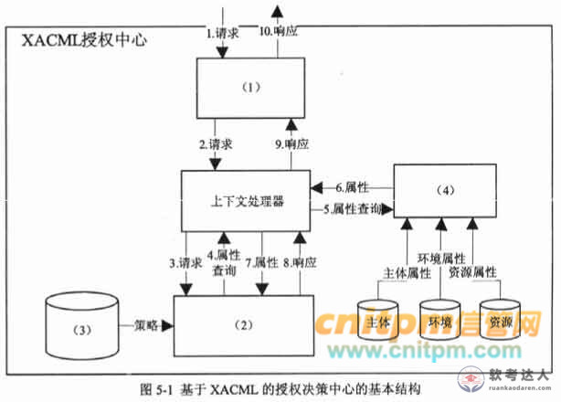
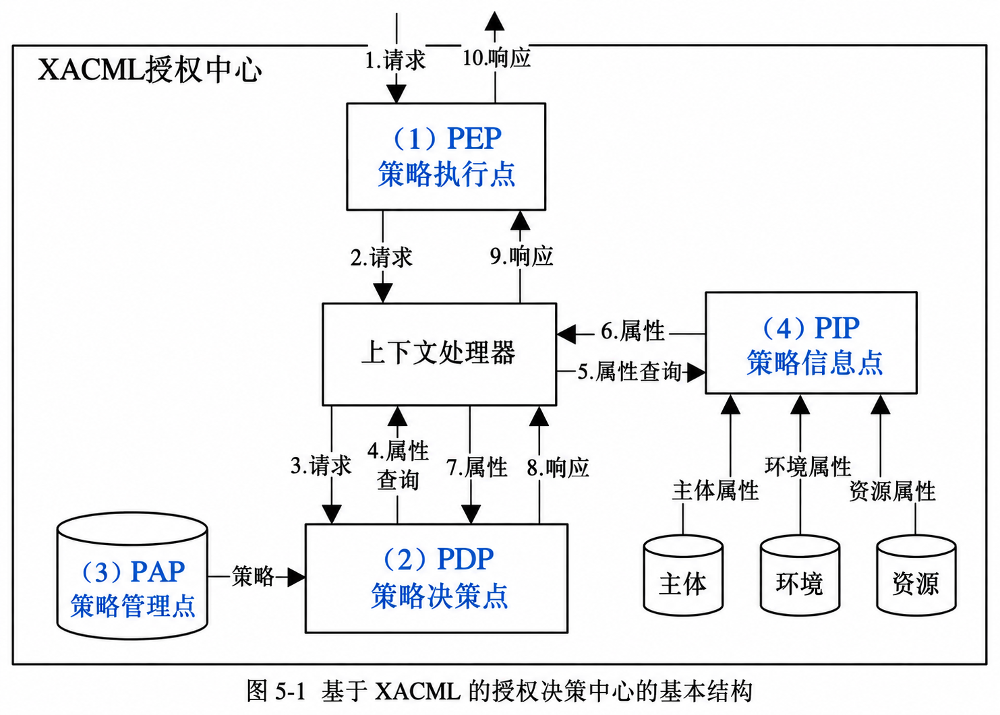

# SOA 安全案例：传输加密、RBAC 与 XACML 授权（试题五，25 分）

## 题干（原题抄写）

> 试题五（共 25 分）
>
> 阅读以下关于信息系统安全性的说明，在答题纸上回答问题 1 至问题 3。
>
> 【说明】某大型跨国企业的 IT 部门一年前基于 SOA（Service-Oriented Architecture）对企业原有的多个信息系统进行了集成，实现了原有各系统之间的互连互通，搭建了支撑企业完整业务流程运作的统一信息系统平台。随着集成后系统的投入运行，IT 部门发现在满足企业正常业务运作要求的同时，系统也暴露出明显的安全性缺陷，并在近期出现了企业敏感业务数据泄漏及系统核心业务功能非授权访问等严重安全事件。针对这一情况，企业决定由 IT 部门成立专门的项目组负责提高现有系统的安全性。
>
> 项目组在仔细调研和分析了系统现有安全性问题的基础上，决定首先为在网络中传输的数据提供机密性（Confidentiality）与完整性（Integrity）保障，同时为系统核心业务功能的访问提供访问控制机制，以保证只有授权用户才能使用特定功能。经过分析和讨论，项目组决定采用加密技术为网络中传输的数据提供机密性与完整性保障。但在确定具体访问控制机制时，张工认为应该采用传统的强制访问控制（Mandatory Access Control）机制，而王工则建议采用基于角色的访问控制（Role-Based Access Control）与可扩展访问控制标记语言（eXtensible Access Control Markup Language，XACML）相结合的机制。项目组经过集体讨论，最终采用了王工的方案。

## 小问与分值

| 问题 | 分值 | 要求 |
|---|---|---|
| 问题 1 | 8 分 | 400 字以内：分别针对对称加密策略与公钥加密策略，说明如何利用加密技术为网络中传输的数据提供机密性与完整性保障 |
| 问题 2 | 9 分 | 300 字以内：从授权的可管理性、细粒度访问控制的支持和对分布式环境的支持三方面指出采用王工方案（RBAC+XACML）的原因 |
| 问题 3 | 8 分 | 将备选答案填入图 5-1 中 XACML 授权决策中心结构的（1）～（4） |

## 图（原图与答案图分开）

- **原题图**：
- **彩色答案图（已填答案，非原题图）**：

## 考场答案与采分要点

**正确结论**：机密性用加密，完整性用认证加密、带密钥认证码或数字签名；RBAC 管理用户—角色—权限关系，XACML 表达并支持统一评估细粒度策略。图中（1）PEP、（2）PDP、（3）PAP、（4）PIP；（3）的圆柱表示策略来源／存储。

**问题 1 作答稿（400 字以内）**：

> 对称策略：双方安全共享密钥，采用 AES-GCM 等认证加密同时产生密文与认证标签；接收方校验标签后才接受明文。也可采用标准的加密加消息认证码方案，分别使用加密密钥和认证密钥，认证覆盖密文及必要上下文。公钥策略：发送方用自己的私钥对消息签名，再用接收方公钥保护消息及签名；大数据可用随机会话密钥加密正文、接收方公钥保护会话密钥。接收方用自己的私钥解密，再用发送方公钥验签，验证通过才使用数据。公钥与身份的绑定、密钥保密和算法使用条件均须可靠。

| 策略 | 机密性怎么保证 | 完整性怎么检验 |
|---|---|---|
| 对称 | 使用双方安全共享的秘密密钥加密数据 | 验证认证加密标签，或验证带密钥的消息认证码 |
| 公钥 | 用接收方公钥保护消息／会话密钥，由接收方私钥解密 | 发送方私钥签名，接收方用发送方公钥验签 |

**问题 3 填图**：入口拦截与执行对应 PEP，结合策略评估对应 PDP，策略来源对应 PAP，汇集属性对应 PIP。不能把四个名字的介绍顺序直接套成图中编号。

## 解析与易错点

- **密钥方向是核心**：想让谁读，就使用接收方的加密公钥保护；想证明谁签署，就用发送方签名私钥生成签名、用其公钥验证。不应混淆加密与签名用途。
- **纠正“加密自动保证完整性”**：普通加密不应被笼统当作完整性机制，必须说明所用认证模式或额外认证措施。GCM 是认证加密模式，同一密钥下 nonce／IV 不重用；不要只写“AES 加密”就宣称得到认证保证。
- 来源所列第三问“1 PAP、2 PIP、3 PDP、4 PEP”与图中请求、策略和属性箭头不匹配，已按图修正。

## 知识点链接

- [SOA 安全与 XACML 职责](https://github.com/Goodyzhang/ruankao.skill/blob/main/materials/%E7%B3%BB%E7%BB%9F%E6%9E%B6%E6%9E%84%E8%AE%BE%E8%AE%A1%E5%B8%88/%E7%AC%94%E8%AE%B0/%E7%9F%A5%E8%AF%86%E7%82%B9/04-%E4%BF%A1%E6%81%AF%E5%AE%89%E5%85%A8%E6%8A%80%E6%9C%AF%E5%9F%BA%E7%A1%80%E7%9F%A5%E8%AF%86.md)

## 核验状态与来源

- 核验状态：`pending`（年份、原试卷题号未提供，不补造字母选项；第三问完整备选列表缺失）。
- 按系统架构设计师高级第 4 章案例归档；填图使用用户参考答案给出的四个组件名称。
- 实验室可用性：**暂不可导出**——来源身份未核实（无年份/题号）。
