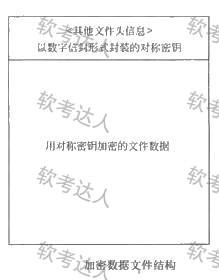

# 信息安全支撑平台案例

## 原题（网站题号 213：信息安全支撑平台）

**试题**　阅读以下关于系统设计的叙述，回答问题。
【说明】
某软件公司拟开发一套信息安全支撑平台，为客户的局域网业务环境提供信息安全保护。主要需求：1.为局域网业务环境提供用户身份鉴别与资源访问授权功能；2.为局域网环境中交换的网络数据提供加密保护；3.为服务器和终端机存储的敏感持久数据提供加密保护；4.保护的主要实体对象包括局域网内交换的网络数据包、文件服务器中的敏感数据文件、数据库服务器中的敏感关系数据和终端机用户存储的敏感数据文件；5.服务器中存储的敏感数据按安全管理员配置的权限访问；6.业务系统生成的单个敏感数据文件可能会达到数百兆的规模；7.终端机用户存储的敏感数据为用户私有；8.局域网业务环境的总用户数在100人以内。

| 网站题号 | 小问 | 分值 |
|---|---|---|
| 213 | 问题1（分值未标） | 1 |
## 图示（原图，未覆盖）

## 来源答案与解析（网站原文）
- 题213问题1：公钥认证三理由（防认证攻击更安全/私钥可加密用户私有数据更简便/100人局域网规模可满足效率要求）。
问题2：应采用流加密（文件数百兆规模流加密效率更高）；加密=生成对称密钥→公钥加密对称密钥存文件头→对称密钥加密文件数据；解密=私钥解密对称密钥→对称密钥解密数据原文。
问题3：加解密API（SQL中调用，灵活性强构建管理复杂）vs透明加密（安全管理员选加密方式与密钥强度，应用只需口令开关密钥表，DBMS自动完成，管理简单负担轻灵活性差）；应选透明加密（减少安全管理与应用程序负担+支持不同强度密钥）。

## 核验答案（考场作答）
### 【问题1】公钥认证机制选型原因

**考场答案**：①口令认证实现简单但受口令复杂度及管理限制易受认证攻击；公钥体系密钥机制复杂且认证过程中私钥不在网络上传输，可有效防止认证攻击，更为安全。②需求要求依据用户身份对业务数据（含用户私有终端机数据文件）进行保护；口令方式下口令为用户与认证服务器共享，无用户独有秘密信息；公钥方式可基于用户私钥对私有数据加密保护，实现更简便。③公钥认证计算复杂度高于口令方式，但总用户数100人以内规模不大、局域网环境，可满足平台效率要求。

**采分要点**：三角度（安全性/私有数据保护/效率权衡）各1/3分值。

**详细解析**：与§4.5.4 PKI联动：私钥不上网传=防截获；用户独有私钥=可加密私有文件；小规模局域网=复杂度可承受。

**常见失分表达**：漏“私钥不传输”机制词；漏效率权衡。

**知识点链接**：[PKI公钥认证](https://github.com/Goodyzhang/ruankao.skill/blob/main/materials/%E7%B3%BB%E7%BB%9F%E6%9E%B6%E6%9E%84%E8%AE%BE%E8%AE%A1%E5%B8%88/%E7%AC%94%E8%AE%B0/%E7%9F%A5%E8%AF%86%E7%82%B9/04-%E4%BF%A1%E6%81%AF%E5%AE%89%E5%85%A8%E6%8A%80%E6%9C%AF%E5%9F%BA%E7%A1%80%E7%9F%A5%E8%AF%86.md)

### 【问题2】数字信封流加密与加解密过程

**考场答案**：应采用**流加密方式**——单个敏感数据文件可能达数百兆规模，文件数据量较大，流加密可获得更高的加解密效率。加密过程：先生成一个对称密钥，使用用户公钥加密该对称密钥后存储在文件头，再用对称密钥加密文件数据存储。解密过程：用户首先使用自己的私钥解密被加密的对称密钥，再用该对称密钥解密出数据原文。

**采分要点**：选型+理由约1/3分值＋加密过程约1/3＋解密过程约1/3。

**详细解析**：数字信封=非对称保护对称密钥+对称加密保护大数据。流加密适合大文件（逐字节）、块加密适合小数据块——与题52 AES-256分块填充（块加密）对照。

**常见失分表达**：选块加密（数百兆文件流加密效率是题眼）；解密漏“先解密对称密钥”。

**知识点链接**：[数字信封与流加密](https://github.com/Goodyzhang/ruankao.skill/blob/main/materials/%E7%B3%BB%E7%BB%9F%E6%9E%B6%E6%9E%84%E8%AE%BE%E8%AE%A1%E5%B8%88/%E7%AC%94%E8%AE%B0/%E7%9F%A5%E8%AF%86%E7%82%B9/04-%E4%BF%A1%E6%81%AF%E5%AE%89%E5%85%A8%E6%8A%80%E6%9C%AF%E5%9F%BA%E7%A1%80%E7%9F%A5%E8%AF%86.md)

### 【问题3】加解密API vs 透明加密

**考场答案**（300字内）：①加解密API——数据库管理系统提供可在SQL语句中调用的加解密API，应用利用这些API构建自己的基础架构对数据加密保护；灵活性强，但构建和管理复杂。②透明加密——安全管理员为数据库敏感字段选择加密方式及密钥强度，应用访问受保护数据时只需使用口令打开或关闭密钥表，数据的加密和解密由数据库管理系统自动完成；管理简单，应用程序负担轻，但灵活性较差。选型：用户要求对不同程度敏感字段采用不同强度密钥防护，且尽可能减少安全管理与应用程序负担——透明加密支持对特定敏感字段透明加密并可按需配置密钥强度，满足要求，因此应选择**透明加密方式**。

**采分要点**：两方式解释各约1/3分值＋选型理由约1/3。

**详细解析**：API方式=应用层自建（灵活担子重），透明加密=DBMS内核层（省事欠灵活）。题眼“减少安全管理与应用程序负担”直接指向透明加密。

**常见失分表达**：两方式特点写反；选型未回扣“减少负担”题眼。

**知识点链接**：[数据库透明加密](https://github.com/Goodyzhang/ruankao.skill/blob/main/materials/%E7%B3%BB%E7%BB%9F%E6%9E%B6%E6%9E%84%E8%AE%BE%E8%AE%A1%E5%B8%88/%E7%AC%94%E8%AE%B0/%E7%9F%A5%E8%AF%86%E7%82%B9/06-%E6%95%B0%E6%8D%AE%E5%BA%93%E8%AE%BE%E8%AE%A1%E5%9F%BA%E7%A1%80%E7%9F%A5%E8%AF%86.md)

## 来源与身份（待核验记录说明）

- 题源：软考达人·第二十二章 案例分析/第一节 案例分析，网站题号213（网站分类“第二十二章 案例分析”保留为来源位置，章节路由按实际考点匹配教材章（第2版20章体系）。）
- 年份/卷别未核实，按 web-bank 处理。三问分值未标。
