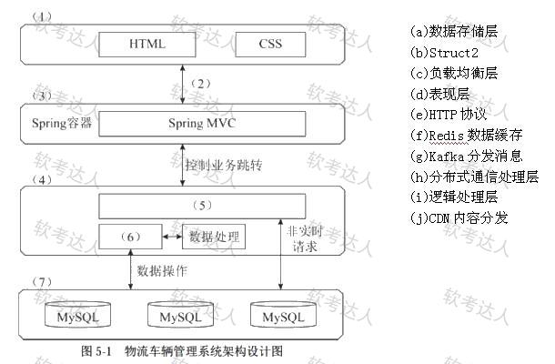
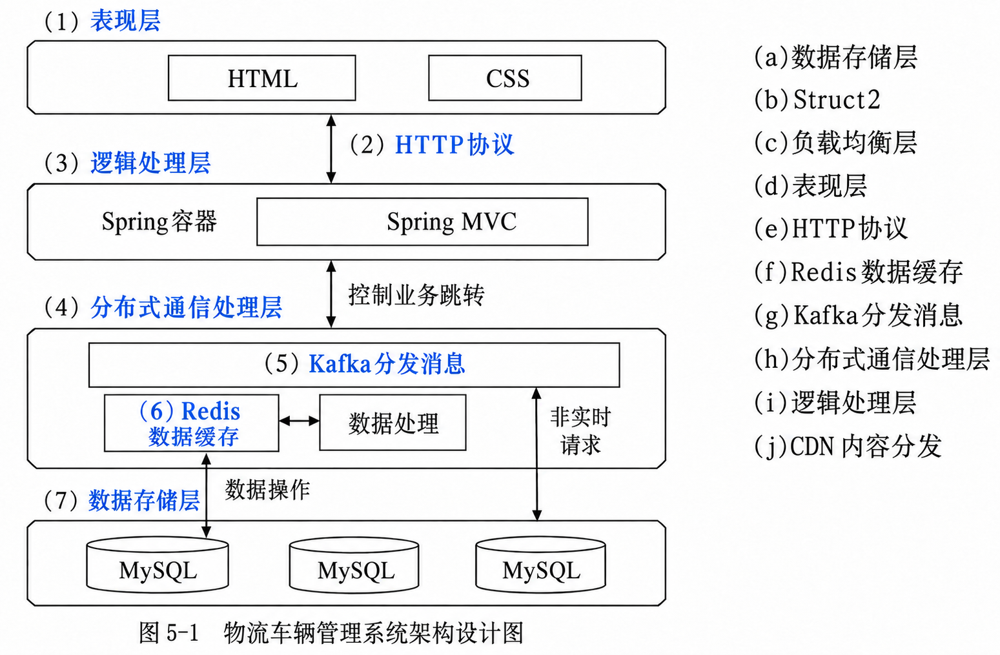

# 物流车辆管理系统架构与 SQL 注入防御（2019 年下半年 试题五，25 分）

## 题干（原题抄写）

> 试题五（共 25 分）
>
> 请详细阅读有关 Web 架构设计方面的叙述，在答题纸上回答问题 1 至问题 3。
>
> 【说明】某公司拟开发一个物流车辆管理系统，该系统可支持各车辆实时位置监控、车辆历史轨迹管理、违规违章记录管理、车辆固定资产管理、随车备品及配件更换记录管理、车辆寿命管理等功能需求。其非功能性需求如下：
>
> （1）系统应支持大于 50 个终端设备的并发请求；
> （2）系统应能够实时识别车牌，识别时间应小于 1 s；
> （3）系统应 7×24 小时工作；
> （4）具有友好的用户界面；
> （5）可抵御常见 SQL 注入攻击；
> （6）独立事务操作响应时间应小于 3 s；
> （7）系统在故障情况下，应在 1 小时内恢复；
> （8）新用户学习使用系统的时间少于 1 小时。
>
> 面对系统需求，公司召开项目组讨论会议，制订系统设计方案，最终决定基于分布式架构设计实现该物流车辆管理系统，应用 Kafka、Redis 数据缓存等技术实现对物流车辆自身数据、业务数据进行快速、高效的处理。

## 小问与分值

| 问题 | 分值 | 要求 |
|---|---|---|
| 问题 1 | 4 分 | 将非功能性需求（1）～（8）归类到性能、安全性、可用性、易用性四类 |
| 问题 2 | 14 分 | 从（a）～（j）中选择，补充完善图 5-1 中（1）～（7）处空白 |
| 问题 3 | 7 分 | 200 字以内说明什么是 SQL 注入攻击，并列举两种抵御方式 |

问题 2 备选项：(a) 数据存储层；(b) Struct2；(c) 负载均衡层；(d) 表现层；(e) HTTP 协议；(f) Redis 数据缓存；(g) Kafka 分发消息；(h) 分布式通信处理层；(i) 逻辑处理层；(j) CDN 内容分发。（(b) Struct2 按题面保留，疑为 Struts2 笔误，不影响答案。）

## 图（原图与答案图分开）

- **原题图**：
- **去水印蓝字答案图（已填答案，非原题图）**：

## 考场答案与采分要点

**问题 1**：性能 1、2、6；安全性 5；可用性 3、7；易用性 4、8。

| 类别 | 编号 | 题干判别词 | 判断依据 |
|---|---|---|---|
| 性能 | 1、2、6 | 并发终端数量；识别小于 1 s；响应小于 3 s | 承载能力、处理速度与响应时延 |
| 安全性 | 5 | 抵御 SQL 注入 | 防止非授权操作、保护数据与服务 |
| 可用性 | 3、7 | 7×24 小时工作；故障后 1 小时内恢复 | 服务持续可用与恢复能力 |
| 易用性 | 4、8 | 友好界面；新用户学习少于 1 小时 | 易理解、易操作与易学习 |

**问题 2**：(1) d 表现层；(2) e HTTP 协议；(3) i 逻辑处理层；(4) h 分布式通信处理层；(5) g Kafka 分发消息；(6) f Redis 数据缓存；(7) a 数据存储层。

- 先找最明显的两端（HTML/CSS→表现层，MySQL→数据存储层）；标在两层连线上的是 HTTP。
- 区别“层”和“层内组件”：(3)(4) 是层名，(5)(6) 是具体组件。
- 未选项辨析：(b) Struct2 图中已有 Spring MVC；(c) 负载均衡层题图缺空位；(j) CDN 不是 Kafka 的替代品。

**问题 3（200 字以内作答稿）**：

> SQL 注入是应用将不可信输入直接拼入 SQL，导致输入被当作指令解释，进而执行非授权数据库操作。防御方式：①使用预编译、参数化查询，如 PreparedStatement，以占位符绑定参数值，避免拼接输入；②在服务端按类型、长度、范围和允许集合校验输入，对无法绑定的表名、列名等使用固定白名单映射。

## 解析与易错点

- 归类题先抓目标再看数字：第 7 项恢复时间属可用性，第 8 项学习时间属易用性；并发（第 1 项）属性能而非可用性。
- 占位符用于数据值，不能普遍代替表名、列名或排序方向；黑名单删关键词既可能漏检也会误伤，不应作为主要防线。
- Kafka 与 Redis 对应消息处理和访问性能，不能因为引入它们就认为已满足 SQL 防护、7×24 可用或易用性要求。
- 归档勘误：解析中“SOL”统一纠正为“SQL”。

## 知识点链接

- [本题三问解题方法](https://github.com/Goodyzhang/ruankao.skill/blob/main/materials/%E7%B3%BB%E7%BB%9F%E6%9E%B6%E6%9E%84%E8%AE%BE%E8%AE%A1%E5%B8%88/%E7%AC%94%E8%AE%B0/%E7%9F%A5%E8%AF%86%E7%82%B9/04-%E4%BF%A1%E6%81%AF%E5%AE%89%E5%85%A8%E6%8A%80%E6%9C%AF%E5%9F%BA%E7%A1%80%E7%9F%A5%E8%AF%86.md)

## 核验状态与来源

- 核验状态：`identity-stated-by-source`——年份与试题身份来自来源页面标注（2019 年下半年试题五）；可与 [真题库/下午题/2019-下半年-下午](../../%E5%8E%86%E5%B9%B4%E7%9C%9F%E9%A2%98/2019-%E4%B8%8B%E5%8D%8A%E5%B9%B4-%E4%B8%8B%E5%8D%88.md) 整卷交叉核对。
- 来源附写后核验记录：七个填空与参考答案一致；原图、去水印彩图已保存；技术资料（OWASP、Kafka、Redis）核验日期 2026-09-20。
- 实验室可用性：**候选**——具备年份+试题五身份与完整三问/原图/答案，需按 lab 契约确认本机接口后建包；公开题包只含题干与未作答原图。
