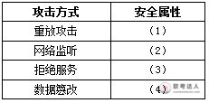
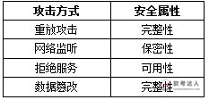
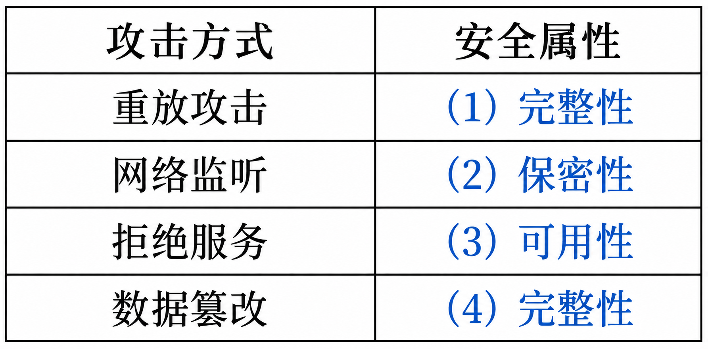

# 证券公司网络安全案例：被动攻击、CIA 与 SYN Flood／DDoS

## 题干（原题抄写）

> 某证券公司计划更新其网络架构，以提高安全服务能力。该公司技术总监王工通过对公司内部调研，以及对现有系统分析发现，公司网络经常遭受同一种网络攻击。被攻击时的现象为：
>
> （1）被攻击主机上有大量等待的 TCP 连接；
>
> （2）网络中充斥着大量的无用的数据包，源地址为假；
>
> （3）高流量无用数据，造成网络拥塞，使受害主机无法正常和外界通讯；
>
> （4）在遭受严重攻击时，主机系统出现崩溃死机的状况。
>
> 【问题 1】（6 分）以下哪些行为属于信息安全中的被动攻击方式：
> A、重放攻击　B、主观抵赖　C、网络监听　D、假冒身份
> E、信息截取　F、散播病毒　G、拒绝服务　H、数据篡改
> I、流量分析
>
> 【问题 2】（8 分）信息系统安全属性主要包括：保密性、完整性、可用性。请分析以下攻击方式，是破坏哪一种安全属性。
>
> | 攻击方式 | 安全属性 |
> |---|---|
> | 重放攻击 | （1） |
> | 网络监听 | （2） |
> | 拒绝服务 | （3） |
> | 数据篡改 | （4） |
>
> 【问题 3】（11 分）请根据王工所描述的现象，分析这是一种什么样的网络攻击。可以采取何种方式来抵抗这种攻击。

## 图（原图与答案图分开）

- **原题图（安全属性表）**：
- **参考答案原图（用户提供）**：
- **彩色答案图（已填答案，非原题图）**：

## 考场答案与采分要点

- **问题 1（6 分）**：选 **C、E、I**（网络监听、信息截取、流量分析）。
- **问题 2（8 分）**：依次为**完整性、保密性、可用性、完整性**。
- **问题 3（11 分）**：题库参考答案为 DDoS，所述现象（大量等待 TCP 连接、伪造源地址、高流量拥塞、主机崩溃）典型指向 **SYN Flood 型拒绝服务**；缓解手段：连接防护（如 SYN Cookie、缩短半连接超时）、合理参数配置和流量治理（清洗、限速、上游过滤）。

## 解析与易错点

- 监听、截取、流量分析以获取信息为目的，属被动攻击；重放会主动注入旧消息，不属被动攻击。
- 大量等待连接与伪造地址提示未完成握手造成的状态占用，无法服务反映可用性受损。
- “伪造源地址即证明分布式”“加密即可避免全部被动攻击”“按 IP 限制即可解决洪泛”等推论需要限定。

## 知识点链接

- [被动攻击、安全属性与拒绝服务判别](https://github.com/Goodyzhang/ruankao.skill/blob/main/materials/%E7%B3%BB%E7%BB%9F%E6%9E%B6%E6%9E%84%E8%AE%BE%E8%AE%A1%E5%B8%88/%E7%AC%94%E8%AE%B0/%E7%9F%A5%E8%AF%86%E7%82%B9/04-%E4%BF%A1%E6%81%AF%E5%AE%89%E5%85%A8%E6%8A%80%E6%9C%AF%E5%9F%BA%E7%A1%80%E7%9F%A5%E8%AF%86.md)

## 核验状态与来源

- 核验状态：`pending`（年份、试卷题号未提供；三问、题目表、参考答案表与文字解析来自用户材料）。
- 实验室可用性：**暂不可导出**——来源身份未核实。
