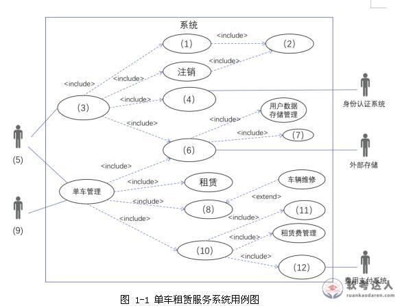

# 共享单车租赁-用例图与设计模式案例

## 原题（网站题号 149：共享单车租赁系统，单条完整案例，25分）

**试题（25分）**　阅读以下关于系统建模的叙述，回答问题。

【说明】某软件公司为共享单车租赁公司开发单车租赁服务系统。需求：1)非注册用户注册（身份/手机号/在线支付押金）；2)支付宝会员可第三方关联注册，芝麻信用500分以上免押金；3)采购单车注册标识后方可投入使用；4)注册用户扫码或输编号解锁；5)关锁上报状态、更新车辆状态并结算费用；6)积分奖励方案（每200积分升会员等级，不同等级结算折扣不同）；7)积分商城兑换合作伙伴产品服务；8)各合作伙伴类调用方法不同，更换合作伙伴时应尽可能少修改或新建类。项目组采用面向对象方法与设计模式（Adapter/Builder/Command/Facade/Mediator/Prototype/Proxy/State/Strategy等）。

| 小问 | 分值 |
|---|---|
| 问题1（12分）：分析A~R概念类及方法，在图1-1用例图(1)~(12)处补充缺失信息 | 12 |
| 问题2（5分）：200字以内说明创建型、结构型、行为型三类设计模式的作用 | 5 |
| 问题3（8分）：针对设计要求(6)~(8)分别选择设计模式并说明解决方案 | 8 |

## 图示（原图，未覆盖）

## 来源答案与解析（网站原文）

- 问题1：(1)D.注册 (2)F.用户查询 (3)C.用户管理 (4)R.身份认证 (5)A.用户 (6)N.数据存储管理 (7)P.单车数据存储管理 (8)I.归还 (9)B.共享单车 (10)K.费用管理 (11)L.保证金管理 (12)Q.费用结算。
- 问题2：三类模式作用（创建/结构/行为）。
- 问题3：(1)策略模式（会员等级折扣计算）；(2)适配器模式（合作伙伴接口转换）。

## 核验答案（考场作答）

### 【问题1】（12分）

**考场答案**：(1)D.注册；(2)F.用户查询；(3)C.用户管理；(4)R.身份认证；(5)A.用户；(6)N.数据存储管理；(7)P.单车数据存储管理；(8)I.归还；(9)B.共享单车；(10)K.费用管理；(11)L.保证金管理；(12)Q.费用结算。

**采分要点**：十二空各1分（推定）。

**详细解析**：用例图填空读图法：①看include方向定父子用例——(1)注册被(3)用户管理include、自身include(2)用户查询与(4)身份认证；②看参与者位置——左侧(5)用户、下方(9)共享单车（车辆上报状态是“共享单车”特殊参与者）；③看外部系统连线——(4)连身份认证系统、(6)连外部存储；④费用侧(10)费用管理include(11)保证金管理与(12)费用结算。需求条目与用例一一对应。

**常见失分表达**：(5)与(9)参与者颠倒；(4)误填“账号管理”。

**知识点链接**：[UML 用例图](https://github.com/Goodyzhang/ruankao.skill/blob/main/materials/%E7%B3%BB%E7%BB%9F%E6%9E%B6%E6%9E%84%E8%AE%BE%E8%AE%A1%E5%B8%88/%E7%AC%94%E8%AE%B0/%E7%9F%A5%E8%AF%86%E7%82%B9/05-%E8%BD%AF%E4%BB%B6%E5%B7%A5%E7%A8%8B%E5%9F%BA%E7%A1%80%E7%9F%A5%E8%AF%86.md)

### 【问题2】（5分）

**考场答案**（200字内）：创建型模式主要用于创建对象，为设计类实例化新对象提供指南；结构型模式主要用于处理类或对象的组合，对类如何设计以形成更大的结构提供指南；行为型模式主要用于描述类或对象的交互以及职责的分配，对类之间交互以及分配责任的方式提供指南。

**采分要点**：三类各1.7分（推定）。

**详细解析**：GoF三分类口诀：造对象（创建型）、组结构（结构型）、管交互（行为型）。

**常见失分表达**：三类作用互换。

**知识点链接**：[设计模式分类](https://github.com/Goodyzhang/ruankao.skill/blob/main/materials/%E7%B3%BB%E7%BB%9F%E6%9E%B6%E6%9E%84%E8%AE%BE%E8%AE%A1%E5%B8%88/%E7%AC%94%E8%AE%B0/%E7%9F%A5%E8%AF%86%E7%82%B9/05-%E8%BD%AF%E4%BB%B6%E5%B7%A5%E7%A8%8B%E5%9F%BA%E7%A1%80%E7%9F%A5%E8%AF%86.md)

### 【问题3】（8分）

**考场答案**：(1)针对需求(6)（不同会员等级不同折扣）：选择**策略模式**——在具有公共接口的独立类中定义每个计算；创建各促销类并从同一超类继承，每个类都有相同名称的标准接口方法，用于根据会员等级计算折扣金额总数。(2)针对需求(8)（更换合作伙伴尽可能少修改或新建类）：选择**适配器模式**——增加一个适配器类，转换类的接口到客户端期望的另一个接口；实现适配器类为系统其他部分提供不变的调用方法；为集成不同供应商的优惠计算类编写适配器子类（含调用所需代码），将系统调用映射到某供应商的优惠计算类；更换供应商时只需编写新的适配器子类，其他保持不变。

**采分要点**：两模式选择各1分＋方案说明各3分（推定）。

**详细解析**：模式选型判别：需求6“不同等级不同算法”→策略（算法族替换）；需求8“第三方接口不一致、要多方适配”→适配器（接口转换）。

**常见失分表达**：需求8误选外观或中介；适配器方案漏“子类映射”机制。

**知识点链接**：[设计模式选型](https://github.com/Goodyzhang/ruankao.skill/blob/main/materials/%E7%B3%BB%E7%BB%9F%E6%9E%B6%E6%9E%84%E8%AE%BE%E8%AE%A1%E5%B8%88/%E7%AC%94%E8%AE%B0/%E7%9F%A5%E8%AF%86%E7%82%B9/05-%E8%BD%AF%E4%BB%B6%E5%B7%A5%E7%A8%8B%E5%9F%BA%E7%A1%80%E7%9F%A5%E8%AF%86.md)

## 来源与身份

- 题源：软考达人·第二十二章 案例分析/第一节 案例分析，网站题号149（网站分类保留为来源位置，章节路由按实际考点匹配教材章）
- 年份/卷别未核实，按 web-bank 处理；分值加和 12+5+8=25。
- 图示：用例图原图已下载并实际看图核对十二空位置。
