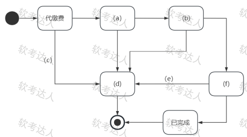

# 医院检验管理系统-参与者桥接模式与状态图案例

## 原题（网站题号 75～77 合并：试题二，25分）

**试题二（25分）**　阅读以下关于软件系统建模的叙述，在答题纸上回答问题1至问题3。

【说明】某医院计划升级其检验管理系统，核心需求：(1)系统用户需登录后使用功能；(2)医生可开具电子检验单并打印；(3)患者可通过APP缴费和预约采样，以及查看检验单结果；(4)护士负责采样；(5)医学检验师负责检测；(6)系统管理员可以作废检验单并退费；(7)一周未缴费的检验单自动作废；(8)检验单需跟踪状态（待缴费、已缴费、采样中、检测中、已完成、已作废）。项目组决定采用面向对象开发技术建模。

| 网站题号 | 小问 | 分值 |
|---|---|---|
| 75 | 问题1（8分）：说明检验管理系统中有哪些参与者 | 8 |
| 76 | 问题2（5分）：为屏蔽不同厂商检查设备控制逻辑差异且检验业务可能变化，选择合适的设计模式并说明理由 | 5 |
| 77 | 问题3（12分）：填写图2状态图（a）～（f）空白，完成检验单处理状态图 | 12 |

## 图示（原图，未覆盖）

## 来源答案与解析（网站原文）

- 题75：参与者：系统用户、医生、患者、护士、医学检验师、系统管理员、时间、打印机。（解析：无）
- 题76：桥接模式＋两维度解耦理由。（解析：无）
- 题77：（a）已缴费；（b）采样中；（c）一周之内未缴费；（d）已作废；（e）作废检验单并退费；（f）检测中。（解析：无）

## 核验答案（考场作答）

### 【问题1】（8分）

**考场答案**：参与者：系统用户、医生、患者、护士、医学检验师、系统管理员、时间、打印机。

**采分要点**：业务角色五种约4分＋系统用户1分＋时间/打印机等辅助参与者约3分（推定）。

**详细解析**：参与者三来源：人（医生/患者/护士/检验师/管理员）、外部系统或设备（打印机——打印检验单的外部设备）、时间（需求(7)“一周未缴费自动作废”的定时触发者，与题7图书管理案例“系统时间”同款考法）。“系统用户”是登录功能的泛化角色，网站口径单列，照抄即可。

**常见失分表达**：漏“时间”或“打印机”；把“系统用户”遗漏（它是需求(1)的直接主语）。

**知识点链接**：[UML 用例图参与者](https://github.com/Goodyzhang/ruankao.skill/blob/main/materials/%E7%B3%BB%E7%BB%9F%E6%9E%B6%E6%9E%84%E8%AE%BE%E8%AE%A1%E5%B8%88/%E7%AC%94%E8%AE%B0/%E7%9F%A5%E8%AF%86%E7%82%B9/05-%E8%BD%AF%E4%BB%B6%E5%B7%A5%E7%A8%8B%E5%9F%BA%E7%A1%80%E7%9F%A5%E8%AF%86.md)

### 【问题2】（5分）

**考场答案**：适合使用**桥接模式（Bridge Pattern）**。理由：桥接模式的核心思想是将抽象（Abstraction）与其实现（Implementation）解耦，使它们可以独立地变化。本场景存在两个独立变化的维度：抽象维度=检验业务（如详细检测、快速检测），实现维度=设备控制（如读取数据、转换）；桥接模式通过**组合**方式优雅地分离这两个维度，使厂商设备控制逻辑的差异被屏蔽，且检验业务变化不影响设备控制实现。

**采分要点**：结论2分＋两维度识别与组合解耦3分（推定）。

**详细解析**：桥接模式的题型签名是“两个独立变化维度”：一维是业务抽象（怎么检），一维是平台实现（怎么驱动设备）。若题目只说“屏蔽厂商差异”单维度，适配器也可候选；但本题明确“检验业务也可能变化”→双维度→桥接。记忆口诀：桥接连两维，组合不继承。

**常见失分表达**：误选抽象工厂或策略且未识别双维度；理由漏“独立变化”。

**知识点链接**：[面向对象方法（设计模式）](https://github.com/Goodyzhang/ruankao.skill/blob/main/materials/%E7%B3%BB%E7%BB%9F%E6%9E%B6%E6%9E%84%E8%AE%BE%E8%AE%A1%E5%B8%88/%E7%AC%94%E8%AE%B0/%E7%9F%A5%E8%AF%86%E7%82%B9/05-%E8%BD%AF%E4%BB%B6%E5%B7%A5%E7%A8%8B%E5%9F%BA%E7%A1%80%E7%9F%A5%E8%AF%86.md)

### 【问题3】（12分）

**考场答案**：（a）已缴费；（b）采样中；（c）一周之内未缴费（转移条件）；（d）已作废（状态）；（e）作废检验单并退费（转移事件）；（f）检测中。

**采分要点**：六空各2分（推定）；(c)(e)为转移标注、(a)(b)(d)(f)为状态，填错类型不得分。

**详细解析**：状态图填空先分清“框=状态、箭头标注=事件/条件”。主流程：代缴费(待缴费)→已缴费→采样中→检测中→已完成→终态；分支：代缴费--一周之内未缴费-->已作废；管理员作废事件“作废检验单并退费”从检测中拉到已作废。需求(8)的状态枚举是答案池，(c)的唯一来源是需求(7)。

**常见失分表达**：把(c)填成状态名（它是转移守卫条件）；(e)漏“退费”半句；顺序填错（采样中在已缴费后）。

**知识点链接**：[UML 行为建模](https://github.com/Goodyzhang/ruankao.skill/blob/main/materials/%E7%B3%BB%E7%BB%9F%E6%9E%B6%E6%9E%84%E8%AE%BE%E8%AE%A1%E5%B8%88/%E7%AC%94%E8%AE%B0/%E7%9F%A5%E8%AF%86%E7%82%B9/05-%E8%BD%AF%E4%BB%B6%E5%B7%A5%E7%A8%8B%E5%9F%BA%E7%A1%80%E7%9F%A5%E8%AF%86.md)、[面向对象方法（状态图）](https://github.com/Goodyzhang/ruankao.skill/blob/main/materials/%E7%B3%BB%E7%BB%9F%E6%9E%B6%E6%9E%84%E8%AE%BE%E8%AE%A1%E5%B8%88/%E7%AC%94%E8%AE%B0/%E7%9F%A5%E8%AF%86%E7%82%B9/05-%E8%BD%AF%E4%BB%B6%E5%B7%A5%E7%A8%8B%E5%9F%BA%E7%A1%80%E7%9F%A5%E8%AF%86.md)

## 来源与身份

- 题源：软考达人·第二十二章 案例分析/第一节 案例分析，网站题号75～77（网站分类“第二十二章 案例分析”保留为来源位置，章节路由按实际考点匹配教材章（第2版20章体系）。）
- 年份/卷别未核实，按 web-bank 处理；分值加和 8+5+12=25 与“试题二（25分）”一致。
- 图示：状态图原图已下载并实际看图核对：状态框(a)(b)(d)(f)与转移标注(c)(e)位置与答案对应一致。
