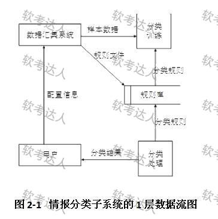
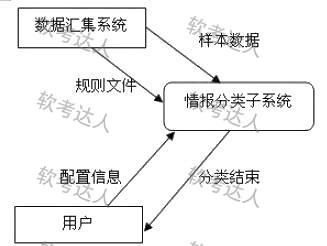
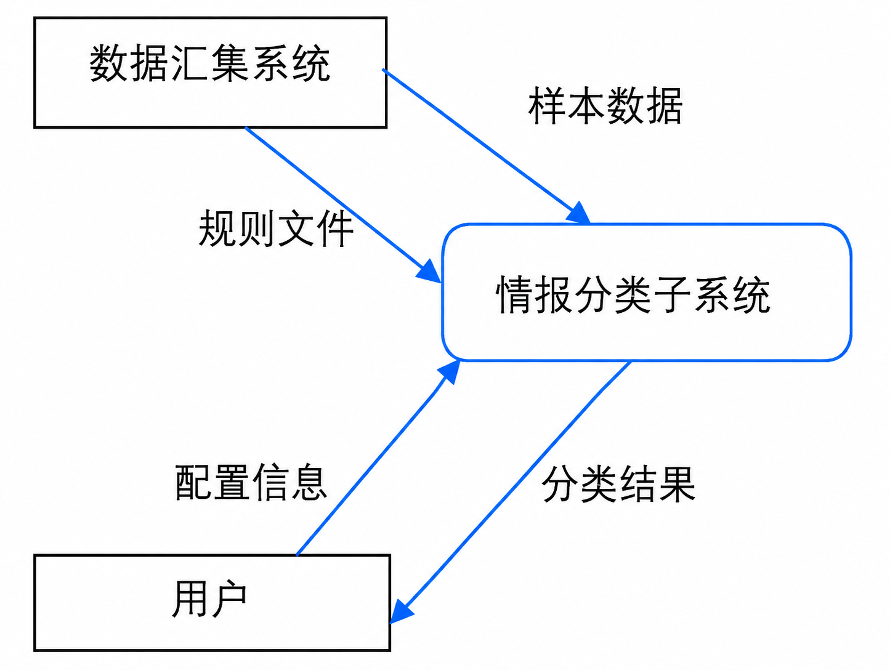

# 商业情报处理系统 DFD：流程图 vs 数据流图、四错定位与三原则

## 题干（原题抄写）

> 试题二（25分）
> 某公司拟开发一个商业情报处理系统，使公司能够及时针对市场环境的变化及时调整发展战略，以获取最大的商业利益。项目组经过讨论，决定采用结构化分析和设计方法。在系统分析阶段，为了更好地对情报数据处理流程及其与外部角色的关联进行建模，项目组成员分别给出了自己的设计思路：
> （1）小张提出先构建系统流程图(System Flowcharts)，以便更精确地反映系统的业务处理过程及数据的输入和输出。
> （2）小李提出先构建系统数据流图(Data Flow Diagrams)，来展现系统的处理过程和定义业务功能边界，并给出了情报分类子系统的0层和1层数据流图。
> 项目组经讨论确定以数据流图作为本阶段的建模手段。工程师老王详细说明了流程图和数据流图之间的区别与联系，并指出了数据流图中的多处错误。
>
> 【问题 1】（11分）请简要说明流程图和数据流图在展现系统内容、执行模式、计时标准和适用生命周期阶段四个维度的主要区别；并说明为什么在系统分析阶段项目组倾向于采用数据流图。
>
> 【问题 2】（8分）给出题图数据流图中的 4 处错误，并指明错误类型（逻辑错误 / 语法错误）。
>
> 【问题 3】（6分）请简要说明设计高质量数据流图应遵循的 3 个主要原则。
>
> （题库标记：软考高级系统架构设计师经典案例分析题 25分大题）

## 图（原图与答案图分开）

- **1 层 DFD 原图（页面原图）**：
- **网站答案图（已填答案，非原题图）**：
- **核验后彩色答案图（imagegen 编辑副本，蓝色标归并关系；已核对三个节点四条边）**：

## 考场答案与采分要点（25 分版）

**【问题 1】（11分）四个主要区别**：
1. **展现系统内容**：流程图展现系统的**控制流**（处理步骤、判断分支、跳转）；数据流图展现系统的**数据流**（数据流动、加工变换与数据存储）。
2. **执行模式**：流程图各处理过程通常是**串行顺序**执行；数据流图各加工过程可**并行并发**执行（数据就绪即触发）。
3. **计时标准**：流程图遵循**全局一致的统一时序时钟标准**；数据流图各个加工可遵循**不同的计时标准**（异步、无全局时钟）。
4. **适用生命周期阶段**：流程图适用于**系统设计与实现的物理建模**（说明怎么做）；数据流图适用于**系统分析阶段的逻辑建模**（说明做什么）。
- **倾向采用 DFD 的原因**：系统分析阶段的核心任务是清晰定义业务处理逻辑与系统功能边界，不需要过早陷入底层的物理控制时序与程序实现细节，而 DFD 恰好专注于逻辑数据流动与功能划分。

**【问题 2】（8分）四处错误**：
- ① **错误 1（逻辑错误 / 数据黑洞）**：“分类训练”加工只有输入数据流（样本数据、分类规则），没有输出数据流。
- ② **错误 2（逻辑错误 / 无中生有/白洞）**：“分类处理”加工只有输出数据流（分类结果、分类规则），没有输入数据流。
- ③ **错误 3（语法错误 / 实体直连存储）**：“规则文件”数据流直接由外部实体（数据环境系统）连向数据存储（规则库），缺少中介加工。
- ④ **错误 4（语法错误 / 实体直连实体）**：“配置信息”数据流直接从外部实体（用户）连向外部实体（数据环境系统），超出了系统边界且缺少中介加工。

**【问题 3】（6分）三原则**：
- ① **复杂性最小化原则 (Minimizing Complexity)**：分层 DFD 结构自顶向下分解，使每层图保持适中规模与清晰度。
- ② **接口最小化原则 (Minimizing Interfaces)**：加工与加工、加工与存储之间的接口和连接数最小化，降低耦合。
- ③ **数据流一致性原则 (Data Flow Consistency)**：保持父图与子图的输入/输出数据流守恒平衡，杜绝黑洞、白洞、灰洞，并保持数据流命名与数据字典严格一致。

## 15 分版（243-279 文件第 246-248 题）差异记录

- 第 246-248 题为同一案例的三问，分值 5+5+5=15 分；第 262 题合页版分值 11+8+6=25 分。两版题干与答案要点一致，仅分值口径不同，**保留版本差异不合并为唯一分值**。
- 0 层图归并关系（247 题补充）：将内部加工与规则库存储隐藏，保留一个“情报分类子系统”加工；数据汇集系统向它提供样本数据、规则文件；用户向它提供配置信息；它向用户输出分类结果。
- 248 题自主表述：父图与子图的边界输入输出内容一致，并使每个加工的输入足以解释输出；接口最小化不允许删掉业务必需的流；父子平衡比较数据内容，不能仅按箭头条数判断。

## 知识点链接

- [结构化方法高级演进：流程图 vs 数据流图四大本质区别](https://github.com/Goodyzhang/ruankao.skill/blob/main/materials/%E7%B3%BB%E7%BB%9F%E6%9E%B6%E6%9E%84%E8%AE%BE%E8%AE%A1%E5%B8%88/%E7%AC%94%E8%AE%B0/%E7%9F%A5%E8%AF%86%E7%82%B9/05-%E8%BD%AF%E4%BB%B6%E5%B7%A5%E7%A8%8B%E5%9F%BA%E7%A1%80%E7%9F%A5%E8%AF%86.md)

**关键解题模型**：正交四维区分法 + 图元合法性校验链 + 黑白灰洞守恒定理 + 分层三原则。

## 核验状态与来源

- 核验状态：`pending`（年份未证实——悬空链接命名为 2022-*，但错题本条目未证实年份；答案为题库口径+来源解析自洽）。
- 图像核验：商业情报 0 层彩色答案图已按“三节点四边”逐项核对（样本数据与规则文件进入子系统，用户配置进入子系统，分类结果返回用户）——243-279 文件补图与校正记录。
- 实验室可用性：**暂不可导出**——来源身份（年份）未核实。
