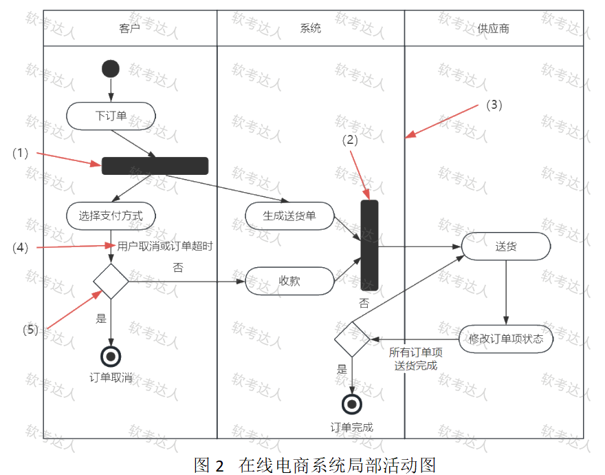

# 在线电商系统-活动图与流程图对比案例

## 原题（网站题号 24～25 合并：试题二，25分）

**试题二（25分）**　阅读以下关于系统设计的说明，回答下列问题。

【说明】某传统线下成衣经销商拟开发一套在线电商系统，以改善用户体验。系统设计阶段，团队成员就使用何种流程建模工具发生分歧：张工提出采用传统的流程图，李工认为活动图更具优势，双方争执不下。

| 网站题号 | 小问 | 分值 |
|---|---|---|
| 24 | 问题1（15分）：补充说明局部活动图中（ ）~（5）各是什么元素，并以300字以内介绍5个元素各自特点 | 15 |
| 25 | 问题2（10分）：300字以内说明流程图与活动图的主要区别 | 10 |

> 本案例已知两问共25分；题面声明未见问题3，网站题号26起为另一问答组，无本案例第三问，不扩展。

## 图示（原图）

## 来源答案与解析（网站原文）

- 题24：（1）并发分岔；（2）并发汇合；（3）泳道；（4）监护表达式；（5）分支，逐项特点。（解析：无）
- 题25：五点区别（描述对象/并发/面向/结束节点/专用元素）。（解析：无）

## 核验答案（考场作答）

### 【问题1】（15分）

**考场答案**：看图定位——(1)下订单后的水平同步条=并发分岔（fork）：将流程拆分为多个并行路径，多个活动同时进行；(2)生成送货单/收款后的垂直同步条=并发汇合（join）：并行路径重新合并，全部完成后继续；(3)泳道分区=泳道：将活动按角色（客户/系统/供应商）分类，展示职责与交互；(4)“用户取消或订单超时”标注=监护表达式：分支中的条件判断，决定走哪条路径；(5)是/否菱形=分支（判定节点）：按条件选择不同执行路径，是活动图的决策点。

**采分要点**：五元素各3分（推定）：名称+特点各占其半。

**详细解析**：活动图元素题的答题法是“先看箭头指向的图形再答名称”：粗横条/粗竖条=fork/join（并发），菱形=判定，转移上的方括号条件=监护表达式，竖向分区=泳道。fork/join 与判定菱形的区别是高频陷阱：并发条是“同时发生”，判定是“二选一”。

**常见失分表达**：把 fork 答成“分支”；把监护表达式答成“事件”；元素特点漏“并发/同步”关键词。

**知识点链接**：[UML 建模速查](https://github.com/Goodyzhang/ruankao.skill/blob/main/materials/%E7%B3%BB%E7%BB%9F%E6%9E%B6%E6%9E%84%E8%AE%BE%E8%AE%A1%E5%B8%88/%E7%AC%94%E8%AE%B0/%E7%9F%A5%E8%AF%86%E7%82%B9/05-%E8%BD%AF%E4%BB%B6%E5%B7%A5%E7%A8%8B%E5%9F%BA%E7%A1%80%E7%9F%A5%E8%AF%86.md)、[面向对象方法（活动图）](https://github.com/Goodyzhang/ruankao.skill/blob/main/materials/%E7%B3%BB%E7%BB%9F%E6%9E%B6%E6%9E%84%E8%AE%BE%E8%AE%A1%E5%B8%88/%E7%AC%94%E8%AE%B0/%E7%9F%A5%E8%AF%86%E7%82%B9/05-%E8%BD%AF%E4%BB%B6%E5%B7%A5%E7%A8%8B%E5%9F%BA%E7%A1%80%E7%9F%A5%E8%AF%86.md)

### 【问题2】（10分）

**考场答案**（300字内）：①流程图描述处理过程，主要控制结构是顺序、分支和循环，各处理过程间有严格的顺序和时间关系；活动图描述对象活动顺序关系所遵循的规则，侧重表现系统行为而非处理过程。②流程图不能表示并发活动，活动图能表示并发。③流程图面向过程，活动图面向对象。④流程图只能有一个结束节点，活动图可有多个结束节点。⑤流程图没有专用元素表达消息传递、时间延迟等操作，活动图有这类图形元素。

**采分要点**：五点各2分（推定）。

**详细解析**：五点区别的记法——本体（过程vs行为）、能力（并发有无）、范式（过程vs对象）、拓扑（单终局vs多终局）、表达力（消息/延迟元素有无）。本题是2021年下半年真题同源考点，五点背全即满分；答题时可各配一句机制解释。

**常见失分表达**：只答“活动图更先进”；漏“多结束节点/消息延迟元素”这两条冷门点。

**知识点链接**：[面向对象方法（活动图与流程图）](https://github.com/Goodyzhang/ruankao.skill/blob/main/materials/%E7%B3%BB%E7%BB%9F%E6%9E%B6%E6%9E%84%E8%AE%BE%E8%AE%A1%E5%B8%88/%E7%AC%94%E8%AE%B0/%E7%9F%A5%E8%AF%86%E7%82%B9/05-%E8%BD%AF%E4%BB%B6%E5%B7%A5%E7%A8%8B%E5%9F%BA%E7%A1%80%E7%9F%A5%E8%AF%86.md)

## 来源与身份

- 题源：软考达人·第二十二章 案例分析/第一节 案例分析，网站题号24～25（网站分类“第二十二章 案例分析”保留为来源位置，章节路由按实际考点匹配教材章（第2版20章体系）。）
- 年份/卷别未核实，按 web-bank 处理；分值加和 15+10=25 与“试题二（25分）”一致。
- 图示：活动图原图已下载并实际看图核对(1)～(5)指向位置。
