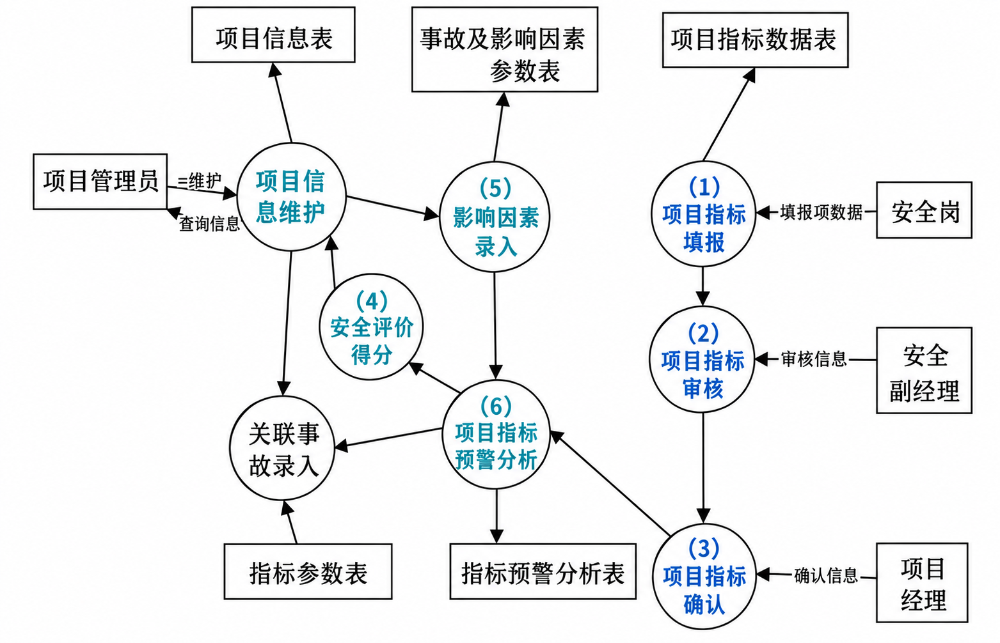
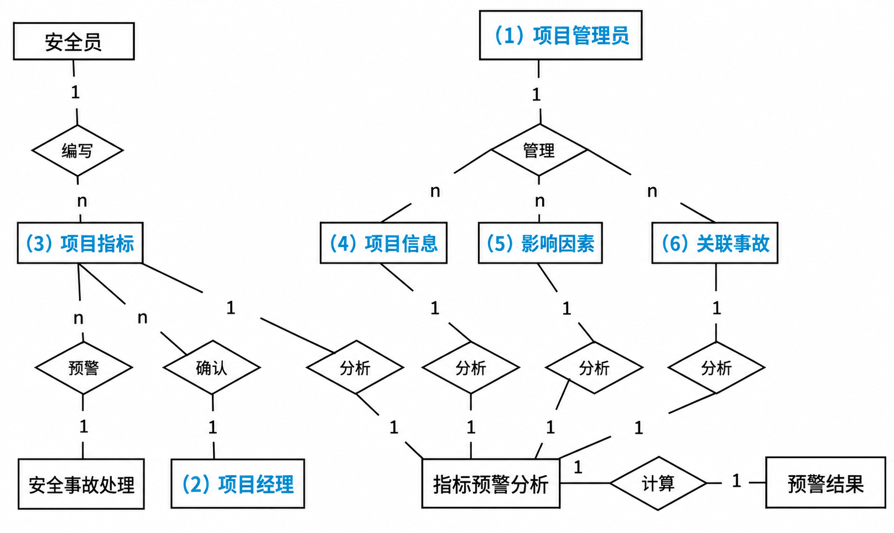
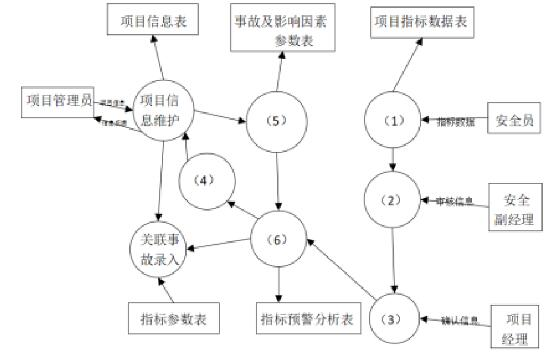
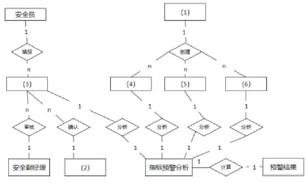

# 煤矿建设项目安全预警系统 DFD 与 ER 图（2022 年下半年 试题二，25 分）

## 题干（原题抄写）

> 【2022 年下半年】试题二（25 分）
> 阅读以下关于软件系统设计与建模的叙述，在答题纸上回答问题 1 至问题 3。
>
> 【说明】煤炭生产是国民经济发展的主要领域之一，其煤矿的安全非常重要。某能源企业拟开发一套煤矿建设项目安全预警系统，以保护煤矿建设项目从业人员生命安全。本系统的主要功能包括如下 (a)～(h) 所述。
>
> 【问题 1】（9 分）王工根据煤矿建设项目安全预警系统的功能要求，设计完成了系统的数据流图，如图 2-1 所示。请使用题干中描述的功能 (a)～(h)，补充完善空 (1)～(6) 处的内容，并简要介绍数据流图在分层细化过程中遵循的数据平衡原则。
>
> (a) 项目信息维护；(b) 影响因素录入；(c) 关联事故录入；(d) 安全评价得分；(e) 项目指标预警分析；(f) 项目指标填报；(g) 项目指标审核；(h) 项目指标确认。
>
> 【问题 2】（9 分）请根据【问题 1】中数据流图表示的相关信息，补充完善煤矿建设项目安全预警系统总体 ER 图（见图 2-2）中实体 (1)～(6) 的具体内容，将正确答案填在答题纸上。
>
> 【问题 3】（7 分）在结构化分析和设计过程中，数据流图和数据字典是常用的技术手段，请用 200 字以内的文字简要说明它们在软件需求分析和设计阶段的作用。
>
> （来源：2022 年下半年系统架构设计师案例分析，题库题号 42；历史归档仅收录问题 3，后同题问题 1、2 已合并。）

## 图（原图与答案图分开）

- **图 2-1 DFD 填空答案示意（答案版重绘图，蓝色为答案；非原题图）**：
- **图 2-2 煤矿安全预警 ER 图答案（答案版重绘图；非原题图）**：
- **260 题预警系统页面截图（原图截图；顶部与底部未完整显示，不作为完整原图）**：
- **265 题煤矿 ER 图完整截图（原图截图）**：

## 考场答案与采分要点

**问题 1**：(1) f 项目指标填报；(2) g 项目指标审核；(3) h 项目指标确认；(4) d 安全评价得分；(5) b 影响因素录入；(6) e 项目指标预警分析。
分层平衡要求子图与父图的数据流数量及方向一致；图内避免黑洞（有输入无输出）、奇迹（有输出无输入）和灰洞（输出缺少输入依据）。

**问题 2**：(1) 项目管理员；(2) 项目经理；(3) 项目指标；(4) 项目信息；(5) 影响因素；(6) 关联事故。

**问题 3**：
- **在需求分析阶段**：① **DFD** 用于界定系统上下文范围，通过自顶向下的逐层功能分解建立加工说明，指明数据在系统内部的移动、流向与加工变换规约；② **DD** 作为分析模型的核心词条库与单一事实源，对系统中所有数据元素、数据流与数据存储进行有组织的严格定义，消除二义性。
- **在软件设计阶段**：① **DFD** 根据数据流类别（变换流 vs 事务流），利用变换分析和事务分析映射方法，直接初始化导出系统的模块结构图（MSD）；② **DD** 根据其对“数据存储”和“数据项”的数据结构、类型与约束定义，直接指导并建立数据库逻辑与物理存储结构设计。

## 版本差异记录（保真保留，不合并）

- 第 260-261 题为第一版本（仅两问），第 264-266 题第二版本补齐第三问；答案一致。
- **第 275 题问题 2 的页面答案与第 261/265 题存在差异**：275 版（3）写“项目指标数据”，(4)～(6) 写“指标参数、项目信息、事故及影响因素参数”并称顺序不限；此前版本依次给出“项目指标、项目信息、影响因素、关联事故”。275 版引用两张图但页面结构未显示图像，无法确认编号结构——**保留版本差异，不合并为唯一正确答案**。
- 平衡原则表述勘误（243-279 记录）：网页“父类／子类”措辞应改为父加工／子图；数据流拆分与合并需证明内容等价，不能强行要求输入输出流条数相等。

## 知识点链接

- [结构化分析（SA）案例实战：数据流图 DFD 与数据字典 DD 双阶段作用](https://github.com/Goodyzhang/ruankao.skill/blob/main/materials/%E7%B3%BB%E7%BB%9F%E6%9E%B6%E6%9E%84%E8%AE%BE%E8%AE%A1%E5%B8%88/%E7%AC%94%E8%AE%B0/%E7%9F%A5%E8%AF%86%E7%82%B9/05-%E8%BD%AF%E4%BB%B6%E5%B7%A5%E7%A8%8B%E5%9F%BA%E7%A1%80%E7%9F%A5%E8%AF%86.md)

**关键解题模型**：双工具双阶段四象限踩分法 + 变换事务映射法。

## 核验状态与来源

- 核验状态：`identity-stated-by-source`——2022 下半年试题二身份来自来源标注；DFD 截图仍有裁切（260 题），ER 图已完整（265 题）。
- 待补：完整未裁切的 DFD 原图（42-*.png 为答案版重绘，非原题截图）。
- 实验室可用性：**候选**——有年份+试题二身份、完整三问与答案；但**原题图缺**（现有图均为答案版），导出前须补原题图并区分原图/答案图。
