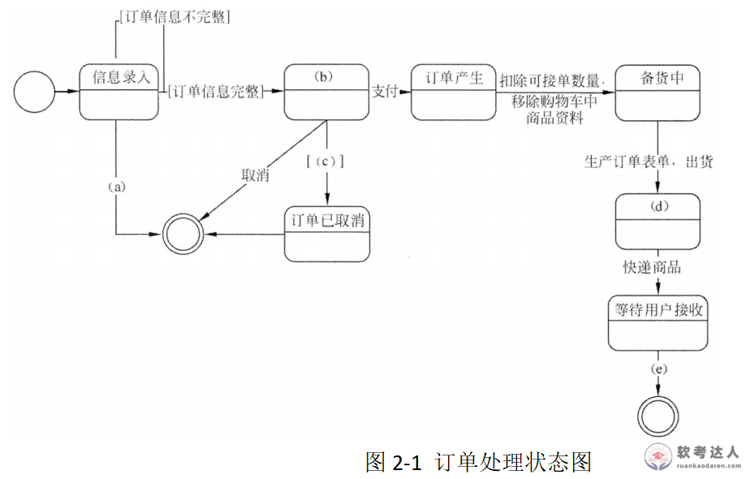

# 网上销售系统-设计类与状态图案例

## 原题（网站题号 180～182 合并：试题二，25分）

**试题二（25分）**　阅读以下关于系统设计的叙述，在答题纸上回答问题1至问题3。

【说明】某软件公司为知名制造企业开发网上销售系统（面向对象方法）。核心流程：注册用户浏览商品→加购物车→结算录入订单→选支付方式填收货信息→提交订单→30分钟内支付否则自动取消（也可手工取消）→支付确认后备货、扣可接单数量、移除购物车→生成订单表单、出货、订单生效→快递→用户签收，交易完成。

| 网站题号 | 小问 | 分值 |
|---|---|---|
| 180 | 问题1（12分）：设计类三种类型、职责，并为每类举2个实例 | 12 |
| 181 | 问题2（3分）：300字内给出活动图与流程图三个主要区别 | 3 |
| 182 | 问题3（10分）：填写图2-1状态图（a）～（e）空白 | 10 |

## 图示（原图，未覆盖）

## 来源答案与解析（网站原文）

- 题180：实体类/边界类/控制类三类职责+实例清单。（解析：无）
- 题181：三个区别（面向对象vs过程/行为vs处理过程/并发支持）。（解析：无）
- 题182：（a）取消；（b）待结算；（c）大于30分钟；（d）订单生效；（e）用户签收。（解析：无）

## 核验答案（考场作答）

### 【问题1】（12分）

**考场答案**（300字内）：设计类分为三种类型：①实体类——映射需求中的每个实体，保存需要存储在永久存储体中的信息；题干实例：商品、订单（另：注册用户、送货信息、购物车）。②边界类（接口类）——封装在用例内、外流动的信息或数据流；题干实例：商品信息页面、订单信息录入页面（另：订单表单）。③控制类——控制用例工作的类，一般由动宾结构短语（动词+名词或名词+动词）转化来的名词；题干实例：订单结算、备货（另：订单支付、出货）。

**采分要点**：三类型职责各2分＋每类2实例各2分（推定）。

**详细解析**：ECB三类的判别：名词实体→实体类；界面/页面/表单→边界类；动宾短语（结算/支付/备货/出货）→控制类——与章级知识点“ECB实体/控制/边界类”完全同源。

**常见失分表达**：把“订单结算”当实体类（动宾结构是控制类标志）。

**知识点链接**：[ECB 实体/控制/边界类](https://github.com/Goodyzhang/ruankao.skill/blob/main/materials/%E7%B3%BB%E7%BB%9F%E6%9E%B6%E6%9E%84%E8%AE%BE%E8%AE%A1%E5%B8%88/%E7%AC%94%E8%AE%B0/%E7%9F%A5%E8%AF%86%E7%82%B9/05-%E8%BD%AF%E4%BB%B6%E5%B7%A5%E7%A8%8B%E5%9F%BA%E7%A1%80%E7%9F%A5%E8%AF%86.md)

### 【问题2】（3分）

**考场答案**：活动图与流程图三个主要区别：①活动图是面向对象的，流程图是面向过程的；②活动图描述对象活动的顺序关系所遵循的规则，着重表现系统行为而非处理过程；流程图着重描述处理过程，主要控制结构是顺序、分支和循环，各处理过程间有严格的顺序和时间关系；③活动图能够表示并发活动的情形，流程图不能。

**采分要点**：三点各1分（推定）。

**详细解析**：与题25（流程图vs活动图五点区别）同族——本题只要三点，取最核心的面向/行为/并发即可。

**常见失分表达**：漏“并发”这条最硬区别。

**知识点链接**：[活动图与流程图](https://github.com/Goodyzhang/ruankao.skill/blob/main/materials/%E7%B3%BB%E7%BB%9F%E6%9E%B6%E6%9E%84%E8%AE%BE%E8%AE%A1%E5%B8%88/%E7%AC%94%E8%AE%B0/%E7%9F%A5%E8%AF%86%E7%82%B9/05-%E8%BD%AF%E4%BB%B6%E5%B7%A5%E7%A8%8B%E5%9F%BA%E7%A1%80%E7%9F%A5%E8%AF%86.md)

### 【问题3】（10分）

**考场答案**：(a)=取消；(b)=待结算；(c)=大于30分钟；(d)=订单生效；(e)=用户签收。

**采分要点**：五空各2分（推定）；(a)(c)(e)为转移标注、(b)(d)为状态。

**详细解析**：与题77状态图同法：状态框(a)(b)(d)(e)按题干订单状态流填，转移条件(c)来自“订单需在30分钟内支付否则自动取消”。(a)“取消”是手工取消事件（区别于(c)超时自动取消）。需求逐句映射状态迁移。

**常见失分表达**：(a)与(c)混淆（手工取消vs超时）；(d)写成“已支付”。

**知识点链接**：[状态图填空](https://github.com/Goodyzhang/ruankao.skill/blob/main/materials/%E7%B3%BB%E7%BB%9F%E6%9E%B6%E6%9E%84%E8%AE%BE%E8%AE%A1%E5%B8%88/%E7%AC%94%E8%AE%B0/%E7%9F%A5%E8%AF%86%E7%82%B9/05-%E8%BD%AF%E4%BB%B6%E5%B7%A5%E7%A8%8B%E5%9F%BA%E7%A1%80%E7%9F%A5%E8%AF%86.md)

## 来源与身份

- 题源：软考达人·第二十二章 案例分析/第一节 案例分析，网站题号180～182（网站分类“第二十二章 案例分析”保留为来源位置，章节路由按实际考点匹配教材章（第2版20章体系）。）
- 年份/卷别未核实，按 web-bank 处理；分值加和 12+3+10=25 与“试题二（25分）”一致。
- 图示：订单状态图原图已下载并实际看图核对五空位置。
