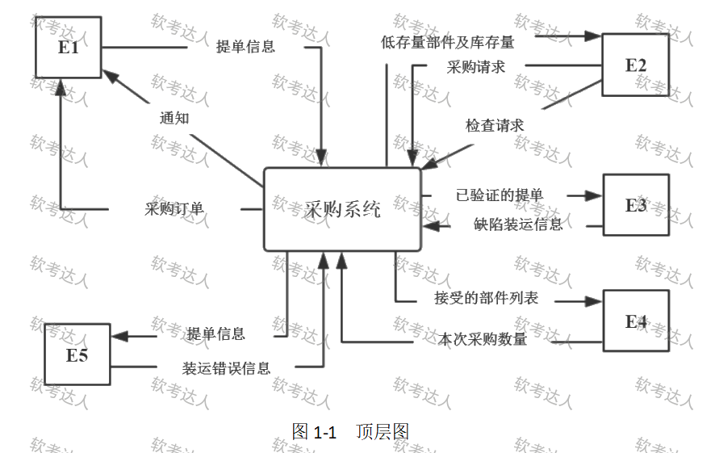
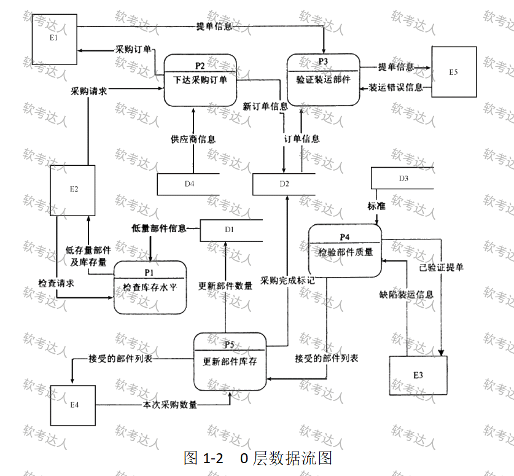

# 采购系统数据流图（题目 243–245，问题 1–3）

## 题干与业务背景

业务覆盖库存预警、采购下单、到货核对、质量检查和库存更新。读图时分别追踪订购、验收、入库以及异常通知；外部角色由其输入和接收的信息辨认。

> 完整性记录（保真保留）：页面题干称“问题 1 至问题 4”，实际第 243～245 题展示问题 1～3，分值为 10＋8＋7＝25；第 246 题已是商业情报案例。未见第四问，不据此补写。

## 图（原图）

- **顶层图原图**：
- **0 层图原图**：

## 小问与分值

| 题号 | 分值 | 要求 |
|---|---|---|
| 243 | 10 分 | 结合业务说明，为 E1～E5 命名 |
| 244 | 8 分 | 为 D1～D4 命名 |
| 245 | 7 分 | 列出遗漏的数据流名称、起点、终点 |

## 考场答案与采分要点

**第 243 题（网站答案整理）**：E1＝供应商；E2＝采购部门；E3＝检验员；E4＝库管员；E5＝S/R 职员。
- 解题过程：先从辨识度最高的数据流入手。E1 提交提单且接收采购订单，对应供应商；E2 发检查和采购请求并接收低库存信息，对应采购部门；E3 接收验证后的提单并报告缺陷，对应检验员；E4 接收可入库部件清单并提供采购数量，对应库管员；E5 接收提单并反馈装运差错，对应运输接收职员。每个角色至少用一条输入和一条输出交叉核对。
- 方法边界：DFD 的“外部”相对于软件系统边界；公司内部员工也可以是外部实体。

**第 244 题**：D1＝库存表；D2＝采购订单表；D3＝质量标准表；D4＝供应商表。
- 易错点：数据流是一次传递的信息，数据存储是供后续读取的持久信息集合。“供应商信息”是流的名字，“供应商表”是存储名字。

**第 245 题**：

| 数据流 | 起点 | 终点 |
|---|---|---|
| 原有部件库存量 | D1 | P5 |
| 产品送检 | P3 | P4 |
| 装运错误通知 | P3 | E1 |
| 缺陷装运通知 | P4 | E1 |

- 解题过程：① 先查父子图平衡——顶层系统向供应商发送通知，分解后由 P3（到货不符）与 P4（质量不合格）分别补到 E1；② 再查业务衔接——P3 核验通过后要将送检信息交给 P4；③ 最后查计算输入——P5 要完成库存累加需要“旧库存＋本次数量”，P5→D1 的写入边无法代替 D1→P5 的读取边。
- 术语说明：DFD 表示信息流，“产品送检”应理解为与送检部件相关的已验证提单及部件项目信息，不能把实物运输线直接当成数据流。网站答案称 P4“校验部件质量”，用户原图写“检验部件质量”，两者均指图中 P4。

## 知识点链接

- [结构化方法](https://github.com/Goodyzhang/ruankao.skill/blob/main/materials/%E7%B3%BB%E7%BB%9F%E6%9E%B6%E6%9E%84%E8%AE%BE%E8%AE%A1%E5%B8%88/%E7%AC%94%E8%AE%B0/%E7%9F%A5%E8%AF%86%E7%82%B9/05-%E8%BD%AF%E4%BB%B6%E5%B7%A5%E7%A8%8B%E5%9F%BA%E7%A1%80%E7%9F%A5%E8%AF%86.md)

## 核验状态与来源

- 核验状态：`pending`（web-bank，未核实年份）。
- **待补**：采购系统彩色补图尝试了三版 imagegen 均未通过端点/原图不变性核验，未放入答案文档；原图和四条正确数据流表已保留，此项改图未完成（243-279 文件完整性结论）。
- 实验室可用性：**暂不可导出**——web-bank 身份未核实。
