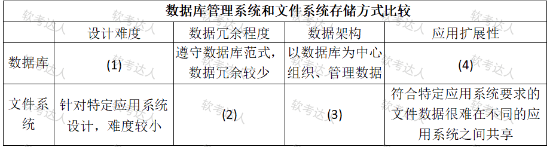
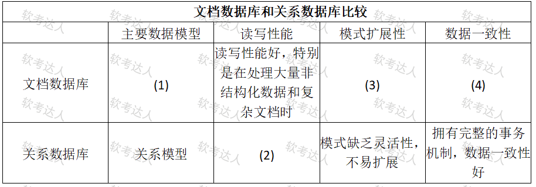

# OA系统-数据存储选型与NoSQL案例

## 原题（网站题号 18～20 合并：试题四，25分）

**试题四（25分）**　阅读以下关于应用系统数据架构的说明，回答下列问题。

【说明】某软件公司计划开发一套全新的办公自动化系统（公文办理、员工管理、考勤、报销审批等模块），要求自动化智能化、界面易用、数据分析能力强、可随企业规模无缝扩展。数据架构设计时，王工主张文件系统（当前数据量不大、功能简单、简单直观、开发周期短），李工建议数据库（公司处于高速扩张期、数据将飞速膨胀、扩展性更强、能支持未来复杂业务）。项目组初步采纳李工意见，决定采用数据库存储客户数据并针对业务特征优化性能。

| 网站题号 | 小问 | 分值 |
|---|---|---|
| 18 | 问题1（8分）：从设计难度、数据冗余程度、数据架构、应用扩展性4方面比较关系型数据库与文件系统，填表（ ）～（4） | 8 |
| 19 | 问题2（8分）：比较文档数据库与关系数据库在数据模型、读写性能、模式扩展性、数据一致性方面的差异，填表4-2（ ）～（4） | 8 |
| 20 | 问题3（9分）：300字以内说明JSON在数据存储、修改和传输方面的优点 | 9 |

## 来源答案与解析（网站原文）

- 题18：（1）数据结构需要符合某些模式，设计难度较大；（2）可能在多个文件中复制相同的数据属性，数据冗余较大；（3）以应用系统为中心组织、管理数据；（4）数据独立于应用系统，很容易在不同的应用系统之间共享数据。（解析：无）
- 题19：（1）文档模型；（2）性能相对较低，特别是关联查询多时；（3）模式自由，可以随时增加字段或者嵌套内部对象；（4）欠缺事务支持，数据一致性差。（解析：无）
- 题20：JSON存储/修改/传输三方面优点。（解析：无）

## 图示（原图与填空答案）

### 问题1 对比表原图（未覆盖）

### 问题1 填空答案副本（Markdown 表格，可编辑；原图未动）

| 存储方式 | 设计难度 | 数据冗余程度 | 数据架构 | 应用扩展性 |
|---|---|---|---|---|
| 数据库 | **(1)** 数据结构需符合某些模式，设计难度较大 | 遵守数据库范式，数据冗余较少 | 以数据库为中心组织、管理数据 | **(4)** 数据独立于应用系统，很容易在不同的应用系统之间共享数据 |
| 文件系统 | 针对特定应用系统设计，难度较小 | **(2)** 可能在多个文件中复制相同的数据属性，数据冗余较大 | **(3)** 以应用系统为中心组织、管理数据 | 符合特定应用系统要求的文件数据很难在不同的应用系统之间共享 |

### 问题2 对比表原图（未覆盖）

### 问题2 填空答案副本（Markdown 表格，可编辑；原图未动）

| 对比项 | 主要数据模型 | 读写性能 | 模式扩展性 | 数据一致性 |
|---|---|---|---|---|
| 文档数据库 | **(1)** 文档模型 | 读写性能好，特别是在处理大量非结构化数据和复杂文档时 | **(3)** 模式自由，可随时增加字段或嵌套内部对象 | **(4)** 欠缺事务支持，数据一致性差 |
| 关系数据库 | 关系模型 | **(2)** 性能相对较低，特别是关联查询多时 | 模式缺乏灵活性，不易扩展 | 拥有完整的事务机制，数据一致性好 |

## 核验答案（考场作答）

### 【问题1】（8分）

**考场答案**：见上方填空答案副本——(1)数据结构需符合某些模式，设计难度较大；(2)可能在多个文件中复制相同数据属性，冗余较大；(3)以应用系统为中心组织、管理数据；(4)数据独立于应用系统，易在不同应用系统间共享。

**采分要点**：四空各2分（推定），按“行×列”对号入座。

**详细解析**：表格题用“行列定坐标”法：先锁定填哪个格（数据库行/文件系统行 × 哪一列），再按该维度补对仗半句——设计难度（模式约束↔面向特定应用）、冗余（范式约束少冗余↔多处复制高冗余）、架构（数据中心↔应用中心）、扩展性（数据独立易共享↔文件难共享）。李工王工之争的论据正落在(4)：扩张期业务膨胀需要数据独立性与共享性，这是选数据库的架构理由。

**常见失分表达**：空号与行列错位（把(2)答到数据架构列）；只答“冗余大/小”没有机制句。

**知识点链接**：[数据管理技术发展阶段（文件系统 vs 数据库系统）](https://github.com/Goodyzhang/ruankao.skill/blob/main/materials/%E7%B3%BB%E7%BB%9F%E6%9E%B6%E6%9E%84%E8%AE%BE%E8%AE%A1%E5%B8%88/%E7%AC%94%E8%AE%B0/%E7%9F%A5%E8%AF%86%E7%82%B9/06-%E6%95%B0%E6%8D%AE%E5%BA%93%E8%AE%BE%E8%AE%A1%E5%9F%BA%E7%A1%80%E7%9F%A5%E8%AF%86.md)

### 【问题2】（8分）

**考场答案**：见上方填空答案副本——(1)文档模型；(2)性能相对较低，特别是关联查询多时；(3)模式自由，可随时增加字段或嵌套内部对象；(4)欠缺事务支持，数据一致性差。

**采分要点**：四空各2分（推定）。

**详细解析**：文档数据库的优势公式是“一次取整篇文档”：文档模型把关联数据内嵌，免JOIN故读写快（尤其非结构化/复杂文档）；Schemaless故扩展灵活。代价公式是“跨文档弱事务”：没有关系库那样完整的事务机制，一致性让位。题干情境自洽：张工拿文档库替换关系库的前提是OA文档类数据多、模式演进快。

**常见失分表达**：(1)写成“键值模型/关系模型”；(4)答成“完全没有事务”（口径是“欠缺事务支持”，不是零事务——MongoDB 4.x后有多文档事务，考试按教材口径作答）。

**知识点链接**：[NoSQL 体系框架（文档数据库）](https://github.com/Goodyzhang/ruankao.skill/blob/main/materials/%E7%B3%BB%E7%BB%9F%E6%9E%B6%E6%9E%84%E8%AE%BE%E8%AE%A1%E5%B8%88/%E7%AC%94%E8%AE%B0/%E7%9F%A5%E8%AF%86%E7%82%B9/06-%E6%95%B0%E6%8D%AE%E5%BA%93%E8%AE%BE%E8%AE%A1%E5%9F%BA%E7%A1%80%E7%9F%A5%E8%AF%86.md)

### 【问题3】（9分）

**考场答案**（300字内）：存储方面：JSON语法简洁明了，易于阅读编写，降低存储复杂性；支持字符串、数字、布尔值、数组、对象等多种类型，可灵活表达复杂数据结构；允许空值与可选字段，灵活性高且节省空间。修改方面：JSON基于文本格式，文档可被程序直接解析修改，也能用文本编辑器查看编辑，利于开发调试。传输方面：格式紧凑，易于传输与存储；跨平台、跨语言的数据交换简单，适配异构系统间传输。

**采分要点**：存储4分（语法2+多类型2）、修改2分、传输3分（推定）。

**详细解析**：按题面三动词“存储/修改/传输”分段作答是保分结构。机制理解：JSON是MongoDB的文档载体（BSON二进制化的对象表示），“多类型+嵌套”对应文档模型的表达力，“文本可直接解析”对应免模式变更的维护成本，“紧凑+跨语言”对应Web时代异构集成。与问题2联动：JSON优点正是文档数据库读写性能好、模式自由的原因。

**常见失分表达**：三方面混写不分段；只写“轻量、可读”没有展开机制；超300字。

**知识点链接**：[NoSQL 体系框架（JSON/文档）](https://github.com/Goodyzhang/ruankao.skill/blob/main/materials/%E7%B3%BB%E7%BB%9F%E6%9E%B6%E6%9E%84%E8%AE%BE%E8%AE%A1%E5%B8%88/%E7%AC%94%E8%AE%B0/%E7%9F%A5%E8%AF%86%E7%82%B9/06-%E6%95%B0%E6%8D%AE%E5%BA%93%E8%AE%BE%E8%AE%A1%E5%9F%BA%E7%A1%80%E7%9F%A5%E8%AF%86.md)

## 来源与身份

- 题源：软考达人·第二十二章 案例分析/第一节 案例分析，网站题号18～20（网站分类“第二十二章 案例分析”保留为来源位置，章节路由按实际考点匹配教材章（第2版20章体系）。）
- 年份/卷别未核实，按 web-bank 处理；分值加和 8+8+9=25 与“试题四（25分）”一致。
- 图示：两张对比表原图以 curl 下载自网站图片资产（image-t.chaiding.com），sha256 见 assets；填空答案以 Markdown 表格副本呈现（可编辑），原图未覆盖，不另制作标注图。
