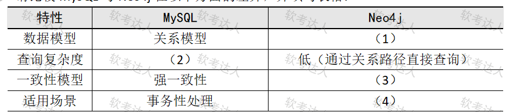

# 医疗患者关系分析-Neo4j与MinIO数据架构案例

## 原题（网站题号 65～67 合并：试题四，25分）

**试题四（25分）**　阅读以下关于某医疗系统患者关系分析系统数据架构的说明，回答下列问题。

【说明】某三甲医院计划构建患者关系分析系统，追踪患者亲属、主治医生及转诊记录，优化医疗资源分配。当前用MySQL存储结构化数据，面临挑战：(1)查询效率低——无法高效查询跨科室的患者关联网络；(2)数据类型复杂——需存储非结构化病历扫描件和多对多关系（患者-医生-科室）。团队考虑引入图数据库（如Neo4j）和分布式对象存储（如MinIO）。

| 网站题号 | 小问 | 分值 |
|---|---|---|
| 65 | 问题1（8分）：MySQL与Neo4j差异填表 | 8 |
| 66 | 问题2（6分）：MinIO存储病历扫描件在可靠性、伸缩性、性能方面的优势及实现原理 | 6 |
| 67 | 问题3（11分）：对比MySQL主从复制、主主复制集群的优缺点及适用场景 | 11 |

## 图示（原图，未覆盖）

## 来源答案与解析（网站原文）

- 题65：（1）图模型（节点-边结构）；（2）高（多表JOIN）；（3）弱一致性（或者最终一致性）；（4）多对多关系分析、社交网络查询。（解析：无）
- 题66：可靠性（多副本+自动修复）/伸缩性（水平扩展PB级）/性能（分布式加速读写、多线程）。（解析：无）
- 题67：主从与主主复制的优缺点及适用场景。（解析：无）

## 核验答案（考场作答）

### 【问题1】（8分）

**考场答案**：数据模型——MySQL关系模型 vs Neo4j图模型（节点-边结构）；查询复杂度——MySQL高（多表JOIN）vs Neo4j低（通过关系路径直接查询）；一致性模型——MySQL强一致性 vs Neo4j弱一致性（最终一致性）；适用场景——MySQL事务性处理 vs Neo4j多对多关系分析、社交网络查询。

**采分要点**：四空各2分（推定）。

**详细解析**：图数据库的本命场景是“关系即数据”：患者-医生-科室的多跳关联在图模型里沿边遍历，免多表JOIN。与题59（Cassandra列族）对照记忆：NoSQL四类各有所长——列族扛写、图扛关系遍历。

**常见失分表达**：(2)只写“高”没有“多表JOIN”机制；(4)写成“存储病历扫描件”（那是MinIO的活）。

**知识点链接**：[NoSQL（图数据库）](https://github.com/Goodyzhang/ruankao.skill/blob/main/materials/%E7%B3%BB%E7%BB%9F%E6%9E%B6%E6%9E%84%E8%AE%BE%E8%AE%A1%E5%B8%88/%E7%AC%94%E8%AE%B0/%E7%9F%A5%E8%AF%86%E7%82%B9/06-%E6%95%B0%E6%8D%AE%E5%BA%93%E8%AE%BE%E8%AE%A1%E5%9F%BA%E7%A1%80%E7%9F%A5%E8%AF%86.md)

### 【问题2】（6分）

**考场答案**：①数据可靠性：MinIO通过数据冗余（多副本）和自动修复机制（检测副本一致性）保障；②伸缩性：支持水平扩展存储容量，支持PB级非结构化数据（如PDF、DICOM影像）；③性能：分布式存储加速读写，支持多线程访问。

**采分要点**：三方面各2分（推定）。

**详细解析**：与题60 HDFS三条几乎同构（冗余/水平扩展/并行）——分布式存储的通用优势模板：副本机制保可靠、加节点保伸缩、数据本地与并行保性能。对象存储的特有点：纠删码（Erasure Coding）可作扩展理解。

**常见失分表达**：漏“自动修复”机制半句；场景词漏“DICOM影像”。

**知识点链接**：[分布式对象存储](https://github.com/Goodyzhang/ruankao.skill/blob/main/materials/%E7%B3%BB%E7%BB%9F%E6%9E%B6%E6%9E%84%E8%AE%BE%E8%AE%A1%E5%B8%88/%E7%AC%94%E8%AE%B0/%E7%9F%A5%E8%AF%86%E7%82%B9/06-%E6%95%B0%E6%8D%AE%E5%BA%93%E8%AE%BE%E8%AE%A1%E5%9F%BA%E7%A1%80%E7%9F%A5%E8%AF%86.md)

### 【问题3】（11分）

**考场答案**：①主从复制集群——优点：部署简单、读写分离、数据备份、高可用；缺点：主库崩溃后从库不会自动升为主库，需人工干预；适用场景：读多写少、数据备份。②主主复制集群——优点：双主可写、故障自动切换；缺点：数据冲突风险、需应用层处理冲突；适用场景：双向同步、小规模高可靠。

**采分要点**：主从（优4缺1景）约5分＋主主（优2缺2景）约4分＋对仗结构2分（推定）。

**详细解析**：复制机制的根源差异：主从是binlog单向流（从库只读，主挂了要人工提升），主主是双向流（都可写但同一行可能被双改→冲突需应用层裁决）。选择逻辑：读多写少选主从（读写分离收益大），双活需求选主主但必须接受冲突处理成本。与题64点餐系统同步冲突方案互相印证。

**常见失分表达**：主从缺点漏“需人工干预”；主主缺点漏“需应用层处理冲突”；适用场景张冠李戴。

**知识点链接**：[分布式数据库（复制）](https://github.com/Goodyzhang/ruankao.skill/blob/main/materials/%E7%B3%BB%E7%BB%9F%E6%9E%B6%E6%9E%84%E8%AE%BE%E8%AE%A1%E5%B8%88/%E7%AC%94%E8%AE%B0/%E7%9F%A5%E8%AF%86%E7%82%B9/06-%E6%95%B0%E6%8D%AE%E5%BA%93%E8%AE%BE%E8%AE%A1%E5%9F%BA%E7%A1%80%E7%9F%A5%E8%AF%86.md)

## 来源与身份

- 题源：软考达人·第二十二章 案例分析/第一节 案例分析，网站题号65～67（网站分类“第二十二章 案例分析”保留为来源位置，章节路由按实际考点匹配教材章（第2版20章体系）。）
- 年份/卷别未核实，按 web-bank 处理；分值加和 8+6+11=25 与“试题四（25分）”一致。
- 图示：MySQL vs Neo4j 对比表原图已下载并实际看图核对四空行列（行名=数据模型/查询复杂度/一致性模型/适用场景）。
