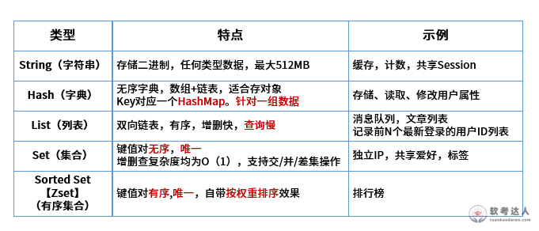
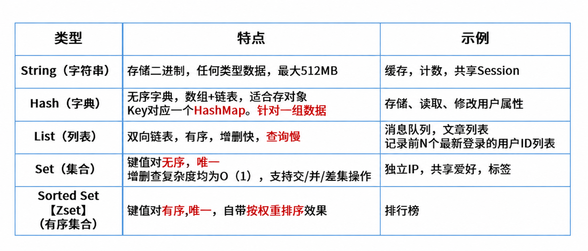

# 医药销售系统数据库设计：反规范化、同步机制与 Redis 排行榜（试题四，25 分）

## 题干（原题抄写）

> 试题四（25分）。某医药销售企业拟建设线上药品销售系统，提供药品展示、订单、用户交流反馈、热销产品排名和评价分类管理。初步采用 MySQL 关系数据库与 Redis 缓存。部分关系为：供应商（供应商ID、供应商名称、联系方式、供应商地址）；药品（药品ID、药品名称、药品型号、药品价格、供应商ID）；药品库存（药品ID、当前库存数量）；订单（订单号码、药品ID、供应商ID、药品数量、订单金额）。
>
> **问题1（9分）**：规范化设计后多表连接影响性能。拟将药品表改为药品（药品ID、药品名称、药品型号、药品价格、供应商ID、供应商名称、当前库存数量）。用200字以内说明常见反规范化方法，并说明商品详情查询应采用哪种方法。
>
> **问题2（9分）**：用200字以内说明解决反规范化数据不一致的三种常见方法，并说明本系统应采用哪种。
>
> **问题3（7分）**：（1）热销药品排名应选择 Redis 的哪种数据类型？（2）用200字以内说明 Redis 与 MySQL 数据同步的常见方案。
>
> （题目附 Redis String、Hash、List、Set、Sorted Set（ZSet）类型对照表。）

## 图（原图与可编辑副本分开）

- **Redis 数据类型表·原题图**：
- **去水印副本（可编辑稿）**：

## 考场答案与采分要点

**问题 1 常见反规范化方法**：
1. **增加冗余列**：在多个关系中复制高频查询属性，减少连接；
2. **增加派生列**：预先保存可由其他数据计算得到的结果；
3. **重新组表**：把常被共同访问的关系合并；
4. **分割表**：按行（水平）或按列（垂直）拆分。

商品详情查询采用**增加冗余列**（在药品表增加供应商名称和当前库存数量，减少多表连接）。

**问题 2 三种常见方法**：应用程序同步、触发器同步、批处理同步。本系统可将供应商名称及库存变化的维护集中到应用服务事务中；若存在多个绕过该服务的写入端，触发器更容易覆盖所有写路径。批处理适合允许一段时间不一致的统计/非实时数据。

**问题 3**：
- （1）**ZSet（Sorted Set，有序集合）**：以药品 ID 作为唯一 member，以销量或热度作为 score，可更新分值并按排序读取。
- （2）200字以内同步方案作答稿：读取先查 Redis，未命中再查 MySQL 并回填缓存。写操作先提交 MySQL，再删除或失效对应 Redis 键，并设置 TTL 作为兜底。需可靠异步同步时，可通过消息队列、事务 outbox 或 binlog/CDC 重试更新；消费者应幂等处理。该方式通常是最终一致，存在短暂延迟。

## 解析与易错点

- 修改后的药品结构只是在药品表增加供应商名称和库存量，属于**增加冗余列**，不是重新组表；供应商表和库存表仍保留时，需将其作为源数据并同步维护副本。
- MySQL 是持久数据源，缓存应可失效重建。

## 知识点链接

- [商品详情反规范化](https://github.com/Goodyzhang/ruankao.skill/blob/main/materials/%E7%B3%BB%E7%BB%9F%E6%9E%B6%E6%9E%84%E8%AE%BE%E8%AE%A1%E5%B8%88/%E7%AC%94%E8%AE%B0/%E7%9F%A5%E8%AF%86%E7%82%B9/06-%E6%95%B0%E6%8D%AE%E5%BA%93%E8%AE%BE%E8%AE%A1%E5%9F%BA%E7%A1%80%E7%9F%A5%E8%AF%86.md)
- [Redis 排行榜与缓存同步](https://github.com/Goodyzhang/ruankao.skill/blob/main/materials/%E7%B3%BB%E7%BB%9F%E6%9E%B6%E6%9E%84%E8%AE%BE%E8%AE%A1%E5%B8%88/%E7%AC%94%E8%AE%B0/%E7%9F%A5%E8%AF%86%E7%82%B9/06-%E6%95%B0%E6%8D%AE%E5%BA%93%E8%AE%BE%E8%AE%A1%E5%9F%BA%E7%A1%80%E7%9F%A5%E8%AF%86.md)

## 核验状态与来源

- 核验状态：`pending`（年份未核实）。
- 实验室可用性：**暂不可导出**——来源身份未核实。
