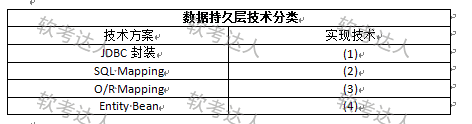

# 在线投票系统-Hibernate与iBatis选型案例

## 原题（网站题号 34～36 合并：试题五，25分）

**试题五（25分）**　阅读以下关于Web系统架构的设计的叙述，回答下列问题。

【说明】某信息技术公司开发在线投票系统（市场调研、信息调查、销售反馈服务），先以宣传+奖品快速积累用户，再按信息服务种类和投票数量收费。为降低成本提高效率，采用轻量级Java EE框架。考虑因素：1.用MySQL但将来可能移植到其他数据库平台；2.尽可能降低或消除SQL语句开发工作量；3.数据关系复杂，需支持数据对象的聚合和继承等关系。项目组基于MVC模式设计投票系统架构（表示层/业务逻辑层/数据持久层/数据层）。数据持久层方案：老王建议成熟的Hibernate框架，小李认为iBatis更灵活。

| 网站题号 | 小问 | 分值 |
|---|---|---|
| 34 | 问题1（8分）：300字以内说明什么是ORM技术及优点 | 8 |
| 35 | 问题2（9分）：应选用哪种技术实现数据持久层？200字以内说明原因 | 9 |
| 36 | 问题3（8分）：根据(a)～(d)所列技术的方案类别在下表（ ）～（4）填入序号 | 8 |

## 图示（原图）

## 来源答案与解析（网站原文）

- 题34：ORM定义+四条优点。（解析：无）
- 题35：选Hibernate+三条理由（对应题干三因素）。（解析：无）
- 题36：（1）(c)（2）(b)（3）(d)（4）(a)。（解析：无）

## 核验答案（考场作答）

### 【问题1】（8分）

**考场答案**（300字内）：ORM全称Object Relational Mapping（对象关系映射），通过使用描述对象和数据之间映射的元数据，将程序中的对象自动持久化到关系数据库中。优点：①提高开发效率，降低开发成本；②使开发更加对象化；③可移植；④可以很方便地引入数据缓存之类的附加功能。

**采分要点**：定义3分＋四条优点各1分＋表述完整1分（推定）。

**详细解析**：定义句的核心是“元数据映射+自动持久化”两个关键词。四条优点与题干三因素有映射关系：可移植↔因素1（换数据库）、效率↔因素2（少写SQL）、对象化↔因素3（聚合继承）——答题时点出这个呼应可为问题2铺垫。

**常见失分表达**：定义漏“元数据”或“自动持久化”；优点写成“不用写SQL”绝对化。

**知识点链接**：[ORM 定义与优点](https://github.com/Goodyzhang/ruankao.skill/blob/main/materials/%E7%B3%BB%E7%BB%9F%E6%9E%B6%E6%9E%84%E8%AE%BE%E8%AE%A1%E5%B8%88/%E7%AC%94%E8%AE%B0/%E7%9F%A5%E8%AF%86%E7%82%B9/06-%E6%95%B0%E6%8D%AE%E5%BA%93%E8%AE%BE%E8%AE%A1%E5%9F%BA%E7%A1%80%E7%9F%A5%E8%AF%86.md)

### 【问题2】（9分）

**考场答案**（200字内）：项目组应选用Hibernate框架。原因：①Hibernate支持多种不同类型数据库，满足项目组数据库移植需求；②Hibernate相对于iBatis减少了SQL语句开发的工作量；③iBatis生成的PO是扁平化的，无法像Hibernate一样支持对象的继承和聚合等立体化关系。

**采分要点**：结论2分＋三条理由各2分＋挂因素1分（推定）；三条理由与题干三因素一一对应。

**详细解析**：选型题的满分结构是“结论+逐条对应题干因素”：MySQL可能移植→Hibernate方言机制多库支持；消除SQL工作量→Hibernate全自动生成SQL（iBatis需手写映射SQL）；聚合继承→iBatis扁平PO不支持立体关系。iBatis的优势（SQL可控、性能调优灵活）在本题需求下不占权重——若答题选iBatis必须逐条反驳三因素，难度大，训练按网站口径答Hibernate。

**常见失分表达**：只写“Hibernate成熟稳定”没有对应因素；漏第③条扁平PO对比。

**知识点链接**：[Hibernate vs iBatis 选型](https://github.com/Goodyzhang/ruankao.skill/blob/main/materials/%E7%B3%BB%E7%BB%9F%E6%9E%B6%E6%9E%84%E8%AE%BE%E8%AE%A1%E5%B8%88/%E7%AC%94%E8%AE%B0/%E7%9F%A5%E8%AF%86%E7%82%B9/06-%E6%95%B0%E6%8D%AE%E5%BA%93%E8%AE%BE%E8%AE%A1%E5%9F%BA%E7%A1%80%E7%9F%A5%E8%AF%86.md)

### 【问题3】（8分）

**考场答案**：（1）JDBC封装→(c)Spring JdbcTemplate；（2）SQL Mapping→(b)iBatis/MyBatis；（3）O/R Mapping→(d)TopLink、JDO、Hibernate；（4）Entity Bean→(a)BMP、CMP。

**采分要点**：四空各2分（推定）。

**详细解析**：持久层四类方案按“自动化程度”排序：JDBC封装（模板消除样板代码，SQL仍手写）→SQL Mapping（SQL写在XML/注解，映射手工配置）→O/R Mapping（全自动对象关系映射）→Entity Bean（EJB容器托管持久化，重量级）。判别技巧：看到JdbcTemplate就是“封装JDBC”、看到XML里的SQL就是SQL Mapping、BMP/CMP是EJB术语直接对号Entity Bean。

**常见失分表达**：(1)与(2)混淆（JdbcTemplate没有映射文件）；(4)误填Hibernate。

**知识点链接**：[持久层技术四分类](https://github.com/Goodyzhang/ruankao.skill/blob/main/materials/%E7%B3%BB%E7%BB%9F%E6%9E%B6%E6%9E%84%E8%AE%BE%E8%AE%A1%E5%B8%88/%E7%AC%94%E8%AE%B0/%E7%9F%A5%E8%AF%86%E7%82%B9/06-%E6%95%B0%E6%8D%AE%E5%BA%93%E8%AE%BE%E8%AE%A1%E5%9F%BA%E7%A1%80%E7%9F%A5%E8%AF%86.md)

## 来源与身份

- 题源：软考达人·第二十二章 案例分析/第一节 案例分析，网站题号34～36（网站分类“第二十二章 案例分析”保留为来源位置，章节路由按实际考点匹配教材章（第2版20章体系）。）
- 年份/卷别未核实，按 web-bank 处理；分值加和 8+9+8=25 与“试题五”口径一致（网站未标总分）。
- 图示：持久层技术分类表原图已下载并实际看图核对空位。
