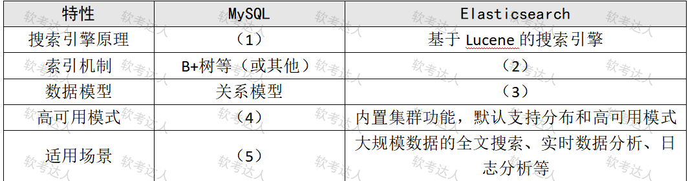

# 在线教育平台-Elasticsearch数据架构案例

## 原题（网站题号 68～70 合并：试题四，25分）

**试题四（25分）**　阅读以下关于某在线教育平台数据架构升级的说明，回答下列问题。

【说明】某在线教育平台数据量快速增长（课程视频、学习记录、互动评论等非结构化数据激增），为提升检索效率、加强安全、实现实时分析与个性化推荐，计划全面升级数据架构。当前依赖MySQL存结构化数据、Elasticsearch做全文搜索，但存在搜索性能瓶颈、数据同步延迟及非结构化数据处理能力不足。团队决定引入Apache HBase（高性能NoSQL，存大规模结构化/半结构化数据）、优化Elasticsearch集群，并结合Apache Kafka实现实时同步与处理。

| 网站题号 | 小问 | 分值 |
|---|---|---|
| 68 | 问题1（10分）：MySQL与Elasticsearch在搜索引擎原理、索引机制、数据模型及适用场景的差异填表 | 10 |
| 69 | 问题2（5分）：ES中文分词原理及自定义分词器实现 | 5 |
| 70 | 问题3（10分）：MySQL到Elasticsearch的数据同步方法有哪些 | 10 |

## 图示（原图，未覆盖）

## 来源答案与解析（网站原文）

- 题68：五空（(1)基于SQL的查询引擎/(2)分词、建立倒排索引/(3)面向文档为主的灵活的数据模型/(4)默认单机模式需额外配置主从等高可用/(5)小规模数据的在线事务处理和查询）。（解析：无）
- 题69：分词原理三步骤+自定义分析器。（解析：无）
- 题70：五种同步方法（binlog/插件/同步双写/异步双写/定时任务），答出方法即可得分。（解析：无）

## 核验答案（考场作答）

### 【问题1】（10分）

**考场答案**：搜索引擎原理——MySQL基于SQL的查询引擎 vs ES基于Lucene的搜索引擎；索引机制——MySQL B+树等 vs ES分词、建立倒排索引；数据模型——MySQL关系模型 vs ES面向文档为主的灵活的数据模型；高可用模式——MySQL默认单机模式、需额外配置主从等高可用 vs ES内置集群功能、默认支持分布和高可用；适用场景——MySQL小规模数据的在线事务处理和查询 vs ES大规模数据的全文搜索、实时数据分析、日志分析等。

**采分要点**：五空各2分（推定）。

**详细解析**：核心机制对比是“B+树（行存点查）vs 倒排索引（词→文档列表）”——全文搜索里倒排把“词找文档”变成O(1)级查找，这正是ES比MySQL LIKE快的根源。数据模型差异对应Schemaless文档JSON。

**常见失分表达**：(2)漏“倒排索引”关键词；(4)写反列（内置集群是ES侧已给内容）。

**知识点链接**：[搜索引擎与NoSQL](https://github.com/Goodyzhang/ruankao.skill/blob/main/materials/%E7%B3%BB%E7%BB%9F%E6%9E%B6%E6%9E%84%E8%AE%BE%E8%AE%A1%E5%B8%88/%E7%AC%94%E8%AE%B0/%E7%9F%A5%E8%AF%86%E7%82%B9/06-%E6%95%B0%E6%8D%AE%E5%BA%93%E8%AE%BE%E8%AE%A1%E5%9F%BA%E7%A1%80%E7%9F%A5%E8%AF%86.md)

### 【问题2】（5分）

**考场答案**：①分词原理：将输入文本字符串切分成独立的词汇单元（Token），以便索引和查询时有效匹配；分词过程包括字符过滤（去除标点、停用词等）、词汇切分和词汇归一化（如转小写）等步骤。②自定义分词器：通过ES插件机制或配置自定义分析器实现，自定义分析器可包含自定义字符过滤器、分词器和词汇过滤器；针对在线教育领域专业术语可创建自定义词汇表并在分词时优先匹配以保证准确性；还可按业务调整分词策略（基于统计或基于规则的分词方法）。

**采分要点**：原理2分＋自定义实现3分（推定）。

**详细解析**：Analyzer三件套=Character Filter→Tokenizer→Token Filter，与答案“字符过滤/词汇切分/词汇归一化”一一对应。中文分词器（IK等）靠词典+规则；业务定制落点就是“自定义词典+更新策略”。

**常见失分表达**：三步骤缺“归一化”；自定义只写“装插件”没有词典与优先匹配。

**知识点链接**：[Elasticsearch 分词](https://github.com/Goodyzhang/ruankao.skill/blob/main/materials/%E7%B3%BB%E7%BB%9F%E6%9E%B6%E6%9E%84%E8%AE%BE%E8%AE%A1%E5%B8%88/%E7%AC%94%E8%AE%B0/%E7%9F%A5%E8%AF%86%E7%82%B9/06-%E6%95%B0%E6%8D%AE%E5%BA%93%E8%AE%BE%E8%AE%A1%E5%9F%BA%E7%A1%80%E7%9F%A5%E8%AF%86.md)

### 【问题3】（10分）

**考场答案**：五种同步方法：①基于binlog的数据同步——灵活性高、可精确控制同步数据，常用工具Logstash、Canal；②基于MySQL的插件同步——插件直接在MySQL捕获数据变更并同步ES，如go-mysql-elasticsearch；③同步双写——MySQL修改时同时写入ES；④异步双写——修改先写入MQ等消息中间件，再从MQ写入ES；⑤定时任务同步——Cron Job结合SQL查询与批量导入定期同步。

**采分要点**：五种各2分（推定）；答出方法名即可，网站注明不需解释。

**详细解析**：五种方法按“实时性×侵入性”排布：binlog（实时、对业务零侵入）→插件（实时、侵入数据库）→同步双写（实时、侵入业务代码、有一致性风险）→异步双写（经MQ解耦、最终一致）→定时任务（非实时、最简单）。答出名称即得分，但训练时把每种的风险（双写不一致、MQ延迟）讲清更稳。

**常见失分表达**：漏“异步双写”或与“同步双写”混写；把Canal记成数据库。

**知识点链接**：[数据同步与中间件](https://github.com/Goodyzhang/ruankao.skill/blob/main/materials/%E7%B3%BB%E7%BB%9F%E6%9E%B6%E6%9E%84%E8%AE%BE%E8%AE%A1%E5%B8%88/%E7%AC%94%E8%AE%B0/%E7%9F%A5%E8%AF%86%E7%82%B9/06-%E6%95%B0%E6%8D%AE%E5%BA%93%E8%AE%BE%E8%AE%A1%E5%9F%BA%E7%A1%80%E7%9F%A5%E8%AF%86.md)

## 来源与身份

- 题源：软考达人·第二十二章 案例分析/第一节 案例分析，网站题号68～70（网站分类“第二十二章 案例分析”保留为来源位置，章节路由按实际考点匹配教材章（第2版20章体系）。）
- 年份/卷别未核实，按 web-bank 处理；分值加和 10+5+10=25 与“试题四（25分）”一致。
- 图示：MySQL vs ES 对比表原图已下载并实际看图核对五空行列（行名=搜索引擎原理/索引机制/数据模型/高可用模式/适用场景）。
