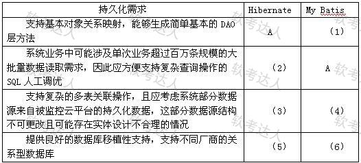

# 房企云管系统-WebX与持久层选型及水平分割案例

## 原题（网站题号 74：Web应用叙述，单条含完整三问，25分）

**试题（25分）**　阅读以下关于Web应用的叙述，在答题纸上回答问题1至问题3。

【说明】某房企转移业务重心，从售卖为主转为互联网租房业务，拟开发一套基于Web的云管业务系统，按租户视图、系统管理视图、业务视图划分为多个Web应用，需求含文件处理、安全防护等扩展功能。

| 小问 | 分值 |
|---|---|
| 问题1：300字以内从多应用支持、基础服务支持、可扩展性三方面对比WebX与Spring MVC | 5 |
| 问题2：Hibernate与MyBatis对表4-1所列6项需求的支持情况，填A（支持）/B（不支持或支持差） | 12 |
| 问题3：订单表按月拆分采用哪种反规范化方法？300字以内解释说明并指出优缺点 | 8 |

## 图示（原图，未覆盖）

## 来源答案与解析（网站原文）

- 问题1：基础服务支持/多应用支持/可扩展性三段。
- 问题2：（1）A（2）B（3）B（4）A（5）A（6）B。
- 问题3：水平分割（分割参数“月”）+水平/垂直分割定义+优缺点。（解析：无）

## 核验答案（考场作答）

### 【问题1】（5分）

**考场答案**（300字内）：①基础服务支持：WebX在阿里巴巴和淘宝使用多年，经受超大访问量电商网站考验，被证明成熟可靠；②多应用支持：WebX与Spring MVC一样完全建立在Spring框架之上，可使用Spring所有特性，且WebX被设计成多个层次，层次间分界线清晰，每个层次足够开放和易于扩展（天然契合本系统多视图多Web应用的划分）；③可扩展性：WebX对Spring做了扩展，一个组件可以扩展另一个组件，也可以被其他组件扩展，这种机制使WebX具有较好的扩展性，且比未经扩展的Spring更易使用。

**采分要点**：三方面各约2分、1分、2分（推定）。

**详细解析**：框架对比题要“维度+证据”：基础服务（大厂生产环境背书）、多应用（层次化设计契合题干三视图多应用需求——注意把框架特性挂钩题干场景）、扩展性（组件互扩机制）。Spring MVC轻量但多应用支持弱，这是选型落点。

**常见失分表达**：三方面混写；不挂钩题干“多Web应用”场景。

**知识点链接**：[表现层框架设计](https://github.com/Goodyzhang/ruankao.skill/blob/main/materials/%E7%B3%BB%E7%BB%9F%E6%9E%B6%E6%9E%84%E8%AE%BE%E8%AE%A1%E5%B8%88/%E7%AC%94%E8%AE%B0/%E7%9F%A5%E8%AF%86%E7%82%B9/13-%E5%B1%82%E6%AC%A1%E5%BC%8F%E6%9E%B6%E6%9E%84%E8%AE%BE%E8%AE%A1%E7%90%86%E8%AE%BA%E4%B8%8E%E5%AE%9E%E8%B7%B5.md)

### 【问题2】（12分）

**考场答案**：（1）A；（2）B；（3）B；（4）A；（5）A；（6）B。

**采分要点**：六空各2分（推定）。

**详细解析**：需求→方案映射：①基本ORM/DAO生成——两者皆支持（Hibernate自动、MyBatis工具生成）；②百万级大批量读取+SQL人工调优——MyBatis手写SQL占优（Hibernate B）；③复杂多表关联+外部不可更改数据源+实体设计不合理——MyBatis可灵活映射（Hibernate B）；④同上句的后半段（MyBatis A）；⑤⑥数据库移植性——Hibernate跨方言强（A），MyBatis方言相关（B）。判分口径来自网站答案，训练时按此背诵映射关系。

**常见失分表达**：②③误判Hibernate A（被“自动ORM”迷惑，忽视调优与既有表结构约束）；⑤⑥记反。

**知识点链接**：[Hibernate vs MyBatis](https://github.com/Goodyzhang/ruankao.skill/blob/main/materials/%E7%B3%BB%E7%BB%9F%E6%9E%B6%E6%9E%84%E8%AE%BE%E8%AE%A1%E5%B8%88/%E7%AC%94%E8%AE%B0/%E7%9F%A5%E8%AF%86%E7%82%B9/06-%E6%95%B0%E6%8D%AE%E5%BA%93%E8%AE%BE%E8%AE%A1%E5%9F%BA%E7%A1%80%E7%9F%A5%E8%AF%86.md)

### 【问题3】（8分）

**考场答案**（300字内）：王工采用的是**表分割**方式中的**水平分割**（分割参数为“月”）。表分割包括水平分割与垂直分割两种形式：水平分割按记录进行分割，不同的记录分开保存，每个子表的列数相同，分割条件可以是某列或多列数据的值（如时间参数）；垂直分割按列进行分割，把一条记录分开多个地方保存，每个子表的行数相同，把主键和部分列放一个表、主键和其余列放另一个表，通过主键关联。水平分割的优点：降低查询时需要读取的数据量和索引页数，同时降低索引层数，提高查询速度；缺点：给应用增加复杂度，查询时需要多个表名，查询所有数据需要union操作。

**采分要点**：方法判定4分＋两种分割定义2分＋优缺点2分（推定）。

**详细解析**：“按月存储”直接锁定水平分割（按记录/时间切分）；垂直分割是按列拆。反规范化四板斧（增加冗余列/增加派生列/重新组表/表分割）中表分割又分水平垂直——审题关键词“按月”决定答案。缺点里的union是高频考点词。

**常见失分表达**：答成垂直分割；缺点漏“union操作”；定义把水平垂直说反。

**知识点链接**：[规范化与反规范化](https://github.com/Goodyzhang/ruankao.skill/blob/main/materials/%E7%B3%BB%E7%BB%9F%E6%9E%B6%E6%9E%84%E8%AE%BE%E8%AE%A1%E5%B8%88/%E7%AC%94%E8%AE%B0/%E7%9F%A5%E8%AF%86%E7%82%B9/06-%E6%95%B0%E6%8D%AE%E5%BA%93%E8%AE%BE%E8%AE%A1%E5%9F%BA%E7%A1%80%E7%9F%A5%E8%AF%86.md)

## 来源与身份

- 题源：软考达人·第二十二章 案例分析/第一节 案例分析，网站题号74（网站分类“第二十二章 案例分析”保留为来源位置，章节路由按实际考点匹配教材章（第2版20章体系）。）
- 年份/卷别未核实，按 web-bank 处理；本站条目为单条完整案例（三问同页），分值加和 5+12+8=25。
- 图示：表4-1原图已下载并实际看图核对六空行列（行1基本ORM/行2大批量SQL调优/行3-4复杂关联与外部数据源/行5-6移植性）。
