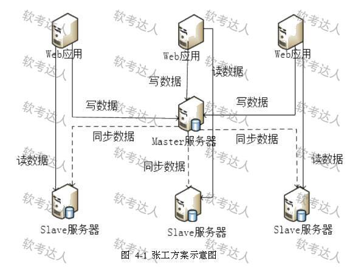

# 新闻社交软件-MySQL主从复制与混合存储案例

## 原题（网站题号 118～120 合并：试题四（20分，选做题二选一））

**试题四（20分，选做题二选一）**　阅读以下关于MySQL数据库扩展的叙述，回答问题1至问题3。

【说明】某软件企业开发新闻社交类软件（新闻发布、用户关注、用户推荐、新闻点评、新闻推荐、热点新闻），采用MySQL存储业务数据。上线后用户量增加、数据库压力增大。张工提出读写分离+主从复制扩展（程序改动小、见效快、后续可扩展到MySQL集群，图4-1）；李工认为部分功能不需要关系数据库甚至受限，应采用NoSQL替代重构数据层；刘工认为张工方案对关注列表、推荐列表、热搜榜单等实现困难且性能提升不大，李工方案太激进工作量大，应采用Key-Value数据库+MySQL混合方案。企业最终采用刘工方案。

| 网站题号 | 小问 | 分值 |
|---|---|---|
| 118 | 问题1（6分）：主从复制给系统带来的好处 | 6 |
| 119 | 问题2（6分）：MySQL通过binary log实现主从同步，简述主从复制过程 | 6 |
| 120 | 问题3（8分）：同步、异步、半同步复制各自特点 | 8 |

## 图示（原图，未覆盖）

## 来源答案与解析（网站原文）

- 题118：①避免单点故障（主库宕机可提升从库为主）；②提高查询效率（主库写、从库读分担）。（解析：无）
- 题119：I/O线程→Binlog Dump线程→Relay Log→SQL线程四步链路。（解析：无）
- 题120：同步（保一致弃可用）/异步（保可用弃一致）/半同步（等待部分备库同步后响应）。（解析：无）

## 核验答案（考场作答）

### 【问题1】（6分）

**考场答案**：①避免数据库单点故障——主服务器实时、异步复制数据到从服务器，主库宕机时可从从库中选一个升级为主服务器；②提高查询效率——主库负责插入、删除、更新等写操作，从库专门负责查询，将查询分担到不同从服务器，提高数据库访问效率。

**采分要点**：两条各3分（推定）。

**详细解析**：与题93（Redis主从）、题67（MySQL主从优缺点）互为印证：好处=高可用+读写分离分担负载。注意本题语境是“程序改动小、见效快”的保守方案优点。

**常见失分表达**：漏“避免单点故障”只写读写分离。

**知识点链接**：[数据库扩展](https://github.com/Goodyzhang/ruankao.skill/blob/main/materials/%E7%B3%BB%E7%BB%9F%E6%9E%B6%E6%9E%84%E8%AE%BE%E8%AE%A1%E5%B8%88/%E7%AC%94%E8%AE%B0/%E7%9F%A5%E8%AF%86%E7%82%B9/06-%E6%95%B0%E6%8D%AE%E5%BA%93%E8%AE%BE%E8%AE%A1%E5%9F%BA%E7%A1%80%E7%9F%A5%E8%AF%86.md)

### 【问题2】（6分）

**考场答案**：从库启动复制时，首先创建I/O线程连接主库；主库随后创建Binlog Dump线程读取数据库事件并发送给I/O线程；I/O线程获取事件数据后写入从库的中继日志（Relay Log）；之后从库上的SQL线程读取中继日志中更新的数据库事件并应用。

**采分要点**：四步链路各1.5分（推定）：I/O线程→Binlog Dump→Relay Log→SQL线程。

**详细解析**：MySQL复制三线程两日志：主库Binlog Dump线程+从库I/O线程与SQL线程，binlog与Relay Log。与题93（Redis RDB+复制流）对照记忆——机制不同、目标相同。

**常见失分表达**：漏Relay Log中转环节；线程名写错。

**知识点链接**：[数据同步机制](https://github.com/Goodyzhang/ruankao.skill/blob/main/materials/%E7%B3%BB%E7%BB%9F%E6%9E%B6%E6%9E%84%E8%AE%BE%E8%AE%A1%E5%B8%88/%E7%AC%94%E8%AE%B0/%E7%9F%A5%E8%AF%86%E7%82%B9/06-%E6%95%B0%E6%8D%AE%E5%BA%93%E8%AE%BE%E8%AE%A1%E5%9F%BA%E7%A1%80%E7%9F%A5%E8%AF%86.md)

### 【问题3】（8分）

**考场答案**：①同步复制——主数据库需等待所有备数据库均操作成功才响应用户，影响用户体验；保证系统一致性，牺牲数据可用性。②异步复制——主数据库处理完请求直接响应用户，不必等待备库完成同步，备库异步同步，更新操作不因备库未同步而阻塞；保证可用性，牺牲一致性。③半同步复制——用户发出写请求后主库执行写操作并向备库发送同步请求，主库不必等待所有备库回复同步成功，等待一部分备库同步完成后即响应用户写操作成功；是同步与异步的折中。

**采分要点**：三种各约2.7分（推定）：机制+一致/可用取舍。

**详细解析**：三种复制是CAP在主从复制上的体现：同步=强一致、异步=高可用、半同步=折中（至少N个备库确认）。与题59/65的“弱一致性（最终一致性）”口径呼应。

**常见失分表达**：半同步写成“等待所有备库”（那是同步）；漏“一致性/可用性”取舍半句。

**知识点链接**：[复制与一致性](https://github.com/Goodyzhang/ruankao.skill/blob/main/materials/%E7%B3%BB%E7%BB%9F%E6%9E%B6%E6%9E%84%E8%AE%BE%E8%AE%A1%E5%B8%88/%E7%AC%94%E8%AE%B0/%E7%9F%A5%E8%AF%86%E7%82%B9/06-%E6%95%B0%E6%8D%AE%E5%BA%93%E8%AE%BE%E8%AE%A1%E5%9F%BA%E7%A1%80%E7%9F%A5%E8%AF%86.md)

## 来源与身份

- 题源：软考达人·第二十二章 案例分析/第一节 案例分析，网站题号118～120（网站分类“第二十二章 案例分析”保留为来源位置，章节路由按实际考点匹配教材章（第2版20章体系）。）
- 年份/卷别未核实，按 web-bank 处理；**本题为选做题（二选一），卷面分20分**：6+6+8=20 与“试题四（20分）”一致。
- 图示：图4-1复制架构原图已下载（与三问共用）。
