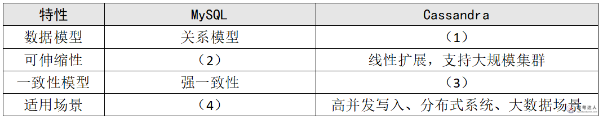

# 电商平台-Cassandra与HDFS数据架构案例

## 原题（网站题号 59～61 合并：试题四，25分）

**试题四（25分）**　阅读以下关于某电商平台数据架构的说明，回答下列问题。

【说明】某电商平台计划升级数据存储系统，支持日益增长的商品数据、用户信息及交易记录；目标是提高查询效率、增强安全性、实现灵活扩展。当前主要使用MySQL存储结构化数据，但面临查询性能瓶颈、备份恢复复杂度高、难以高效处理大规模非结构化数据（商品图片、用户评价等）的问题。团队决定引入NoSQL数据库（如Cassandra）和分布式文件系统（如HDFS）：Cassandra因高可用性、线性扩展性和低延迟读写性能负责高并发用户数据和商品信息，HDFS负责大规模非结构化数据。

| 网站题号 | 小问 | 分值 |
|---|---|---|
| 59 | 问题1（8分）：MySQL与Cassandra在数据模型、可扩展性、一致性模型及适用场景的差异填表 | 8 |
| 60 | 问题2（6分）：HDFS在数据可靠性、伸缩性和性能方面的优势及实现方式 | 6 |
| 61 | 问题3（11分）：为何选择Kafka作为实时数据流处理中间件 | 11 |

## 图示（原图，未覆盖）

## 来源答案与解析（网站原文）

- 题59：（1）列式存储，灵活可扩展的数据模型；（2）垂直和有限水平扩展；（3）弱一致性（或者最终一致性）；（4）复杂查询、事务处理。（解析：无）
- 题60：可靠性（三副本+自动容错）/伸缩性（线性扩展PB级）/性能（数据本地化、并行读写）三条。（解析：无）
- 题61：八条理由（兼容性/可伸缩性/容错性/高吞吐量/低延迟/发布-订阅/持久化/生态系统支持），答出6个即满分。（解析：无）

## 核验答案（考场作答）

### 【问题1】（8分）

**考场答案**：数据模型——MySQL关系模型 vs Cassandra列式存储、灵活可扩展的数据模型；可伸缩性——MySQL垂直和有限水平扩展 vs Cassandra线性扩展、支持大规模集群；一致性模型——MySQL强一致性 vs Cassandra弱一致性（最终一致性）；适用场景——MySQL复杂查询、事务处理 vs Cassandra高并发写入、分布式系统、大数据场景。

**采分要点**：四空各2分（推定）。

**详细解析**：对比表题用“行列定坐标”。Cassandra的锚点词：列族、环形一致哈希、可调节一致性（QUORUM等）、无单点；MySQL锚点：JOIN与事务、主从半同步。一弱一强的一致性取舍正是CAP在两类库上的体现。

**常见失分表达**：(1)写成“键值存储”（Cassandra是列族）；(4)漏“事务处理”关键词。

**知识点链接**：[RDBMS vs NoSQL 选型](https://github.com/Goodyzhang/ruankao.skill/blob/main/materials/%E7%B3%BB%E7%BB%9F%E6%9E%B6%E6%9E%84%E8%AE%BE%E8%AE%A1%E5%B8%88/%E7%AC%94%E8%AE%B0/%E7%9F%A5%E8%AF%86%E7%82%B9/06-%E6%95%B0%E6%8D%AE%E5%BA%93%E8%AE%BE%E8%AE%A1%E5%9F%BA%E7%A1%80%E7%9F%A5%E8%AF%86.md)

### 【问题2】（6分）

**考场答案**：①数据可靠性：HDFS通过数据冗余存储（默认三副本）和自动容错机制（数据块复制、心跳检测、数据块扫描）确保高可靠；②伸缩性：添加节点即可线性扩展存储容量，支持PB级数据；③性能：通过数据本地化、优化读写路径、利用硬件特性（磁盘并行读写）提高传输与处理效率。

**采分要点**：三方面各2分（推定）：优势半句+实现半句。

**详细解析**：题面要求“说明优势并说明如何实现”，每条都要“结论+机制”两段：副本机制→可靠（NameNode/DataNode、心跳与块扫描）；横向加节点→伸缩；本地化读（移动计算不移动数据）→性能。

**常见失分表达**：只写优势不写实现机制；漏“三副本”数字。

**知识点链接**：[大数据处理系统架构特征](https://github.com/Goodyzhang/ruankao.skill/blob/main/materials/%E7%B3%BB%E7%BB%9F%E6%9E%B6%E6%9E%84%E8%AE%BE%E8%AE%A1%E5%B8%88/%E7%AC%94%E8%AE%B0/%E7%9F%A5%E8%AF%86%E7%82%B9/19-%E5%A4%A7%E6%95%B0%E6%8D%AE%E6%9E%B6%E6%9E%84%E8%AE%BE%E8%AE%A1%E7%90%86%E8%AE%BA%E4%B8%8E%E5%AE%9E%E8%B7%B5.md)

### 【问题3】（11分）

**考场答案**（答出6条即满分）：①兼容性——Kafka能收集和处理来自Cassandra的实时数据流；②可伸缩性——分布式架构支持加节点线性伸缩，适应数据量增长；③容错性——数据复制和分区机制提供强容错；④高吞吐量——支持高吞吐数据处理，可削峰填谷；⑤低延迟——满足电商实时数据处理需求；⑥发布-订阅模式——实时分析引擎、数据仓库等不同消费者独立消费互不影响；⑦持久化——可按需调整数据保留策略和副本因子；⑧生态系统支持——丰富API，无缝集成现有数据处理与分析框架。

**采分要点**：八选六，每条约1.8分＋条数与场景口径（推定）。

**详细解析**：中间件选型题的答题骨架是“数据特征→中间件能力→业务收益”。Kafka的本命三条：分区副本（容错）、顺序追加日志（吞吐+持久化）、发布订阅（多消费者解耦）。与题22（金融消息队列）联动：优势清单高度重合，可对照记忆。

**常见失分表达**：答不足6条；只写“Kafka很快”没有机制词（分区/副本/发布订阅）。

**知识点链接**：[MOM（Kafka）](https://github.com/Goodyzhang/ruankao.skill/blob/main/materials/%E7%B3%BB%E7%BB%9F%E6%9E%B6%E6%9E%84%E8%AE%BE%E8%AE%A1%E5%B8%88/%E7%AC%94%E8%AE%B0/%E7%9F%A5%E8%AF%86%E7%82%B9/06-%E6%95%B0%E6%8D%AE%E5%BA%93%E8%AE%BE%E8%AE%A1%E5%9F%BA%E7%A1%80%E7%9F%A5%E8%AF%86.md)

## 来源与身份

- 题源：软考达人·第二十二章 案例分析/第一节 案例分析，网站题号59～61（网站分类“第二十二章 案例分析”保留为来源位置，章节路由按实际考点匹配教材章（第2版20章体系）。）
- 年份/卷别未核实，按 web-bank 处理；分值加和 8+6+11=25 与“试题四（25分）”一致。
- 图示：MySQL vs Cassandra 对比表原图已下载并实际看图核对四空行列。
