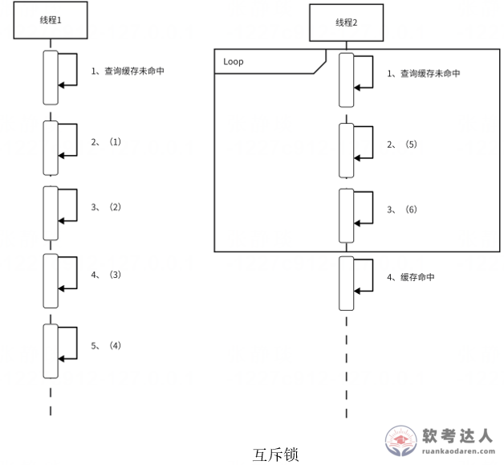
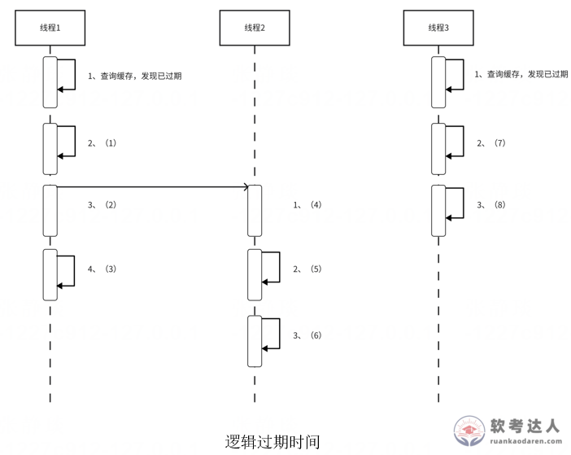

# 电商缓存击穿案例

## 原题（网站题号 178～179：电商缓存击穿）

**试题**　阅读以下关于系统设计的叙述，回答问题。
【说明】
某电商平台为提升系统性能，采用MySQL作为主数据库，同时引入Redis作为缓存存储热点数据。系统主要支持商品信息查询、库存管理及订单存储等业务：商品详情页访问频繁，需快速响应；库存数据需实时准确，支持高并发修改；订单数据需长期保存，查询频率较低。
设计中，Redis主要存储热门商品基本信息（如名称、价格）和实时库存数量、热销商品排名；MySQL存储完整商品数据、库存明细、订单全量信息及用户数据。

| 网站题号 | 小问 | 分值 |
|---|---|---|
| 178 | 问题1（6分） | 6 |
| 179 | 问题2（8分） | 8 |

## 来源答案与解析（网站原文）
## 图示（原图，未覆盖）

- 题178：(1)获取互斥锁成功 (2)查询数据库 (3)更新缓存 (4)释放锁 (5)获取互斥锁失败 (6)休眠一会重试。解析：缓存击穿=热点Key失效瞬间大并发穿透直击数据库；互斥锁只有首线程访问数据库。
- 题179：(1)获取分布式锁成功 (2)开启新线程 (3)返回旧数据 (4)查询数据库 (5)更新缓存 (6)释放锁 (7)获取分布式锁失败 (8)返回旧数据。解析：逻辑过期不删除缓存，异步加载新数据，期间返回旧数据，存在短暂不一致。（解析均含）

## 核验答案（考场作答）
### 【问题1】（6分）

**考场答案**：(1)获取互斥锁成功；(2)查询数据库；(3)更新缓存；(4)释放锁；(5)获取互斥锁失败；(6)休眠一会，重试。

**采分要点**：六空各1分（推定）。

**详细解析**：缓存击穿=热点Key失效瞬间大并发直击数据库。互斥锁方案：首线程拿锁查库更新缓存，其余线程休眠重试——保证只有一个请求打到数据库。与题94（雪崩）、题161（穿透）构成缓存三大问题家族。

**常见失分表达**：(5)(6)写成“直接查库”（那是击穿本身）。

**知识点链接**：[缓存击穿（互斥锁）](https://github.com/Goodyzhang/ruankao.skill/blob/main/materials/%E7%B3%BB%E7%BB%9F%E6%9E%B6%E6%9E%84%E8%AE%BE%E8%AE%A1%E5%B8%88/%E7%AC%94%E8%AE%B0/%E7%9F%A5%E8%AF%86%E7%82%B9/06-%E6%95%B0%E6%8D%AE%E5%BA%93%E8%AE%BE%E8%AE%A1%E5%9F%BA%E7%A1%80%E7%9F%A5%E8%AF%86.md)

### 【问题2】（8分）

**考场答案**：(1)获取分布式锁成功；(2)开启新线程；(3)返回旧数据；(4)查询数据库；(5)更新缓存；(6)释放锁；(7)获取分布式锁失败；(8)返回旧数据。

**采分要点**：八空各1分（推定）。

**详细解析**：逻辑过期方案：不删除缓存，额外存储逻辑过期时间；过期后拿到分布式锁的线程开新线程异步查库更新，所有请求期间一律返回旧数据——可用性优先，代价是短暂不一致。与互斥锁方案对比：互斥锁保一致性但阻塞，逻辑过期保可用但短暂脏读。

**常见失分表达**：锁失败分支写成“休眠重试”（逻辑过期是直接返回旧数据）。

**知识点链接**：[缓存击穿（逻辑过期）](https://github.com/Goodyzhang/ruankao.skill/blob/main/materials/%E7%B3%BB%E7%BB%9F%E6%9E%B6%E6%9E%84%E8%AE%BE%E8%AE%A1%E5%B8%88/%E7%AC%94%E8%AE%B0/%E7%9F%A5%E8%AF%86%E7%82%B9/06-%E6%95%B0%E6%8D%AE%E5%BA%93%E8%AE%BE%E8%AE%A1%E5%9F%BA%E7%A1%80%E7%9F%A5%E8%AF%86.md)

## 来源与身份（待核验记录说明）

- 题源：软考达人·第二十二章 案例分析/第一节 案例分析，网站题号178～179（网站分类“第二十二章 案例分析”保留为来源位置，章节路由按实际考点匹配教材章（第2版20章体系）。）
- 年份/卷别未核实，按 web-bank 处理。已捕获部分分值 6+8=14；题面“试题三”总分待问题3补齐后核对。
