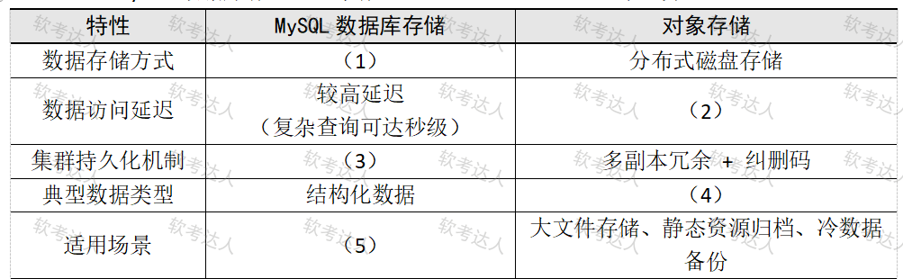

# 社交媒体存储升级-OSS与Redis集群案例

## 原题（网站题号 92～94 合并：试题四，25分）

**试题四（25分）**　阅读以下关于某社交媒体平台存储架构升级的说明，并回答问题。

【说明】某社交媒体平台当前使用MySQL集群作为主数据库（用户信息、社交关系链、动态帖子等结构化数据），面临高并发查询性能瓶颈；海量图片、短视频和文件的本地存储难以支撑业务扩展。团队计划引入对象存储服务（如阿里云OSS）并部署Redis集群优化存储架构。

| 网站题号 | 小问 | 分值 |
|---|---|---|
| 92 | 问题1（10分）：MySQL与对象存储技术差异填表 | 10 |
| 93 | 问题2（10分）：Redis主从复制读写分离的原理、过程与可用性保障 | 10 |
| 94 | 问题3（5分）：缓存雪崩原因与两种以上解决方案 | 5 |

## 图示（原图，未覆盖）

## 来源答案与解析（网站原文）

- 题92：（1）基于磁盘的表结构存储；（2）低延迟（毫秒级）；（3）基于binlog的主从复制；（4）非结构化数据；（5）复杂查询、事务处理、高频读写场景。（解析：无）
- 题93：原理（3分）+过程（全量2分/增量2分）+可用性（3分），网站按分值给答。
- 题94：雪崩原因1分+方案答两个4分（过期随机化/永不过期/分布式锁/多级缓存）。

## 核验答案（考场作答）

### 【问题1】（10分）

**考场答案**：数据存储方式——MySQL基于磁盘的表结构存储 vs 对象存储分布式磁盘存储；数据访问延迟——MySQL较高延迟（复杂查询可达秒级）vs 对象存储低延迟（毫秒级）；集群持久化机制——MySQL基于binlog的主从复制 vs 对象存储多副本冗余+纠删码；典型数据类型——MySQL结构化数据 vs 对象存储非结构化数据；适用场景——MySQL复杂查询、事务处理、高频读写场景 vs 对象存储大文件存储、静态资源归档、冷数据备份。

**采分要点**：五空各2分（推定）。

**详细解析**：对象存储（OSS/S3风格）的画像：扁平命名空间+HTTP访问+多副本/纠删码，为海量大文件而生；MySQL强在事务与JOIN。与题59（Cassandra）、题65（Neo4j）、题71（数据湖）构成“按数据形态选存储”家族题。

**常见失分表达**：(3)漏“binlog”；(4)写成“图片视频”（答抽象类型“非结构化数据”更准）。

**知识点链接**：[存储选型](https://github.com/Goodyzhang/ruankao.skill/blob/main/materials/%E7%B3%BB%E7%BB%9F%E6%9E%B6%E6%9E%84%E8%AE%BE%E8%AE%A1%E5%B8%88/%E7%AC%94%E8%AE%B0/%E7%9F%A5%E8%AF%86%E7%82%B9/06-%E6%95%B0%E6%8D%AE%E5%BA%93%E8%AE%BE%E8%AE%A1%E5%9F%BA%E7%A1%80%E7%9F%A5%E8%AF%86.md)

### 【问题2】（10分）

**考场答案**：原理（3分）：Redis主从复制通过主节点（Master）向从节点（Slave）同步数据，主节点处理写操作，从节点同步数据并分担读请求，实现读写分离和高可用。过程：①全量同步（2分）——从节点主动向主节点发出SYNC指令，主节点生成RDB快照并发送，从节点收到后写入RDB文件再加载；②增量同步（2分）——全量复制完成后主从保持TCP长连接，主节点将后续写命令实时写入复制流，从节点异步执行，保持数据最终一致。可用性保障（3分）：主节点故障时需手工选择准备升主的从节点，将其他从节点的复制目标指向新主节点，并配置客户端将写操作指向新主节点。

**采分要点**：原理3＋全量2＋增量2＋可用性3（网站给分明示）。

**详细解析**：复制三阶段记忆“SYNC→RDB→复制流”；可用性口径注意——普通主从需**手工**切换（哨兵/Cluster才自动），与题67主从缺点“需人工干预”一致，两题互相印证。

**常见失分表达**：漏“RDB快照”或“复制流”机制词；可用性答成哨兵自动切换（超出本题口径）。

**知识点链接**：[Redis 主从复制](https://github.com/Goodyzhang/ruankao.skill/blob/main/materials/%E7%B3%BB%E7%BB%9F%E6%9E%B6%E6%9E%84%E8%AE%BE%E8%AE%A1%E5%B8%88/%E7%AC%94%E8%AE%B0/%E7%9F%A5%E8%AF%86%E7%82%B9/06-%E6%95%B0%E6%8D%AE%E5%BA%93%E8%AE%BE%E8%AE%A1%E5%9F%BA%E7%A1%80%E7%9F%A5%E8%AF%86.md)

### 【问题3】（5分）

**考场答案**：雪崩原因（1分）：缓存节点宕机或大量缓存数据集中过期，导致数据库请求激增。解决方案（4分，答出两个即可）：①缓存过期时间随机化——在原过期时间基础上加随机范围，使过期时间分散避免同时失效的流量峰值；②缓存永不过期——热点数据设为永不过期，由后台程序定期更新；③分布式锁——互斥锁机制，缓存失效瞬间仅一个线程查询数据库并更新缓存，其余线程等待锁释放后读缓存；④多级缓存策略——在本地缓存（如Caffeine）和分布式缓存（Redis）之间再加一层缓存，减少对分布式缓存和数据库的直接访问。

**采分要点**：原因1分＋两方案4分（推定）。

**详细解析**：雪崩 vs 穿透 vs 击穿三兄弟：雪崩=大面积同时失效（本题），穿透=查不存在的key，击穿=单个热点key失效。方案记忆：随机化打散时间、永不过期+后台更新、锁串行化重建、多级缓存分摊。

**常见失分表达**：原因只写“Redis挂了”没有“集中过期”半句；方案与穿透混淆。

**知识点链接**：[缓存雪崩](https://github.com/Goodyzhang/ruankao.skill/blob/main/materials/%E7%B3%BB%E7%BB%9F%E6%9E%B6%E6%9E%84%E8%AE%BE%E8%AE%A1%E5%B8%88/%E7%AC%94%E8%AE%B0/%E7%9F%A5%E8%AF%86%E7%82%B9/06-%E6%95%B0%E6%8D%AE%E5%BA%93%E8%AE%BE%E8%AE%A1%E5%9F%BA%E7%A1%80%E7%9F%A5%E8%AF%86.md)

## 来源与身份

- 题源：软考达人·第二十二章 案例分析/第一节 案例分析，网站题号92～94（网站分类“第二十二章 案例分析”保留为来源位置，章节路由按实际考点匹配教材章（第2版20章体系）。）
- 年份/卷别未核实，按 web-bank 处理；分值加和 10+10+5=25 与“试题四（25分）”一致。
- 图示：MySQL vs OSS 对比表原图已下载并实际看图核对五空行列。
