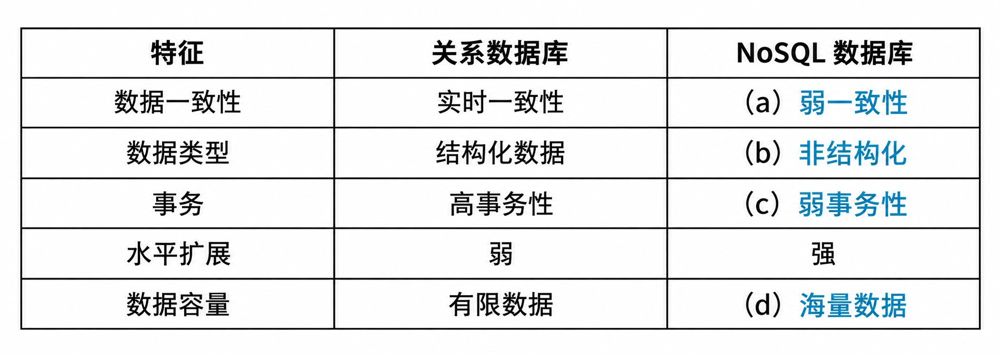

# 社交网络数据库架构迁移：关系数据库 vs NoSQL 选型（题库题目 9–15，试题四）

## 题干（原题抄写）

> 试题四：请详细阅读有关数据架构方面的描述，回答问题。
>
> 【说明】某软件公司欲开发一个基于 Web 2.0 的大型社交网络系统。李工决定使用通用商用关系型数据库，系统内部数据采用集中方式存储。初期用户较少，系统运行平稳；6 个月后用户爆炸式增长，出现读写响应变慢、数据格式变化后维护困难、数据容量超过原设计上限且扩容困难、系统频繁宕机且可用性较差等问题。王工建议用 NoSQL 替代关系数据库；李工担心 NoSQL 使用风险。技术人员认真测试产品后，最终决定采用 NoSQL。

## 小问结构（题目 9–15 增量合并）

- **题目 9、12**：完成关系数据库与 NoSQL 特征比较表中 (a)～(d) 的空白（维度：数据一致性、数据类型、事务、水平扩展、数据容量）。
- **题目 10、13**：介绍 NoSQL 数据库的分类及各自特点。
- **题目 11、14**：指出该系统采用 NoSQL 数据库时可能存在的问题。
- **题目 15（同一试题四的扩展问法）**：【问题 1】分别解释系统出现问题 (1)～(4) 的原因；【问题 2】针对问题 (1)～(4) 指出促使公司采用 NoSQL 的特点；【问题 3】指出采用 NoSQL 可能存在的问题。

## 图

- **表 4-1 关系数据库与 NoSQL 特征对比·答案图（已填答案，非原题图）**：

## 考场答案与采分要点

**题目 9、12 特征表**：(a) 弱一致性；(b) 非结构化；(c) 弱事务性；(d) 海量数据。其余比较项：关系数据库通常强调实时一致性、结构化数据、较强事务能力；NoSQL 通常更便于水平扩展。以上是题库概括特征，具体产品能力有差异。

**题目 15 问题 1 四类瓶颈成因**：
1. **读写响应慢**：社交网络按用户个性化信息实时生成动态页面和动态内容，难以依赖静态页面缓存完全消化请求；并发可达每秒上万次读写。高并发写入带来磁盘 I/O 压力，多表连接也会拖慢响应。
2. **数据格式变化后维护困难**：功能持续扩充改变数据格式；关系数据库以元组和预定义表结构组织数据，调整成本高。
3. **容量超过设计上限且扩容困难**：短期产生海量数据；集中式关系数据库容量受早期存储设计约束，难以横向扩展。
4. **宕机、可用性差**：集中式存储容易成为性能瓶颈；中心节点过载或故障可能令整个系统不可用。

**题目 10、13 NoSQL 四类及特点**：
1. **键值存储**：键定位值，常用哈希结构，模型简单、易部署；按值内部字段查询或局部更新能力较弱。举例：Tokyo Cabinet/Tyrant、Redis、Voldemort、Oracle BDB。
2. **列存储／列族**：以行键关联多列，列组织为列族，适合分布式海量数据。举例：Cassandra、HBase、Riak。
3. **文档型**：存储半结构化文档（常见 JSON），查询能力通常强于简单键值模型。举例：CouchDB、MongoDB、SequoiaDB。
4. **图数据库**：以节点、边及属性表达关系，适合关系遍历、最短路径和多跳关联查询。举例：Neo4j、InfoGrid、InfiniteGraph。

**题目 15 问题 2 问题→NoSQL 特点映射**：

| 既有问题 | 对应的 NoSQL 特点 |
|---|---|
| (1) 高并发读写慢 | 支持高并发数据访问，吞吐性能较高 |
| (2) 数据格式变化、维护困难 | 存储结构较灵活，可容纳多种数据格式 |
| (3) 海量数据超过容量上限 | 支持海量数据存储，便于水平扩展 |
| (4) 中心故障导致停机 | 分布式存储可降低单点和集中瓶颈影响，提高可用性 |

**题目 11、14、15 问题 3 采用 NoSQL 可能的问题（题库口径）**：①产品成熟度参差（题库所处时期许多产品仍在发展早期）；②产品种类多，接口与标准不统一；③不提供对 SQL 的支持，访问方式、学习和迁移成本较高；④部分产品所支持的事务、查询或管理功能较有限。

## 解析与易错点

- 把四个系统症状分别还原为集中式关系数据库的吞吐、模式适配、容量和单点瓶颈，再与 NoSQL 的并发、灵活数据模型、横向扩展和分布式部署对应。
- 不可把“弱事务性”理解为任何 NoSQL 产品都完全没有事务，也不可把“分布式”直接等同于无需配置即可高可用（题库的“可用性高”需要复制与故障切换等设计支持）。

## 知识点链接

- [RDBMS 与 NoSQL 特征及选型](https://github.com/Goodyzhang/ruankao.skill/blob/main/materials/%E7%B3%BB%E7%BB%9F%E6%9E%B6%E6%9E%84%E8%AE%BE%E8%AE%A1%E5%B8%88/%E7%AC%94%E8%AE%B0/%E7%9F%A5%E8%AF%86%E7%82%B9/06-%E6%95%B0%E6%8D%AE%E5%BA%93%E8%AE%BE%E8%AE%A1%E5%9F%BA%E7%A1%80%E7%9F%A5%E8%AF%86.md)

## 核验状态与来源

- 核验状态：`pending`（web-bank，年份未标注）。
- 实验室可用性：**暂不可导出**——web-bank 身份未核实。
