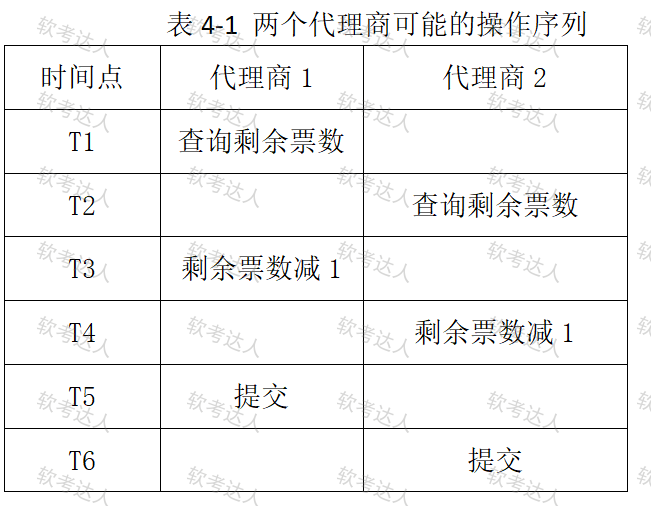
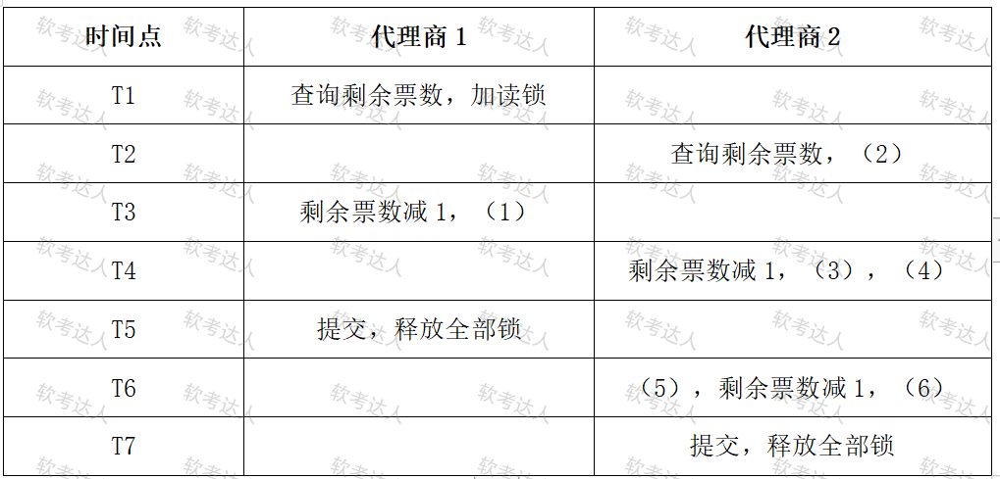

# 航空订票系统-反规范化与并发控制案例

## 原题（网站题号 100～102 合并：试题四，25分）

**试题四（25分）**　阅读以下关于数据库设计的叙述，在答题纸上回答问题1至问题3。

【说明】某航空公司开发订票信息处理系统，部分关系模式：航班（航班编号，航空公司，起飞地，起飞时间，目的地，到达时间，剩余票数，票价）、代理商（代理商编号，代理商名称，客服电话，地址，负责人）、机票代理（代理商编号，航班编号，票价）、旅客（身份证号，姓名，性别，出生日期，电话）、购票（购票单号，身份证号，航班编号，搭乘日期，购票金额）。核心功能是查询某航班时返回所有代理商及优惠票价。实现中发现需对代理商和机票代理做连接操作性能很差，故将机票代理扩充为：机票代理（代理商编号，航班编号，代理商名称，客服电话，票价），只查机票代理即可，提高查询效率。

| 网站题号 | 小问 | 分值 |
|---|---|---|
| 100 | 问题1（6分）：说明不满足3NF带来的存储异常问题并举例；给出解决数据不一致的方案 | 6 |
| 101 | 问题2（9分）：两个代理商并发售票（表4-1，剩1张票）的结果；并发操作三类数据不一致 | 9 |
| 102 | 问题3（10分）：读写锁机制（表4-2）填空（1）～（6），并150字内说明读写锁缺点 | 10 |

## 图示（原图，未覆盖）

## 来源答案与解析（网站原文）

- 题100：数据冗余与更新异常+两类解决方案（程序/触发器）。（解析：无）
- 题101：代理1正确售票、代理2查询正确但减一出错无票可售；三类不一致=丢失修改、读脏数据、不可重复读。（解析：无）
- 题102：（1）加写锁（2）加读锁（3）加写锁（4）被阻塞（5）得到通知（6）加写锁；缺点=读写互相阻塞串行化降低并发性能，设计不好可能交叉锁定死锁。（解析：无）

## 核验答案（考场作答）

### 【问题1】（6分）

**考场答案**：1）问题：数据冗余和更新异常。举例——代理商名称、客服电话同时存在于代理商和机票代理两个关系模式；机票代理中该代理商代理了多少个航班，其名称和客服电话就被重复存储多少次（如代理商A代理10个航班则重复存10次）；当代理商更名或变更客服电话时，若只改代理商表不改机票代理表，查询将得到旧数据。2）解决方案：①通过程序实现——修改代理商关系模式数据时，由程序同步修改机票代理关系模式；②通过触发器实现——在代理商关系模式上建修改触发器，数据修改时自动同步更新机票代理关系模式。

**采分要点**：两类问题2分＋举例1分＋两方案各1.5分（推定）。

**详细解析**：这是“以冗余换性能”的反规范化经典代价：票价查询免JOIN，代价是违反3NF产生更新异常。补偿手段=程序/触发器保持同步（与教程§6.2.3反规范化的“数据同步取舍”一致）。

**常见失分表达**：只答“数据冗余”漏“更新异常”；方案漏触发器。

**知识点链接**：[3NF与反规范化](https://github.com/Goodyzhang/ruankao.skill/blob/main/materials/%E7%B3%BB%E7%BB%9F%E6%9E%B6%E6%9E%84%E8%AE%BE%E8%AE%A1%E5%B8%88/%E7%AC%94%E8%AE%B0/%E7%9F%A5%E8%AF%86%E7%82%B9/06-%E6%95%B0%E6%8D%AE%E5%BA%93%E8%AE%BE%E8%AE%A1%E5%9F%BA%E7%A1%80%E7%9F%A5%E8%AF%86.md)

### 【问题2】（9分）

**考场答案**：1）第一个代理商能正确售票；第二个代理商查询剩余票数时结果正确（1张），但执行“剩余票数减一”时出错——该机票已被第一个代理商售出，第二个代理商无票可售（丢失修改：代理2的减一被代理1的提交覆盖）。2）并发操作带来的三类数据不一致：①丢失修改（两事务同时修改同一数据，一方的修改丢失）；②读脏数据（读了另一事务未提交、随后被回滚的数据）；③不可重复读（同一事务内两次读取同一数据结果不同）。

**采分要点**：结果5分（两个代理商分别说明）＋三类不一致4分（推定）。

**详细解析**：表4-1时序：T1代理1查询(=1)→T2代理2查询(=1)→T3代理1减1→T4代理2减1→T5代理1提交(=0)→T6代理2提交(=0，覆盖了代理1的更新——超售/丢失修改)。三类不一致是§6.1并发控制标准清单，与封锁协议考点联动。

**常见失分表达**：结果只说“超售”没有按两代理商分别描述；三类漏“不可重复读”。

**知识点链接**：[事务与并发控制](https://github.com/Goodyzhang/ruankao.skill/blob/main/materials/%E7%B3%BB%E7%BB%9F%E6%9E%B6%E6%9E%84%E8%AE%BE%E8%AE%A1%E5%B8%88/%E7%AC%94%E8%AE%B0/%E7%9F%A5%E8%AF%86%E7%82%B9/06-%E6%95%B0%E6%8D%AE%E5%BA%93%E8%AE%BE%E8%AE%A1%E5%9F%BA%E7%A1%80%E7%9F%A5%E8%AF%86.md)

### 【问题3】（10分）

**考场答案**：填空：（1）加写锁；（2）加读锁；（3）加写锁；（4）被阻塞；（5）得到通知；（6）加写锁。缺点（150字内）：读写锁会造成读写操作的互相阻塞，实际使得用户的操作被串行化，降低了系统的并发性能；设计不好的情况下，可能出现资源的交叉锁定，形成死锁。

**采分要点**：六空各约1.3分＋缺点3分（推定，合计10）。

**详细解析**：锁相容矩阵：写锁独占（与任何锁互斥）、读锁共享（读读相容、读写互斥）。序列上代理2在代理1持写锁期间被阻塞，代理1释放后得到通知再加锁。缺点两条关键词：“串行化降低并发”与“交叉锁定死锁”。

**常见失分表达**：(4)写成“失败/回滚”（应为被阻塞）；缺点漏“死锁”。

**知识点链接**：[锁机制](https://github.com/Goodyzhang/ruankao.skill/blob/main/materials/%E7%B3%BB%E7%BB%9F%E6%9E%B6%E6%9E%84%E8%AE%BE%E8%AE%A1%E5%B8%88/%E7%AC%94%E8%AE%B0/%E7%9F%A5%E8%AF%86%E7%82%B9/06-%E6%95%B0%E6%8D%AE%E5%BA%93%E8%AE%BE%E8%AE%A1%E5%9F%BA%E7%A1%80%E7%9F%A5%E8%AF%86.md)

## 来源与身份

- 题源：软考达人·第二十二章 案例分析/第一节 案例分析，网站题号100～102（网站分类“第二十二章 案例分析”保留为来源位置，章节路由按实际考点匹配教材章（第2版20章体系）。）
- 年份/卷别未核实，按 web-bank 处理；分值加和 6+9+10=25 与“试题四（25分）”一致。
- 图示：表4-1、表4-2原图已下载并实际看图核对（T1～T6时序、六空位置）。
