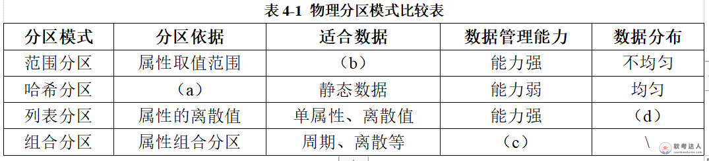

# 药店口罩预约数据管理案例

## 原题（网站题号 162～163～164：药店口罩预约数据管理）

**试题**　阅读以下关于数据管理的叙述，在答题纸上回答问题1至问题3。
【说明】
某全国连锁药店企业在新冠肺炎疫情期间，紧急推出在线口罩预约业务系统。该业务系统为普通用户提供口罩商品查询、购买、订单查询等业务，为后台管理人员提供订单查询、订单地点分布汇总、物流调度等功能。该系统核心的关系模式为预约订单信息表。
推出业务系统后，几天内业务迅速增长到每日10万多笔预约订单，系统数据库服务器压力剧增，导致该业务交易响应速度迅速降低，甚至出现部分用户页面无法刷新、预约订单服务无响应的情况。为此，该企业紧急成立技术团队，由张工负责，以期尽快解决该问题。

| 网站题号 | 小问 | 分值 |
|---|---|---|
| 162 | 问题1（9分） | 9 |
| 163 | 问题2（10分） | 10 |
| 164 | 问题3（6分） | 6 |

## 图示（原图，未覆盖）

## 来源答案与解析（网站原文）
- 题162：索引过多五副作用（占存储/更新开销/优化器评估组合增多/统计信息增多/聚集索引变化同步非聚集索引）。（解析：无）
- 题163：(a)属性的哈希值；(b)周期性数据/周期数据；(c)能力强；(d)不均匀。原因：所在城市为离散值，建列表分区方便不同城市处理自己的数据、方便数据管理。（解析：无）
- 题164：全同步（等所有从库完成，一致性好性能低）/异步（立即返回，性能好可能不一致）/半同步（至少一个从库写入中继日志后返回，牺牲部分性能提高安全性）。（解析：无）

## 核验答案（考场作答）
### 【问题1】（9分）

**考场答案**（100字内）：索引过多的副作用：①占用大量存储空间；②更新开销——更新语句会引起相应索引更新；③查询优化器需评估的组合增多；④每个索引都有对应统计信息，索引越多所需统计信息越多；⑤聚集索引的变化会导致非聚集索引同步变化。

**采分要点**：五条各约1.8分（推定）。

**详细解析**：索引是“读加速写减速”的权衡；副作用围绕空间/写开销/优化器/统计/级联五点。

**常见失分表达**：漏“统计信息”或“聚集索引级联”。

**知识点链接**：[索引设计](https://github.com/Goodyzhang/ruankao.skill/blob/main/materials/%E7%B3%BB%E7%BB%9F%E6%9E%B6%E6%9E%84%E8%AE%BE%E8%AE%A1%E5%B8%88/%E7%AC%94%E8%AE%B0/%E7%9F%A5%E8%AF%86%E7%82%B9/06-%E6%95%B0%E6%8D%AE%E5%BA%93%E8%AE%BE%E8%AE%A1%E5%9F%BA%E7%A1%80%E7%9F%A5%E8%AF%86.md)

### 【问题2】（10分）

**考场答案**：(a)属性的哈希值；(b)周期性数据/周期数据；(c)能力强；(d)不均匀。李工选择原因：预约订单“所在城市”属性为离散值，根据所在城市属性建立列表分区，也方便不同城市处理自己的数据，方便数据管理。

**采分要点**：四空各2分＋原因2分（推定）。

**详细解析**：物理分区四模式：范围（取值范围/周期数据/管理能力强/分布不均匀）、哈希（哈希值/静态数据/能力弱/均匀）、列表（离散值/单属性离散值/能力强/不均匀）、组合（组合/周期离散等/能力强）。表图行序与空位一一对应。

**常见失分表达**：(c)(d)行列错位；原因漏“离散值”。

**知识点链接**：[物理分区](https://github.com/Goodyzhang/ruankao.skill/blob/main/materials/%E7%B3%BB%E7%BB%9F%E6%9E%B6%E6%9E%84%E8%AE%BE%E8%AE%A1%E5%B8%88/%E7%AC%94%E8%AE%B0/%E7%9F%A5%E8%AF%86%E7%82%B9/06-%E6%95%B0%E6%8D%AE%E5%BA%93%E8%AE%BE%E8%AE%A1%E5%9F%BA%E7%A1%80%E7%9F%A5%E8%AF%86.md)

### 【问题3】（6分）

**考场答案**（200字内）：①全同步复制——主库执行完事务后等待所有从库执行完才返回客户端；数据一致性较高，但需等待所有从库，性能可能较低。②异步复制——主库执行完事务后立即返回客户端，不关心从库是否接收处理；简单且性能较好，但主从数据不一致概率较大。③半同步复制——介于两者之间，主库执行完事务后等待至少一个从库接收到并写入中继日志后才返回客户端；牺牲一定性能，提高了数据安全性。

**采分要点**：三模式各2分（推定）。

**详细解析**：与题67/93/120三度出现的复制三模式——这次是“全同步”措辞（此前题120为“同步”），口径一致。

**常见失分表达**：半同步漏“写入中继日志”。

**知识点链接**：[主从复制](https://github.com/Goodyzhang/ruankao.skill/blob/main/materials/%E7%B3%BB%E7%BB%9F%E6%9E%B6%E6%9E%84%E8%AE%BE%E8%AE%A1%E5%B8%88/%E7%AC%94%E8%AE%B0/%E7%9F%A5%E8%AF%86%E7%82%B9/06-%E6%95%B0%E6%8D%AE%E5%BA%93%E8%AE%BE%E8%AE%A1%E5%9F%BA%E7%A1%80%E7%9F%A5%E8%AF%86.md)

## 来源与身份

- 题源：软考达人·第二十二章 案例分析/第一节 案例分析，网站题号162～163～164（网站分类“第二十二章 案例分析”保留为来源位置，章节路由按实际考点匹配教材章（第2版20章体系）。）
- 年份/卷别未核实，按 web-bank 处理。分值加和 9+10+6=25 与“试题四（25分）”一致。
