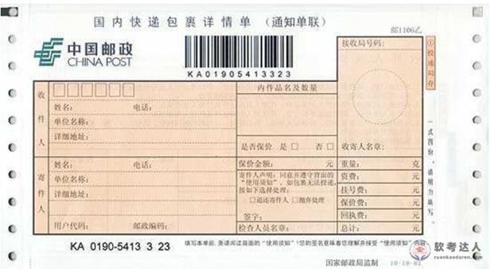
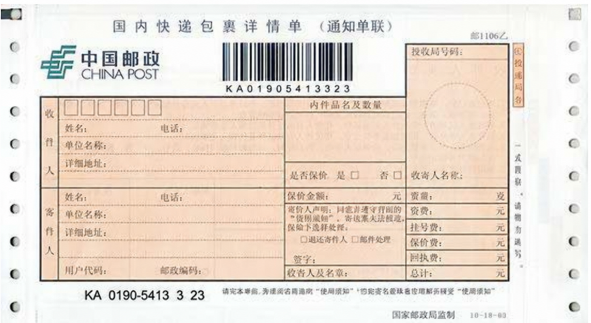

# 邮政包裹单数据库建模：逻辑模型、超类实体与派生属性

## 题干（原题抄写）

> 阅读关于数据库设计的叙述并回答问题1～3。某企业委托软件公司开发包裹信息管理系统，对不同快递信息的包裹单进行建模，邮政包裹单如图2-1所示。
>
> **问题1（14分）**：说明关系型数据库逻辑数据模型设计包含哪些任务；列出包裹单逻辑模型中的实体及每个关系模式的主键。
>
> **问题2（6分）**：说明什么是超类实体；结合图中包裹单设计一种超类实体并给出完整属性。
>
> **问题3（5分）**：说明派生属性，并指出图2-1中的派生属性。

## 图（原图与可编辑副本分开）

- **原题图**：
- **去水印副本（可编辑稿，非原图）**：

## 考场答案与采分要点

**问题 1**：逻辑模型设计依次包括：
1. 构建上下文数据模型，识别实体和实体间联系；
2. 为各实体添加主键，形成主键模型；
3. 补充非主键属性，形成全属性模型；
4. 对关系模式规范化，得到规范化模型。

| 实体 | 主键（按题库口径） |
|---|---|
| 收件人 | 电话 |
| 寄件人 | 电话 |
| 包裹单 | 编号 |

包裹单关系可引用寄件人与收件人的标识作为外键。

**问题 2**：超类实体（超类型）是概括多个子类共同属性的高层实体。子类表示超类的特例，继承超类属性，可增加自身属性；父子实体共享同一实体标识。本题可设计：**客户**（姓名、电话、单位名称、详细地址），寄件人和收件人为客户的两个子类。

**问题 3**：派生属性可根据实体的其他属性计算得到。包裹单中的**总计**为派生属性：`总计 = 资费 + 挂号费 + 保价费 + 回执费`。

## 解析与易错点

- 题库指定电话作收件人/寄件人的主键；实际系统中电话可能变更或多人共用，通常另设稳定客户ID（工程补充，不属于题库必答属性）。
- 总计通常由分项费用计算；若要保存下单时的计费快照供审计，应明确保存的是历史金额，而不是当前实时派生值。

## 知识点链接

- [逻辑模型设计任务与实体主键](https://github.com/Goodyzhang/ruankao.skill/blob/main/materials/%E7%B3%BB%E7%BB%9F%E6%9E%B6%E6%9E%84%E8%AE%BE%E8%AE%A1%E5%B8%88/%E7%AC%94%E8%AE%B0/%E7%9F%A5%E8%AF%86%E7%82%B9/06-%E6%95%B0%E6%8D%AE%E5%BA%93%E8%AE%BE%E8%AE%A1%E5%9F%BA%E7%A1%80%E7%9F%A5%E8%AF%86.md)
- [超类实体与派生属性](https://github.com/Goodyzhang/ruankao.skill/blob/main/materials/%E7%B3%BB%E7%BB%9F%E6%9E%B6%E6%9E%84%E8%AE%BE%E8%AE%A1%E5%B8%88/%E7%AC%94%E8%AE%B0/%E7%9F%A5%E8%AF%86%E7%82%B9/06-%E6%95%B0%E6%8D%AE%E5%BA%93%E8%AE%BE%E8%AE%A1%E5%9F%BA%E7%A1%80%E7%9F%A5%E8%AF%86.md)

## 核验状态与来源

- 核验状态：`pending`（年份未核实；答案来自题库口径+来源解析）。
- 实验室可用性：**暂不可导出**——来源身份未核实。
