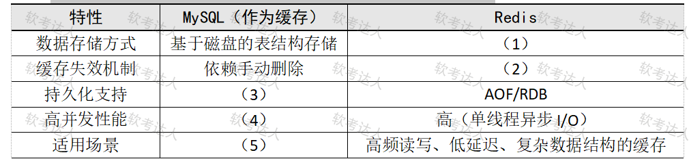

# 高并发电商-Redis缓存架构升级案例

## 原题（网站题号 159～161，试题四25分）

**试题四（25分）**　阅读以下关于某高并发电商系统缓存架构升级的说明，回答下列问题。

【说明】某电商系统使用Oracle RAC集群作为主数据库，MySQL作为单机缓存存储热点商品信息、订单数据和用户行为日志。促销期间频繁出现数据库请求超时（热点商品读取压力过大）。团队计划引入Redis作为分布式缓存中间件替代单机缓存，要求支持高并发访问、保证缓存与数据库数据一致性、具备横向扩展能力。技术方案：Redis多数据类型优化缓存策略；Redis集群架构实现高可用与分片；Redis持久化机制与数据同步策略保障可靠性。

| 网站题号 | 小问 | 分值 |
|---|---|---|
| 159 | 问题1（10分）：MySQL与Redis作为缓存的技术差异填表 | 10 |
| 160 | 问题2（10分）：五种常见Redis数据类型及电商典型应用场景 | 10 |
| 161 | 问题3（5分）：缓存穿透原因与解决方案 | 5 |

## 图示（原图，未覆盖）

## 来源答案与解析（网站原文）

- 题159：（1）基于内存存储（键值对）；（2）主动过期+被动淘汰；（3）原生支持；（4）较低（受锁机制限制）；（5）低频读写、小数据量、简单数据结构的临时缓存。（解析：无）
- 题160：String/Hash/List/Set/ZSet五类及电商场景。（解析：无）
- 题161：缓存穿透定义（2分）+三种方案（3分）：缓存空值/布隆过滤器/参数合法性校验。（解析：无）

## 核验答案补充（考场作答）

### 【问题3】（5分）

**考场答案**：缓存穿透指当缓存和数据库中都没有相应数据时，用户的请求直接穿过缓存访问数据库，导致每次请求都会查询数据库，失去缓存的作用（2分）。解决方案（3分）：①缓存空值——请求的数据在数据库中不存在时，将空值（NULL）缓存起来并设置较短过期时间，避免相同请求多次查询数据库；②使用布隆过滤器——将所有可能存在的键预先存储在布隆过滤器中，查询时先经布隆过滤器判断，判定键不存在则直接返回，避免查询数据库；③参数合法性校验——在业务逻辑层对传入参数进行合法性验证，过滤明显无效或恶意的请求，减少对缓存和数据库的无效访问。

**采分要点**：原因2分＋方案3分（网站给分明示）。

**详细解析**：穿透 vs 雪崩（题94）vs 击穿：穿透=查不存在的数据（空值/布隆过滤器对症），雪崩=大面积同时失效（随机过期/多级缓存对症）。布隆过滤器“可能存在”（假阳允许、假阴无）是其机制关键词。

**常见失分表达**：原因漏“缓存和数据库都没有”；方案与雪崩混淆。

**知识点链接**：[缓存穿透](https://github.com/Goodyzhang/ruankao.skill/blob/main/materials/%E7%B3%BB%E7%BB%9F%E6%9E%B6%E6%9E%84%E8%AE%BE%E8%AE%A1%E5%B8%88/%E7%AC%94%E8%AE%B0/%E7%9F%A5%E8%AF%86%E7%82%B9/06-%E6%95%B0%E6%8D%AE%E5%BA%93%E8%AE%BE%E8%AE%A1%E5%9F%BA%E7%A1%80%E7%9F%A5%E8%AF%86.md)

## 核验答案（考场作答）

### 【问题1】（10分）

**考场答案**：数据存储方式——MySQL基于磁盘的表结构存储 vs Redis基于内存存储（键值对）；缓存失效机制——MySQL依赖手动删除 vs Redis主动过期+被动淘汰；持久化支持——MySQL原生支持 vs Redis AOF/RDB；高并发性能——MySQL较低（受锁机制限制）vs Redis高（单线程异步I/O）；适用场景——MySQL低频读写、小数据量、简单数据结构的临时缓存 vs Redis高频读写、低延迟、复杂数据结构的缓存。

**采分要点**：五空各2分（推定）。

**详细解析**：与题92（MySQL vs OSS）、题59（MySQL vs Cassandra）同族：MySQL行存的点在事务与SQL，短板在高并发读。Redis单线程异步I/O避免锁竞争是“高并发”的机制词。

**常见失分表达**：(2)漏“被动淘汰”；(5)场景三要素不全。

**知识点链接**：[Redis缓存](https://github.com/Goodyzhang/ruankao.skill/blob/main/materials/%E7%B3%BB%E7%BB%9F%E6%9E%B6%E6%9E%84%E8%AE%BE%E8%AE%A1%E5%B8%88/%E7%AC%94%E8%AE%B0/%E7%9F%A5%E8%AF%86%E7%82%B9/06-%E6%95%B0%E6%8D%AE%E5%BA%93%E8%AE%BE%E8%AE%A1%E5%9F%BA%E7%A1%80%E7%9F%A5%E8%AF%86.md)

### 【问题2】（10分）

**考场答案**：①String（字符串）——商品库存缓存、分布式会话存储、原子计数器（如秒杀活动库存扣减）；②Hash（散列）——用户信息缓存、用户购物车缓存、商品详情缓存；③List（列表）——订单消息队列、用户最新操作记录、评论分页；④Set（集合）——商品标签去重、用户共同关注商品推荐、权限控制；⑤Sorted Set/ZSet（有序集合）——实时销量排行榜、用户积分排名、个性化推荐权重。

**采分要点**：五类各2分（推定）：类型名+场景。

**详细解析**：五类型一句话记忆：String存串计数、Hash存对象、List存队列、Set去重交并、ZSet排行。电商场景与类型特性一一对应（秒杀原子性→String的INCR；排行榜→ZSet的score排序）。

**常见失分表达**：类型与场景错配（用List做排行榜）。

**知识点链接**：[Redis数据类型](https://github.com/Goodyzhang/ruankao.skill/blob/main/materials/%E7%B3%BB%E7%BB%9F%E6%9E%B6%E6%9E%84%E8%AE%BE%E8%AE%A1%E5%B8%88/%E7%AC%94%E8%AE%B0/%E7%9F%A5%E8%AF%86%E7%82%B9/06-%E6%95%B0%E6%8D%AE%E5%BA%93%E8%AE%BE%E8%AE%A1%E5%9F%BA%E7%A1%80%E7%9F%A5%E8%AF%86.md)

## 来源与身份

- 题源：软考达人·第二十二章 案例分析/第一节 案例分析，网站题号159～161（网站分类“第二十二章 案例分析”保留为来源位置，章节路由按实际考点匹配教材章（第2版20章体系）。）
- 年份/卷别未核实，按 web-bank 处理；分值加和 10+10+5=25 与“试题四（25分）”一致（v1为仅含两问的pending版本，本v2补齐问题3升级verified）。
- 图示：MySQL vs Redis对比表原图未覆盖。
- 图示：MySQL vs Redis对比表原图已下载并实际看图核对五空行列。
