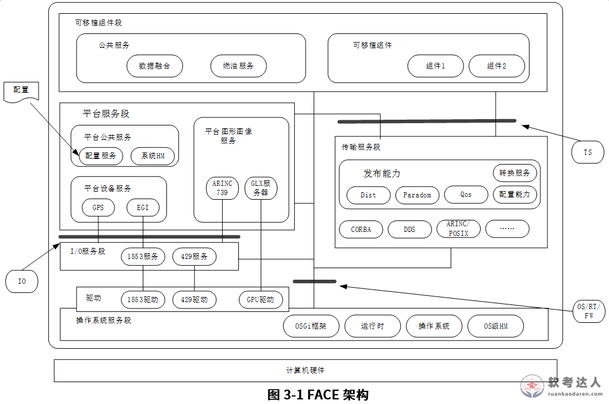

# FACE开放式宇航架构案例

## 原题（网站题号 105：开放式嵌入式软件架构设计，试题25分）

**试题**　阅读以下关于开放式嵌入式软件架构设计的相关描述，回答问题1至问题3。

【说明】某公司一直从事宇航系统研制任务，随着宇航产品综合化、网络化技术发展的需要，研制新的软件架构已迫在眉睫。架构师王工建议采用基于FACE（Future Airborne Capability Environment）的宇航系统开放式软件架构，以实现宇航系统的跨平台复用，实现宇航软件高质量、低成本的开发。公司领导指出全面实施基于FACE的开放式软件架构，应注意每个具体项目在实施中如何有效实现从需求到架构设计的关系，掌握基于软件需求的软件架构设计方法，并做好开放式软件架构中各段间的接口标准化设计工作。

| 网站题号 | 小问 | 分值 |
|---|---|---|
| 105-问题1 | 9分：从描述语言、非功能性需求描述、需求和架构一致性三方面说明需求到架构映射的难点 | 9 |
| 105-问题2 | 10分：说明FACE架构5个段（操作系统/I-O服务/平台服务/传输服务/可移植组件）的含义 | 10 |
| 105-问题3 | 6分：说明可移植性上紧耦合和封装问题的主要表现并给出解决方案 | 6 |

## 图示（原图，未覆盖）

## 来源答案与解析（网站原文）

- 问题1：三难点——需求以非正式自然语言获取而架构用正式结构化语言（理解沟通障碍）；非功能属性在需求中为系统属性、在架构模型中形成规约困难（涉及多组件交互）；需求到架构映射的一致性与可追溯性复杂（单一需求涉及多架构关注点、一个架构元素对应多需求）。解析：①描述语言差异②非功能性需求规约难③一致性与可追溯性难。
- 问题2：五段含义——操作系统服务段（OSGi框架标准化OS接口、即插即用）/I-O服务段（抽象1553/429专用设备，不抽象GPU驱动）/平台服务段（公共/设备GPS·EGI/图像ARINC739·GLX三类）/传输服务段（CORBA/DDS标准接口数据交换，禁止直接调用）/可移植组件段（公共服务数据融合·燃油+可移植组件）。（解析含详述）
- 问题3：紧耦合表现（I/O与业务逻辑/业务逻辑与底层/界面与业务逻辑三处耦合）；封装问题（ICD硬编码/组件紧耦合/直接调用）；解决方案（分离原则隔离各层定义接口协议；提供数据源或槽的软件服务、接口标准化）。解析含精炼版。

## 核验答案（考场作答）

### 【问题1】（9分）

**考场答案**（300字内）：①描述语言差异：软件需求多以非正式自然语言形式从业务用户、产品经理等处获取，而软件架构倾向使用正式、结构化的语言描述系统组件、接口、通信与交互方式，语言差异导致理解与沟通障碍。②非功能性需求描述困难：性能、安全性、可用性等非功能属性在需求中通常被描述为系统属性，但在架构模型中形成规约较为困难——非功能属性涉及多个系统组件和交互，需综合考量。③需求和架构的一致性与可追溯性难：单一软件需求可能涉及多个架构关注点，一个架构元素也可能对应多个软件需求，确保映射关系准确且可追溯需要采用适当的需求管理和架构设计技术。

**采分要点**：三难点各3分（推定）：语言差异/非功能规约/一致性可追溯。

**详细解析**：与题174（CPS）、章级§7基于架构的开发方法呼应。三难点记忆锚：怎么写（语言）、写什么难（非功能）、对得上吗（追溯）。FACE题的落点是把通用方法论引到宇航架构场景。

**常见失分表达**：漏“可追溯性”（只答一致性）；非功能答成功能性。

**知识点链接**：[需求到架构映射](https://github.com/Goodyzhang/ruankao.skill/blob/main/materials/%E7%B3%BB%E7%BB%9F%E6%9E%B6%E6%9E%84%E8%AE%BE%E8%AE%A1%E5%B8%88/%E7%AC%94%E8%AE%B0/%E7%9F%A5%E8%AF%86%E7%82%B9/07-%E7%B3%BB%E7%BB%9F%E6%9E%B6%E6%9E%84%E8%AE%BE%E8%AE%A1%E5%9F%BA%E7%A1%80%E7%9F%A5%E8%AF%86.md)

### 【问题2】（10分）

**考场答案**（300字内）：FACE架构五个服务段：①操作系统服务段——架构基础，提供操作系统、运行时环境和OS级健康监控服务，通过OSGi框架为上层提供标准化操作系统接口，支持上层组件即插即用；②I/O服务段——对1553、429等专用I/O设备进行抽象，简化平台服务段与硬件设备的交互（GPU与图形服务紧耦合，不抽象GPU驱动）；③平台服务段——提供用户所需共性软件服务（系统级健康监控、配置管理、日志、流媒体等），细分为平台公共服务、平台设备服务（GPS/EGI）、平台图像服务三类；④传输服务段——为上层可移植组件段提供平台性数据交换服务（CORBA、DDS等标准接口），组件间禁止直接调用；⑤可移植组件段——提供公共服务（数据融合、燃油服务）和可移植组件，支持应用程序跨平台构建部署与移植。

**采分要点**：五段各2分（推定）：段名+核心职责。

**详细解析**：图3-1对照记忆：自底向上=计算机硬件→OS服务段→I/O服务段→平台服务段→传输服务段→可移植组件段，三接口IO/TS/OS-RT-FW分隔各段。I/O段的GPU例外（不抽象GPU驱动）是高频细节考点。

**常见失分表达**：漏“I/O段不抽象GPU驱动”；传输段漏“禁止直接调用”。

**知识点链接**：[FACE五段架构](https://github.com/Goodyzhang/ruankao.skill/blob/main/materials/%E7%B3%BB%E7%BB%9F%E6%9E%B6%E6%9E%84%E8%AE%BE%E8%AE%A1%E5%B8%88/%E7%AC%94%E8%AE%B0/%E7%9F%A5%E8%AF%86%E7%82%B9/07-%E7%B3%BB%E7%BB%9F%E6%9E%B6%E6%9E%84%E8%AE%BE%E8%AE%A1%E5%9F%BA%E7%A1%80%E7%9F%A5%E8%AF%86.md)

### 【问题3】（6分）

**考场答案**（200字内）：紧耦合问题的主要表现：①I/O操作（文件读写、网络通信）与业务逻辑紧密耦合，I/O变更影响整个业务逻辑；②业务逻辑与底层系统（数据库、文件系统）紧耦合，业务变更需同时修改底层；③用户界面与业务逻辑紧耦合，界面变更影响业务逻辑。封装问题的主要表现：①接口控制文档（ICD）信息被硬编码到代码中，ICD变更需修改代码；②组件间依赖过于紧密，一个组件变更影响其他组件；③组件间直接调用彼此接口，接口变化需修改多个组件。解决方案：紧耦合采用分离原则，将I/O、业务逻辑、表现层隔离并定义明确接口和协议通信；封装问题采用提供数据源或槽的软件服务——将紧耦合组件分解出应用程序，平台相关部分加入计算环境，在计算平台内提供数据源或槽的软件服务，实现接口标准化。

**采分要点**：紧耦合表现2分＋封装表现2分＋解决方案2分（推定）。

**详细解析**：三处紧耦合=经典分层边界（I/O-业务-界面）；封装三问题围绕ICD。与题107/108 GOA接口标准化、题43 AUTOSAR同属开放式架构家族——FACE/GOA/GENESYS三大宇航开放架构对照记忆。

**常见失分表达**：封装表现漏“ICD硬编码”；解决方案漏“数据源或槽”。

**知识点链接**：[FACE可移植性](https://github.com/Goodyzhang/ruankao.skill/blob/main/materials/%E7%B3%BB%E7%BB%9F%E6%9E%B6%E6%9E%84%E8%AE%BE%E8%AE%A1%E5%B8%88/%E7%AC%94%E8%AE%B0/%E7%9F%A5%E8%AF%86%E7%82%B9/07-%E7%B3%BB%E7%BB%9F%E6%9E%B6%E6%9E%84%E8%AE%BE%E8%AE%A1%E5%9F%BA%E7%A1%80%E7%9F%A5%E8%AF%86.md)

## 来源与身份

- 题源：软考达人·第七章 系统架构设计基础知识（新第2版）/第二节 基于架构的软件开发方法，网站题号105（网站分类“第七章…第二节 基于架构的软件开发方法”保留为来源位置，章节路由按实际考点匹配教材章。）
- 年份/卷别未核实，按 web-bank 处理；分值加和 9+10+6=25。
- 图示：FACE架构图原图已下载（带Referer取回真图1058×702）并实际看图核对：五段+三接口+硬件底座与答案互证一致。
