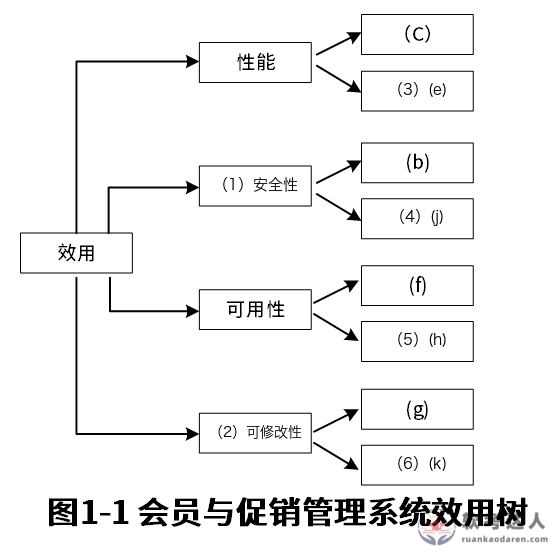

# 会员与促销管理系统：效用树与解释器风格综合案例

> 来源：软考达人，第八章第二节，网站题号 83，一页含问题1＋问题2。网站页面未显示小问分值，按效用树六空推定 12 分、架构风格对比推定 13 分，合计 25 分，全部为训练推定。年份及原考试题号未在网站标注，身份为 web-bank；本地章级笔记记载该电商折扣案例出自 2022 下半年真题且六空答案一致，仅作旁证。没有用户实际作答或错误记录。

## 题干（网站原文）

试题一是必答题
阅读以下关于软件架构设计与评估的叙述，在答题纸上回答问题1和问题2。

【说明】
某电子商务公司拟升级其会员与促销管理系统，向用户提供个性化服务，提高用户的粘性。在项目立项之初，公司领导层一致认为本次升级的主要目标是提升会员管理方式的灵活性，由于当前用户规模不大，业务也相对简单，系统性能方面不做过多考虑。新系统除了保持现有的四级固定会员制度外，还需要根据用户的消费金额、偏好、重复性等相关特征动态调整商品的折扣力度，并支持在特定的活动周期内主动筛选与活动主题高度相关的用户集合，提供个性化的打折促销活动。
在需求分析与架构设计阶段，公司提出的需求和质量属性描述如下：
（a）管理员能够在页面上灵活设置折扣力度规则和促销活动逻辑，设置后即可生效；
（b）系统应该具备完整的安全防护措施，支持对恶意攻击行为进行检测与报警；
（c）在正常负载情况下，系统应在0.3秒内对用户的界面操作请求进行响应；
（d）用户名是系统唯一标识，要求以字母开头，由数字和字母组合而成，长度不少于6个字符；
（e）在正常负载情况下，用户支付商品费用后在3秒内确认订单支付信息；
（f）系统主站点电力中断后，应在5秒内将请求重定向到备用站点；
（g）系统支持横向存储扩展，要求在2人•天内完成所有的扩展与测试工作；
（h）系统宕机后，需要在10秒内感知错误，并自动启动热备份系统；
（i）系统需要内置接口函数，支持开发团队进行功能调试与系统诊断；
（j）系统需要为所有的用户操作行为进行详细记录，便于后期查阅与审计；
（k）支持对系统的外观进行调整和配置，调整工作需要在4•人天内完成。
在对系统需求、质量属性描述和架构特性进行分析的基础上，系统架构师给出了两种候选的架构设计方案，公司目前正在组织相关专家对系统架构进行评估。

原文"粘性""4•人天"等用字保留。

## 问题一：完成效用树（12 分，推定）

问题1：在架构评估过程中，质量属性效用树（utility tree）是对系统质量属性进行识别和优先级排序的重要工具。请将合适的质量属性名称填入图1-1中(1)、(2)空白处，并选择题干描述的(a)～(k)填入(3)～(6)空白处，完成该系统的效用树。

原图结构：效用根向右分四支——性能[固定叶 (C)，空 (3)]、(1)[固定叶 (b)，空 (4)]、可用性[固定叶 (f)，空 (5)]、(2)[固定叶 (g)，空 (6)]。原图右下角带网站水印。

### 考场答案

| 空号 | 填写 | 依据 |
|---|---|---|
| (1) | 安全性 | 固定叶 (b)：安全防护、攻击检测与报警 |
| (2) | 可修改性 | 固定叶 (g)：2 人•天完成存储扩展与测试 |
| (3) | (e) | 支付后 3 秒内确认订单，处理时间类性能场景 |
| (4) | (j) | 用户操作详细记录，便于查阅与审计，安全证据 |
| (5) | (h) | 宕机 10 秒内感知并启动热备份，故障恢复 |
| (6) | (k) | 4 人•天完成外观调整配置，修改代价 |

[可编辑 SVG 标注稿](../../assets/eaf75228cef00158.svg)。原图未改，答案图不进入实验室公开资源。

### 采分要点

训练推定每空 2 分。(4) 若写 (i)（内置接口函数支持调试诊断）偏可测试性，不满足安全性分支，不给分；(3) 除 (e) 外题干再无第二处理时间类条目，(a) 是"设置后即可生效"的功能/易用性描述，不入性能分支。

### Tutor 解析：固定叶定分支，剩余条目按"多快、多久、改多易、谁能动"对号

四条固定叶先定位：(C) 界面 0.3 秒响应→性能；(b) 攻击检测报警→(1) 安全性；(f) 断电 5 秒重定向→可用性；(g) 存储 2 人•天扩展→(2) 可修改性。

剩余条目里：(e) 是"支付确认 3 秒"，与 (C) 同为处理时间口径，填 (3)；(j) 是操作审计记录，审计是安全性的证据面，填 (4)；(h) 是宕机感知与热备份，与 (f) 同为故障恢复，填 (5)；(k) 是 4 人•天外观调整，与 (g) 同为修改代价，填 (6)。易错项：(a)"灵活设置规则"容易誘人填进可修改性，但它描述的是业务功能（管理员配置促销），且它正是问题2解释器风格要支撑的需求本体，不入效用树空位；(d) 用户名格式是功能约束；(i) 内置调试接口属可测试性，四个分支都不接收它。

关联：[效用树四层结构](https://github.com/Goodyzhang/ruankao.skill/blob/main/materials/%E7%B3%BB%E7%BB%9F%E6%9E%B6%E6%9E%84%E8%AE%BE%E8%AE%A1%E5%B8%88/%E7%AC%94%E8%AE%B0/%E7%9F%A5%E8%AF%86%E7%82%B9/08-%E7%B3%BB%E7%BB%9F%E8%B4%A8%E9%87%8F%E5%B1%9E%E6%80%A7%E4%B8%8E%E6%9E%B6%E6%9E%84%E8%AF%84%E4%BC%B0.md)。

## 问题二：面向对象 vs 解释器（13 分，推定）

问题2：针对该系统的功能，李工建议采用面向对象的架构风格，将折扣力度计算和用户筛选分别封装为独立对象，通过对象调用实现对应的功能；王工则建议采用解释器（interpreters）架构风格，将折扣力度计算和用户筛选条件封装为独立的规则，通过解释规则实现对应的功能。请针对系统的主要功能，从折扣规则的可修改性、个性化折扣定义灵活性和系统性能三个方面对这两种架构风格进行比较与分析，并指出该系统更适合采用哪种架构风格。

### 考场答案

该系统更适合采用解释器架构风格。三个方面比较如下：

1. 折扣规则的可修改性：解释器风格优于面向对象。折扣规则被封装为独立的语法规则，规则变化时由解释器直接解析新规则，修改更容易、生效更快；面向对象方式逻辑相对固定，规则变化需要修改具体的类并重新编码、测试。
2. 个性化折扣定义灵活性：解释器风格优于面向对象。解释器可按用户消费金额、偏好等特征灵活解释执行规则，支持千人千面的个性化折扣；面向对象的调用逻辑固定，个性化组合能力弱。
3. 系统性能：面向对象优于解释器。对象调用是编译期确定的直接调用，开销小；解释器在运行期动态绑定、逐条解释规则，解释开销使其性能较低。

结论权衡：本项目核心目标是"提升会员管理方式的灵活性"，且立项之初明确"系统性能方面不做过多考虑"，用户规模不大。灵活性与可修改性的收益远大于性能损失，故选择解释器架构风格。

### 采分要点

训练推定：三方面比较各 3 分（每方面须给出两种风格的强弱对比及机理），结论 2 分须附"灵活性优先、性能可让步"的题干依据。只答"解释器好"不比较不给分；结论不引题干约束扣 1 分。

### Tutor 解析：让"规则"成为数据，是解释器的全部意义

题眼在题干两句设定：主要目标是灵活性、性能不做过多考虑。这是命题人预先替你写好的结论理由——比较完三方面后必须回扣它，否则结论悬空。

机理层面：面向对象把"规则"编译成类的方法，规则即代码，改规则=改代码=重新发布；解释器把"规则"变成解释引擎的输入数据，规则即数据，改规则=改配置。由此推出：可修改性与灵活性解释器占优，性能面向对象占优（解释开销＋运行期动态绑定）。这正是教材 §7.3.5 虚拟机风格"修改规则无需重新编译、执行效率低"的案例化。本题与 08 章笔记中即时战略游戏地图自定义案例同型：凡是"用户自定义规则/流程、灵活优先"的场景，解释器是标准答案。

易失分点：三方面只写单边（只说解释器优点）不构成"比较"；把"个性化灵活性"与"可修改性"混为一点（前者面向最终用户的规则表达丰富度，后者面向开发者的规则变更代价）；结论漏掉"性能不做过多考虑"的题干依据。

关联：[解释器风格机理](https://github.com/Goodyzhang/ruankao.skill/blob/main/materials/%E7%B3%BB%E7%BB%9F%E6%9E%B6%E6%9E%84%E8%AE%BE%E8%AE%A1%E5%B8%88/%E7%AC%94%E8%AE%B0/%E7%9F%A5%E8%AF%86%E7%82%B9/07-%E7%B3%BB%E7%BB%9F%E6%9E%B6%E6%9E%84%E8%AE%BE%E8%AE%A1%E5%9F%BA%E7%A1%80%E7%9F%A5%E8%AF%86.md)、[风格与性能权衡](https://github.com/Goodyzhang/ruankao.skill/blob/main/materials/%E7%B3%BB%E7%BB%9F%E6%9E%B6%E6%9E%84%E8%AE%BE%E8%AE%A1%E5%B8%88/%E7%AC%94%E8%AE%B0/%E7%9F%A5%E8%AF%86%E7%82%B9/08-%E7%B3%BB%E7%BB%9F%E8%B4%A8%E9%87%8F%E5%B1%9E%E6%80%A7%E4%B8%8E%E6%9E%B6%E6%9E%84%E8%AF%84%E4%BC%B0.md)。

~~~mermaid
flowchart LR
 A["折扣规则变更"] --> B["面向对象：改类→重编译→重发布"]
 A --> C["解释器：改规则定义→解释器解析生效"]
 B --> D["可修改性/灵活性弱，性能强"]
 C --> E["可修改性/灵活性强，性能弱"]
 D --> F{"题干：灵活优先，性能不做过多考虑"}
 E --> F
 F --> G["选解释器架构风格"]
~~~

## 网站原解析

### 83 问题1

正确答案：
（1）安全性
（2）可修改性
（3）（e）
（4）（j）
（5）（h）
（6）（k）

### 83 问题2

正确答案：
应该选择解释器架构风格。
折扣规则的可修改性：解释器风格比面向对象方式实现强。因为解释器风格折扣规则是独立的语法规则，由解释器可对变化的规则进行解析，修改更容易。而面向对象相对固定，有变化需要修改具体的类。
个性化折扣定义灵活性：解释器强于面向对象，解释器可以根据用户灵活解释执行规则，做到千人千面。
系统性能：面向对象优于解释器。面向对象的实现相对固定，而解释器是运行期动态绑定执行。

解析：
效用树填空解析：
（1）安全性：(b)（安全防护、攻击检测）和(j)（用户操作审计）属于安全属性，故（1）为安全性，(4)填(j)。
（2）可修改性：(g)（存储扩展）、(k)（外观配置）均涉及系统变更的难易度，故（2）为可修改性，(6)填(k)。
（3）(e)：(c)（界面响应）、(e)（支付确认）均为性能（响应/处理时间），故（3）填(e)。
（5）(h)：(f)（备用站点重定向）、(h)（宕机热备份）均为可用性（故障恢复），故（5）填(h)。

架构风格选择解析：
应选解释器架构。①折扣规则可修改性：解释器将规则封装为语法，修改规则只需更新定义（无需改代码），优于面向对象（需改类）；②个性化灵活性：解释器可动态解析用户特征规则，实现"千人千面"，面向对象逻辑相对固定；③性能：面向对象方法调用更直接（性能优），但题目要求"提升灵活性"且"性能不做过多考虑"，故优先选解释器。

## 核验记录与来源

题干 (a)～(k)、图1-1 六空与两小问逐项对照；效用树原图 559×556 下载并实际查看，固定叶 (C)(b)(f)(g) 辨认一致。六空答案按固定叶反推并与网站解析一致；本地章级笔记 2022 下半年电商折扣案例记载（(1)安全性 (2)可修改性 (3)e (4)j (5)h (6)k）完全吻合，构成第二来源旁证。架构风格答案与教材 §7.3.5 解释器风格机理一致。小问分值网站未显示，12＋13 为训练推定并全文标注。

- [网站小节入口](https://ruankaodaren.com/exam/#/answer/answer?type=1&id=9395)：题号 83，原文与展开解析。
- [原图资源](https://image-t.chaiding.com/ruankaodaren/2026_03_01/watermark/f8ad9603-5df1-4414-90c0-0d72943f4f85.png)：559×556 PNG，含网站水印，本地保留原始像素。
- [教材原文](https://github.com/Goodyzhang/ruankao.skill/blob/main/materials/%E7%B3%BB%E7%BB%9F%E6%9E%B6%E6%9E%84%E8%AE%BE%E8%AE%A1%E5%B8%88/%E6%95%99%E6%9D%90/%E7%B3%BB%E7%BB%9F%E6%9E%B6%E6%9E%84%E8%AE%BE%E8%AE%A1%E5%B8%88%E6%95%99%E7%A8%8B%EF%BC%88%E7%AC%AC2%E7%89%88%EF%BC%89.md)：§7.3.5、§8.3。
- 来源草稿见批次目录 item-83.json。
