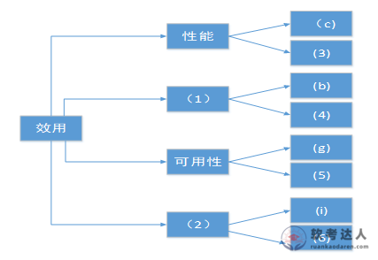
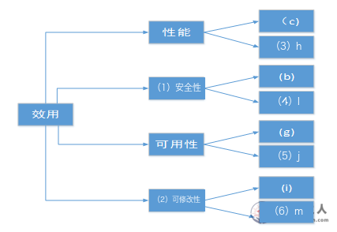

# 公路桥梁在线管理系统：效用树与架构关注点综合案例

> 来源：软考达人，第八章第二节，网站题号 82，一页含问题1＋问题2（12＋13＝25 分）。年份及原考试题号尚未核实，身份为 web-bank，可用于普通训练。采分细则为训练推定；网站解析单独保留。没有用户实际作答或错误记录。

## 题干（网站原文）

试题一(共 25 分)
阅读以下关于软件架构评估的叙述，在答题纸上回答问题 1 和问题 2.

【说明】
某单位为了建设健全的公路桥梁养护管理档案，拟开发一套公路桥梁在线管理系统。在系统的需求分析与架构设计阶段，用户提出的需求、质量属性描述和架构特性如下:
(a) 系统用户分为高级管理员、数据管理员和数据维护员等三类:
(b) 系统应该具备完善的安全防护措施，能够对黑客的攻击行为进行检测与防御:
(c) 正常负载情况下，系统必须在 0.5 秒内对用户的查询请求进行响应:
(d) 对查询请求处理时间的要求将影响系统的数据传输协议和处理过程的设计:
(e) 系统的用户名不能为中文，要求必须以字母开头，长度不少于 5 个字符;
(f) 更改系统加密的级别将对安全性和性能产生影响;
(g) 网络失效后，系统需要在 10 秒内发现错误并启用备用系统，
(h) 查询过程中涉及到的桥梁与公路的实时状态视频传输必须保证画面具有 1024*768 的分辨率， 40 帧 /秒的速率:
(i) 在系统升级时，必须保证在 10 人月内可添加一个新的消息处理中间件:
(j) 系统主站点断电后，必须在 3 秒内将请求重定向到备用站点:
(k) 如果每秒钟用户查询请求的数量是 10 个，处理单个请求的时间为 30 毫秒，则系统应保证在 1 秒内完成用户的查询请求:
(l) 对桥梁信息数据库的所有操作都必须进行完整记录:
(m) 更改系统的 Web 界面接口必须在 4 人周内完成:
(n) 如果"养护报告生成"业务逻辑的描述尚未达成共识，可能导致部分业务功能模块规则的矛盾，影响系统的可修改性
(o) 系统必须提供远程调试接口，并支持系统的远程调试。
在对系统需求，质量属性描述和架构特性进行分析的基础上，系统的架构师给出了三个候选的架构设计方案，公司目前正在组织系统开发的相关人员对系统架构进行评估。

原文条目分隔冒号/分号混用、"1024*768""40 帧 /秒"等用字保留。题干条目为 (a)～(o) 共 15 条。

## 问题一：完成效用树（12 分）

【问题 1】(12 分)：在架构评估过程中，质量属性效用树 (utility tree) 是对系统质量属性进行识别和优先级排序的重要工具。请给出合适的质量属性，填入图 1-1 中 (1)、(2) 空白处:并选择题干描述的 (a)~ (o) ，填入(3)~(6) 空白处，完成该系统的效用树。

原图结构：效用根向右分四支——性能[固定叶 (c)，空 (3)]、(1)[固定叶 (b)，空 (4)]、可用性[固定叶 (g)，空 (5)]、(2)[固定叶 (i)，空 (6)]。原图右下角带网站水印，(6) 框被部分遮挡但框号可辨认。

### 考场答案

| 空号 | 填写 | 依据 |
|---|---|---|
| (1) | 安全性 | 固定叶 (b)：检测与防御黑客攻击 |
| (2) | 可修改性 | 固定叶 (i)：升级时 10 人月内新增消息处理中间件 |
| (3) | (h) | 视频传输 1024×768、40 帧/秒，属响应性能力 |
| (4) | (l) | 数据库操作完整记录（审计），安全性证据 |
| (5) | (j) | 断电后 3 秒内重定向备用站点，故障恢复 |
| (6) | (m) | 4 人周内更改 Web 界面接口，修改代价 |

[可编辑 SVG 标注稿](../../assets/cdb4201f6cda0dc0.svg)。原图未改，答案图不进入实验室公开资源。

### 采分要点

训练推定每空 2 分，属性名称与题干编号须对应。(3) 填 (k)（10 个/秒、30ms/个、1 秒内完成，吞吐量口径的性能场景）并说明理由可视为等价表述；(4) 填 (e)（用户名格式约束）理由不充分，不给分。

### Tutor 解析：从固定叶反推分支，再挑同属性新叶

四个空先由固定叶定分支：(b) 管"谁能进来"→(1) 安全性；(i) 问"加一个构件要多久"→(2) 可修改性。再为每个分支挑一条未被固定叶占用的同属性描述。

性能分支：除 (c) 外，(h)（分辨率与帧率）和 (k)（吞吐量）都算性能场景，网站取 (h)；写 (k) 需说明是"单位时间处理量"口径。(d) 容易误入性能分支——它说"处理时间要求影响协议设计"，是设计受属性制约的表述，后面问题2里它有专门身份（敏感点），不要在这里重复占用。(l) 的"完整记录"是审计需求，审计日志防抵赖防篡改，归安全性；(o) 远程调试属可测试性，本题分支未包含；(n) 是风险描述，不作为效用树叶。可用性分支：(j) 与固定叶 (g) 同型（失效后多久恢复），直接对号。

关联：[效用树四层结构](https://github.com/Goodyzhang/ruankao.skill/blob/main/materials/%E7%B3%BB%E7%BB%9F%E6%9E%B6%E6%9E%84%E8%AE%BE%E8%AE%A1%E5%B8%88/%E7%AC%94%E8%AE%B0/%E7%9F%A5%E8%AF%86%E7%82%B9/08-%E7%B3%BB%E7%BB%9F%E8%B4%A8%E9%87%8F%E5%B1%9E%E6%80%A7%E4%B8%8E%E6%9E%B6%E6%9E%84%E8%AF%84%E4%BC%B0.md)。

## 问题二：风险、敏感点、权衡点（13 分）

【问题 2】(13 分)：在架构评估过程中，需要正确识别系统的架构风险、敏感点和权衡点，并进行合理的架构决策。请用 300 字以内的文字给出系统架构风险、敏感点和权衡点的定义，并从题干(a) - (o) 中分别选出 1 个对系统架构风险、敏感点和权衡点最为恰当的描述。

### 考场答案（300 字以内）

架构风险是指架构设计中潜在的、存在问题的架构决策所带来的隐患，它不支持给定的高优先级质量属性。敏感点是为了实现某种特定质量属性，一个或多个构件（和/或构件间关系）所具有的特性。权衡点是影响多个质量属性的特性，对多个质量属性而言都是敏感点。

(n) 是架构风险：养护报告业务逻辑未达成共识，规则矛盾是未消除的设计隐患。(d) 是敏感点：查询处理时间要求直接决定数据传输协议与处理过程设计，单点服务于性能这一特定属性。(f) 是权衡点：更改加密级别同时牵动安全性与性能，一升一降。

### 采分要点

训练推定：三个定义各 2 分（判别词"潜在隐患／特定质量属性／多个质量属性"到位）；(n) 选择与理由 2.5 分、(d) 2 分、(f) 2.5 分。只写字母不给理由扣一半。

### Tutor 解析：先"影响谁"后"稳不稳"，三条互不重复占用

(n) 读到"尚未达成共识""可能导致矛盾"即可判风险；它和 B2C 案例 (k) 的差别在于这里没有"可以控制"的翻转句。(d) 是"设计被属性牵引"的标准敏感点句式：一个属性（查询处理时间）决定一个设计维度（协议与处理过程），不涉及第二属性，别被"影响"二字吓成权衡。(f) 与教材 §8.2.1 的加密级别原例逐字同型，安全性与性能此消彼长，是权衡点。三条选择恰好各用一条题干，答题时避免一条描述身兼两角。

易失分点：把 (d) 当风险（把"影响设计"当隐患）；把 (n) 当可修改性场景填进效用树（问题1的 (6) 已由 (m) 占位）；定义漏掉权衡点"是多个质量属性的敏感点"的包含关系。

关联：[四大核心概念辨析](https://github.com/Goodyzhang/ruankao.skill/blob/main/materials/%E7%B3%BB%E7%BB%9F%E6%9E%B6%E6%9E%84%E8%AE%BE%E8%AE%A1%E5%B8%88/%E7%AC%94%E8%AE%B0/%E7%9F%A5%E8%AF%86%E7%82%B9/08-%E7%B3%BB%E7%BB%9F%E8%B4%A8%E9%87%8F%E5%B1%9E%E6%80%A7%E4%B8%8E%E6%9E%B6%E6%9E%84%E8%AF%84%E4%BC%B0.md)、教材 §8.2.1。

## 网站原解析

### 82 问题1

正确答案：
在架构评估过程中，质量属性效用树(utility tree)是对系统质量属性进行识别和优先级排序的重要工具。效用树主要关注性能、可修改性、可用性和安全4个方面
（1）~（6）内容如下：
（1）安全性 （2）可修改性 （3）h （4）l （5）j （6）m

### 82 问题2

正确答案：
统架构风险是指架构设计中潜在的、存在问题的架构决策所带来的隐患。敏感点是为了实现某种特定质量属性，一个或多个系统组件所具有的特性。权衡点是影响多个质量属性，并对多个质量属性来说都是敏感点的系统属性。根据上述分析可知题干描述中，(n)描述的是系统架构风险；(d)描述的是敏感点；(f)描述的是权衡点。

解析：略

（网站问题2答案首字缺"系"，原文保留；定义与教材 §8.2.1、§8.3 一致。）

## 核验记录与来源

题干 15 条 (a)～(o)、两小问分值 12＋13 与解析逐项对照；原图 427×294 下载保存并实际查看，六空位置按固定叶 (c)(b)(g)(i) 反推；网站六空答案与固定叶分支逻辑一致。问题2三选择与本地章级笔记"题库 8.2 节题目 9"公路桥梁综合判定记载相符（风险 (n)、权衡 (f)、敏感 (d)）。答案图在原图副本上按实际坐标填写，实际看成图核对位置与箭头。

- [网站小节入口](https://ruankaodaren.com/exam/#/answer/answer?type=1&id=9395)：题号 82，原文与展开解析。
- [原图资源](https://image-t.chaiding.com/ruankaodaren/2026_03_01/watermark/3c59958f-2b77-4217-9a8d-285039af8b09.png)：427×294 PNG，含网站水印，本地保留原始像素。
- [教材原文](https://github.com/Goodyzhang/ruankao.skill/blob/main/materials/%E7%B3%BB%E7%BB%9F%E6%9E%B6%E6%9E%84%E8%AE%BE%E8%AE%A1%E5%B8%88/%E6%95%99%E6%9D%90/%E7%B3%BB%E7%BB%9F%E6%9E%B6%E6%9E%84%E8%AE%BE%E8%AE%A1%E5%B8%88%E6%95%99%E7%A8%8B%EF%BC%88%E7%AC%AC2%E7%89%88%EF%BC%89.md)：§8.2.1、§8.3。
- 来源草稿见批次目录 item-82.json。
