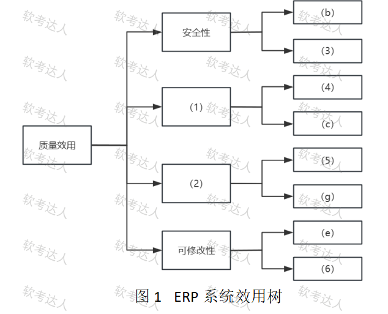
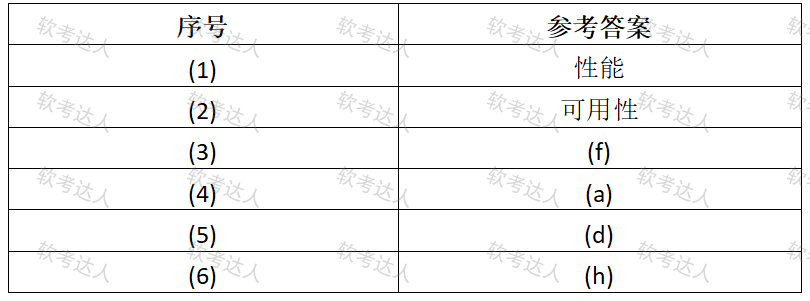

# 制造业ERP-效用树与质量属性场景案例

## 原题（网站题号 84～86 合并：试题一，25分）

**试题一（25分）**　阅读以下关于软件架构评估的说明，回答下列问题。

【说明】某制造业集团计划开发新一代ERP系统，整合财务、供应链、生产管理模块。关键质量属性场景：(a)支持全国200个分支机构同时在线操作；(b)财务审计日志需保留至少7年且不可篡改；(c)每月生成财务报表耗时≤5分钟；(d)数据库故障时30秒内切换至备用数据库；(e)新增跨境电商模块时原有功能不受影响；(f)供应商价格数据更新需通过双因素认证；(g)系统遭受DDoS攻击时保障财务核心功能可用；(h)移动端审批流程上线后需在三周内修改兼容纯血鸿蒙。开发部门正组织对系统架构进行评估。

| 网站题号 | 小问 | 分值 |
|---|---|---|
| 84 | 问题1（12分）：效用树填空 (1)(2)质量属性 + (3)~(6)场景序号 | 12 |
| 85 | 问题2（5分）：ATAM效用树结构与优先级对、CBAM思想填空 | 5 |
| 86 | 问题3（8分）：场景(b)(g)的刺激/环境/制品/响应四要素 | 8 |

## 图示

### 题面效用树原图（未覆盖）

### 网站参考答案表（答案载体为图片，role=answer，不进公开题包）

## 来源答案与解析（网站原文）

- 题84：网站“正确答案”文字区为空，答案以图片表给出（实际看图读取）：(1)性能、(2)可用性、(3)(f)、(4)(a)、(5)(d)、(6)(h)。解析：无。
- 题85：（1）属性分类；（2）质量属性场景；（3）重要且易实现；（4）架构策略；（5）项目干系人。（解析：无）
- 题86：场景(b)与(g)四要素。（解析：无）

## 核验答案（考场作答）

### 【问题1】（12分）

**考场答案**：(1)性能；(2)可用性；(3)=(f)（双因素认证→安全性）；(4)=(a)（200机构并发→性能）；(5)=(d)（30秒切换→可用性）；(6)=(h)（三周兼容鸿蒙→可修改性）。

**采分要点**：六空各2分（推定）。

**详细解析**：效用树填空三步法：①分支下已给叶场景定属性——安全性分支已有(b)审计日志→(3)必为安全类(f)；②剩余场景按质量属性归类——性能(a)(c)、可用性(d)(g)、可修改性(e)(h)；③每个分支“1个已给+1个待填”对号入座。安全性=防未授权（加密、认证、防篡改），可用性=故障恢复与抗攻击可用，易混点是(g)——DDoS下“保障可用”归可用性而非安全性。

**常见失分表达**：(g)误归安全性；(h)误归性能（看到“移动端”字样）。

**知识点链接**：[效用树](https://github.com/Goodyzhang/ruankao.skill/blob/main/materials/%E7%B3%BB%E7%BB%9F%E6%9E%B6%E6%9E%84%E8%AE%BE%E8%AE%A1%E5%B8%88/%E7%AC%94%E8%AE%B0/%E7%9F%A5%E8%AF%86%E7%82%B9/08-%E7%B3%BB%E7%BB%9F%E8%B4%A8%E9%87%8F%E5%B1%9E%E6%80%A7%E4%B8%8E%E6%9E%B6%E6%9E%84%E8%AF%84%E4%BC%B0.md)

### 【问题2】（5分）

**考场答案**：(1)属性分类；(2)质量属性场景；(3)重要且易实现；(4)架构策略；(5)项目干系人。

**采分要点**：五空各1分（推定）。

**详细解析**：效用树四层=树根→质量属性→属性分类→质量属性场景；优先级对(H/M/L, H/M/L)第一维重要性第二维实现难度，(H、L)=重要且易实现（高价值低成本的优先处理场景）。CBAM在ATAM之后用“架构策略→质量属性→效用→收益”做成本效益排序。

**常见失分表达**：(3)写成“重要且难实现”；(5)写成“用户”。

**知识点链接**：[ATAM与CBAM](https://github.com/Goodyzhang/ruankao.skill/blob/main/materials/%E7%B3%BB%E7%BB%9F%E6%9E%B6%E6%9E%84%E8%AE%BE%E8%AE%A1%E5%B8%88/%E7%AC%94%E8%AE%B0/%E7%9F%A5%E8%AF%86%E7%82%B9/08-%E7%B3%BB%E7%BB%9F%E8%B4%A8%E9%87%8F%E5%B1%9E%E6%80%A7%E4%B8%8E%E6%9E%B6%E6%9E%84%E8%AF%84%E4%BC%B0.md)

### 【问题3】（8分）

**考场答案**：场景(b)：刺激=财务操作事件；环境=系统正常运行时；制品=财务审计日志；响应=对日志归档并加校验。场景(g)：刺激=DDoS攻击；环境=资源不足；制品=财务核心功能；响应=流量清洗、资源分配。

**采分要点**：两场景各4分（推定）：四要素各1分。

**详细解析**：六要素填空法与题50/99同源——从场景句里摘主谓宾：触发事件=刺激，运行状态=环境，被作用对象=制品，系统行为=响应（响应度量本题为时间/可用指标，此处未要求）。(g)的环境“资源不足”是攻击导致的运行状态。

**常见失分表达**：刺激与响应写反；(g)环境写成“正常运行”。

**知识点链接**：[质量属性场景描述](https://github.com/Goodyzhang/ruankao.skill/blob/main/materials/%E7%B3%BB%E7%BB%9F%E6%9E%B6%E6%9E%84%E8%AE%BE%E8%AE%A1%E5%B8%88/%E7%AC%94%E8%AE%B0/%E7%9F%A5%E8%AF%86%E7%82%B9/08-%E7%B3%BB%E7%BB%9F%E8%B4%A8%E9%87%8F%E5%B1%9E%E6%80%A7%E4%B8%8E%E6%9E%B6%E6%9E%84%E8%AF%84%E4%BC%B0.md)

## 来源与身份

- 题源：软考达人·第二十二章 案例分析/第一节 案例分析，网站题号84～86（网站分类“第二十二章 案例分析”保留为来源位置，章节路由按实际考点匹配教材章（第2版20章体系）。）
- 年份/卷别未核实，按 web-bank 处理；分值加和 12+5+8=25 与“试题一（25分）”一致。
- 图示：效用树题面原图（original）与参考答案表（answer角色，与题面原图分离存放，不进公开题包）均已下载并实际看图核对。
