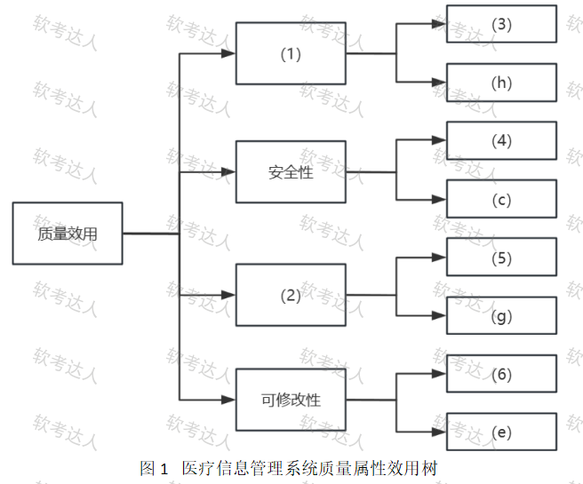
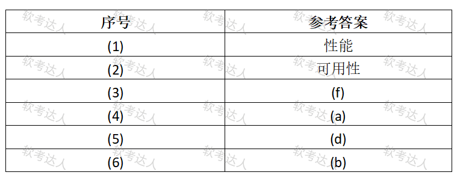

# 医院MIS-效用树安全设计与场景要素案例

## 原题（网站题号 97～99 合并：试题一，25分）

**试题一（25分）**　阅读以下关于软件架构评估的说明，回答下列问题。

【说明】某三甲医院开发医疗信息管理系统（MIS），整合患者电子病历、预约挂号、诊疗记录、药品管理。关键需求与质量属性场景：(a)系统与医院内部网络隔离防外部攻击；(b)新增远程医疗咨询功能三个月内完成；(c)患者隐私数据加密存储和传输；(d)主数据库故障5分钟内切换备用系统；(e)支持新增分院科室无缝集成；(f)实时显示诊室设备状态延迟≤2秒；(g)单服务器故障不影响整体服务且修复≤30分钟；(h)支持1000患者终端+50医生工作站同时访问。

| 网站题号 | 小问 | 分值 |
|---|---|---|
| 97 | 问题1（12分）：效用树填空 (1)(2)质量属性 + (3)~(6)场景序号 | 12 |
| 98 | 问题2（8分）：数据安全/网络安全各选一个描述+技术手段 | 8 |
| 99 | 问题3（5分）：场景要素填空(A)~(E) | 5 |

## 图示

### 题面效用树原图（未覆盖）

### 网站参考答案表（答案载体为图片，role=answer，不进公开题包）

## 来源答案与解析（网站原文）

- 题97：网站答案文字区空，答案以图片表给出：(1)性能、(2)可用性、(3)(f)、(4)(a)、(5)(d)、(6)(b)。解析：无。
- 题98：数据安全(c)五手段+网络安全(a)六手段（网站注明：选项各1分、每知识点答3条得3分）。
- 题99：（A）单个服务器；（B）流量重定向到其他正常服务器并通知管理员修复；（C）服务无中断修复≤30分钟；（D）系统同时处理大量用户访问；（E）挂号高峰期或诊疗高峰期。

## 核验答案（考场作答）

### 【问题1】（12分）

**考场答案**：(1)性能；(2)可用性；(3)=(f)（实时延迟≤2秒→性能）；(4)=(a)（网络隔离→安全性）；(5)=(d)（5分钟切换→可用性）；(6)=(b)（三个月开发新功能→可修改性）。

**采分要点**：六空各2分（推定）。

**详细解析**：与题84同款效用树题：先由已给叶定分支归属（性能分支已给(h)并发→(3)必为(f)实时；安全性分支已给(c)加密→(4)必为(a)隔离；可用性分支已给(g)→(5)必为(d)切换；可修改性分支已给(e)集成→(6)必为(b)新功能开发）。(b)是“新增功能开发时限”归可修改性（含可扩展性）。

**常见失分表达**：(b)误归功能性；(a)误归数据安全。

**知识点链接**：[效用树](https://github.com/Goodyzhang/ruankao.skill/blob/main/materials/%E7%B3%BB%E7%BB%9F%E6%9E%B6%E6%9E%84%E8%AE%BE%E8%AE%A1%E5%B8%88/%E7%AC%94%E8%AE%B0/%E7%9F%A5%E8%AF%86%E7%82%B9/08-%E7%B3%BB%E7%BB%9F%E8%B4%A8%E9%87%8F%E5%B1%9E%E6%80%A7%E4%B8%8E%E6%9E%B6%E6%9E%84%E8%AF%84%E4%BC%B0.md)

### 【问题2】（8分）

**考场答案**：数据安全=(c)。手段：①加密存储——敏感字段（病历、用药记录）用AES-256等算法加密存储；②加密传输——TLS/SSL（HTTPS）加密通信防中间人；③访问控制——基于用户角色+业务的双重访问控制；④数据脱敏——非必要场景显示脱敏数据（姓名显示姓氏+星号）；⑤数据备份——备份与灾难恢复计划保障可用性。网络安全=(a)。手段：①网络隔离——物理隔离（网闸）或防火墙隔断内外网；②网络分段——VLAN逻辑隔离限制横向移动；③边界防护——部署IDS/IPS实时监控阻断攻击；④零信任架构——“永不信任，始终验证”，所有访问需认证；⑤安全协议强化——TLS 1.3加密所有通信；⑥网络沙箱——可疑流量或文件隔离分析。

**采分要点**：两选项各1分＋每知识点答3条得3分（网站给分明示，共8分）。

**详细解析**：数据安全保“数据本身”（加密/脱敏/备份），网络安全保“边界与通道”（隔离/分段/IDS/零信任）。(c)既有存储又有传输，跨两域但落点是数据本身→数据安全；(a)是典型边界防护→网络安全。

**常见失分表达**：手段与选项错位（把防火墙答进数据安全）；每侧不足3条。

**知识点链接**：[安全性设计](https://github.com/Goodyzhang/ruankao.skill/blob/main/materials/%E7%B3%BB%E7%BB%9F%E6%9E%B6%E6%9E%84%E8%AE%BE%E8%AE%A1%E5%B8%88/%E7%AC%94%E8%AE%B0/%E7%9F%A5%E8%AF%86%E7%82%B9/08-%E7%B3%BB%E7%BB%9F%E8%B4%A8%E9%87%8F%E5%B1%9E%E6%80%A7%E4%B8%8E%E6%9E%B6%E6%9E%84%E8%AF%84%E4%BC%B0.md)、[安全架构战术](https://github.com/Goodyzhang/ruankao.skill/blob/main/materials/%E7%B3%BB%E7%BB%9F%E6%9E%B6%E6%9E%84%E8%AE%BE%E8%AE%A1%E5%B8%88/%E7%AC%94%E8%AE%B0/%E7%9F%A5%E8%AF%86%E7%82%B9/08-%E7%B3%BB%E7%BB%9F%E8%B4%A8%E9%87%8F%E5%B1%9E%E6%80%A7%E4%B8%8E%E6%9E%B6%E6%9E%84%E8%AF%84%E4%BC%B0.md)

### 【问题3】（5分）

**考场答案**：(A)单个服务器；(B)将流量重定向到其他正常服务器，并通知管理员修复故障；(C)服务无中断，修复时间≤30分钟；(D)系统同时处理大量用户访问；(E)挂号高峰期或诊疗高峰期。

**采分要点**：五空各1分（推定）。

**详细解析**：六要素摘句法与题50/86同源：从场景句“单个服务器故障不影响整体服务，修复≤30分钟”摘出刺激源=单个服务器、刺激=故障（已给）；响应=系统行为（重定向+通知），响应度量=量化指标（无中断+≤30分钟）；并发场景的刺激=大量访问事件，环境=高峰期。(E)是“运行背景”，答“高峰期”比“正常运行”更贴合题意。

**常见失分表达**：(C)漏“服务无中断”只写修复时间；(E)写成“正常操作”。

**知识点链接**：[质量属性场景描述](https://github.com/Goodyzhang/ruankao.skill/blob/main/materials/%E7%B3%BB%E7%BB%9F%E6%9E%B6%E6%9E%84%E8%AE%BE%E8%AE%A1%E5%B8%88/%E7%AC%94%E8%AE%B0/%E7%9F%A5%E8%AF%86%E7%82%B9/08-%E7%B3%BB%E7%BB%9F%E8%B4%A8%E9%87%8F%E5%B1%9E%E6%80%A7%E4%B8%8E%E6%9E%B6%E6%9E%84%E8%AF%84%E4%BC%B0.md)

## 来源与身份

- 题源：软考达人·第二十二章 案例分析/第一节 案例分析，网站题号97～99（网站分类“第二十二章 案例分析”保留为来源位置，章节路由按实际考点匹配教材章（第2版20章体系）。）
- 年份/卷别未核实，按 web-bank 处理；分值加和 12+8+5=25 与“试题一（25分）”一致。
- 图示：效用树题面原图（original）与参考答案表（answer角色）已下载并实际看图核对；六空与八场景归类逻辑核验吻合。
