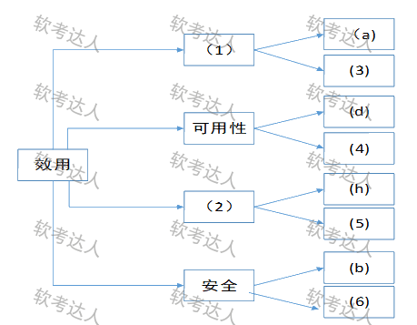
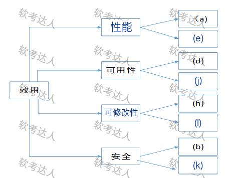

# 在线交易系统升级：效用树与风险敏感权衡综合案例

> 来源：软考达人，第八章第一节，网站题号 136（整题含问题1＋问题2，共 25 分）。年份及原考试题号尚未核实，身份为 web-bank，可用于普通训练。分值拆分为训练推定（网站仅给总分 25 分）；网站解析单独保留。没有用户实际作答或错误记录。

## 共同背景（网站原文）

某电子商务公司拟升级目前正在使用的在线交易系统，以提高客户网上购物时在线支付环节的效率和安全性。公司研发部门在需求分析的基础上，给出了在线交易系统的架构设计。公司组织相关人员召开了针对架构设计的评估会议，会上用户提出的需求、架构师识别的关键质量属性场景和评估专家的意见等内容部分列举如下：

(a) 在正常负载情况下，系统必须在0.5秒内响应用户的交易请求；
(b) 用户的信用卡支付必须保证99.999%的安全性；
(c) 系统升级后用户名要求至少包含8个字符；
(d) 网络失效后，系统需要在2分钟内发现错误并启用备用系统；
(e) 在高峰负载情况下，用户发起支付请求后系统必须在10秒内完成支付功能；
(f) 系统拟采用新的加密算法，这会提高系统安全性，但同时会降低系统的性能；
(g) 对交易请求处理时间的要求将影响系统数据传输协议和交易处理过程的设计；
(h) 需要在30人月内为系统添加公司新购买的事务处理中间件；
(i) 现有架构设计中的支付部分与第三方支付平台紧耦合，当系统需要支持新的支付平台时，这种设计会导致支付部分代码的修改，影响系统的可修改性；
(j) 主站点断电后，需要在3秒内将访问请求重定向到备用站点；
(k) 用户信息数据库授权必须保证99.999%可用；
(l) 系统需要对Web界面风格进行修改，修改工作必须在4人月内完成；
(m) 系统需要为后端工程师提供远程调试接口，并支持远程调试。

## 问题一：效用树填空（12 分）

原题：在架构评估过程中，质量属性效用树(utility tree)是对系统质量属性进行识别和优先级排序的重要工具。请给出合适的质量属性，填入下图中（ ）、（ ）空白处；并选择题干描述的(a)～(m)，填入（ ）～（ ）空白处，完成该系统的效用树。

图结构：根“效用”下四条分支——(1)〔空〕→叶 (a)、(3)；可用性→叶 (d)、(4)；(2)〔空〕→叶 (h)、(5)；安全→叶 (b)、(6)。(1)(2) 填质量属性名，(3)～(6) 填题干字母。

### 考场答案

| 图中空号 | 填写 | 依据 |
|---|---|---|
| (1) | 性能 | 同分支已有叶 (a)：正常负载 0.5 秒内响应交易请求 |
| (2) | 可修改性 | 同分支已有叶 (h)：30 人月内加入新事务处理中间件 |
| (3) | (e) | 高峰负载下 10 秒内完成支付：环境＋响应度量齐全的性能场景 |
| (4) | (j) | 主站点断电 3 秒内重定向备用站点：故障恢复的可用性场景 |
| (5) | (l) | Web 界面风格修改限 4 人月：修改代价的可修改性场景 |
| (6) | (k) | 数据库授权 99.999% 可用：授权防护的安全性场景 |

网站答案表（存档 [source-answer-tree.png](../../assets/4e3b19dab5fc89db.png)）给 (5)=(l)。等价填法：(3) 处 (a)／(e) 同属性能叶，互换成立；(5) 处 (i) 也是紧耦合修改的可修改性场景，但 (i) 同时是问题二指定的风险点，为避免一字母两用优先 (l)；(6) 处 (c)（用户名 8 字符）偏账户口令策略，场景三要素证据弱于 (k)，不推荐。同一分支可挂多条同属性场景，不要因“已有 (a)”而排除 (e)。

[可编辑 SVG 标注稿](../../assets/f6b5e00119479890.svg)。原图未改，答案图不进入实验室公开资源。

### 采分要点

训练推定每空 2 分，共 12 分。属性名必须与分支已有叶子互相印证：(1) 由 (a) 锁定性能，(2) 由 (h) 锁定可修改性。字母填空要写场景归类依据（环境、响应度量），只写字母不给依据在简答题里易被扣步骤分。

### Tutor 解析：用现成叶子反推分支

效用树不必从零背起：每条分支已挂一个已知场景，先读它——(a) 问“多快响应”→性能；(d) 问“故障后多久恢复”→可用性；(h) 问“改动花多大代价”→可修改性；(b) 问“支付安不安全”→安全。空属性 (1)(2) 沿已知叶向左走即可锁定。

其余字母按“先归类、再对号、后排除”三步。(e)(g) 都谈时间，但 (g) 说“处理时间要求影响协议与交易处理设计”，是“属性牵引设计”的敏感点句式（问题二考点），不是带响应度量的场景；(e) 有明确环境（高峰负载）与响应度量（10 秒），是标准性能场景，进 (3)。(i)(l) 都是修改代价：(i) 紧耦合是已暴露的设计隐患（问题二风险点），(l) 是中性的修改时间约束，进 (5)。(j) 与 (d) 同为故障恢复，(j) 补进可用性 (4)。(k) 是“授权必须 99.999% 可用”——别被“可用”两个字骗去可用性分支：可用性分支问“站点/系统失效后多久回来”，(k) 问的是授权防护这一安全目标，进 (6)。(c) 用户名至少 8 字符是账户口令策略，撑不起安全分支的场景三要素。(m) 远程调试接口属可测试性/支持性，本树无该分支，是干扰项。

常错表达：把 (f) 填进树的空里。(f) 是加密算法的安全-性能对抗，属于问题二的权衡点，它没有“环境-响应度量”结构，不是效用树叶子。

关联：效用树四层结构、四大核心概念。

## 问题二：风险点、敏感点、权衡点（13 分）

原题：在架构评估过程中，需要正确识别系统的架构风险、敏感点和权衡点，并进行合理的架构决策。请用300字以内的文字给出系统架构风险、敏感点和权衡点的定义，并从题干(a)～(m)中各选出1个对系统架构风险、敏感点和权衡点最为恰当的描述。

### 考场答案（300 字内）

架构风险是架构设计中潜在的、存在问题的架构决策所带来的隐患；敏感点是为了实现某种特定质量属性，一个或多个构件所具有的特性；权衡点是影响多个质量属性、并对多个质量属性都是敏感点的属性。

对应：风险点选 (i)——支付部分与第三方平台紧耦合，支持新平台必须改代码，是已存在并将付出代价的设计隐患；敏感点选 (g)——交易处理时间要求直接决定数据传输协议与交易处理设计，单点牵动性能实现；权衡点选 (f)——新加密算法同时提高安全性、降低性能，一个决策牵动两个质量属性对抗。（含定义约 190 字，符合限字。）

### 采分要点

训练推定：三个定义各 3 分（风险=“潜在、存在问题的决策→隐患”，敏感点=“特定质量属性＋一个或多个构件的特性”，权衡点=“影响多个质量属性＋都是敏感点”，各含两个关键词簇）；(i)(g)(f) 对应各 1 分；结合题干给出选择理由共 1 分，合计 13 分。定义漏“潜在的/存在问题的”限定、把敏感点写成“整个系统”而非“构件特性”、权衡点漏“都是敏感点”递进层，是最常见的三处失分。

### Tutor 解析：三步判别

先数属性：一个决策只牵动一个质量属性→敏感点；(f) 安全性升、性能降，两属性对抗→权衡点。再判稳不稳：已写进架构、未来要付代价的坏味道→风险点；(i) 的紧耦合“已存在且必然导致修改”，是典型风险句式。最后核对句式：教材 §8.2.1 的经典例句就是“提高加密级别→安全↑性能↓”，与 (f) 一字不差对应，考场遇到直接锁权衡点。

(g) 易与 (f) 混淆：(g) 只谈“处理时间要求”这一个属性如何牵引设计，没有第二个属性与之对抗，是敏感点不是权衡点。(c)(m) 与三类概念无关，是干扰项。

关联：四大核心概念辨析。

## 网站原答案与解析（存档）

网站“答案”栏：【问题1】文字仅说明“效用树主要关注性能、可修改性、可用性和安全4个方面”，配答案表图：(1)性能 (2)可修改性 (3)(e) (4)(j) (5)(l) (6)(k)；【问题2】给出三个定义并判定 (i) 风险、(g) 敏感、(f) 权衡。“解析”栏为“略”。来源答案表存档于 [source-answer-tree.png](../../assets/4e3b19dab5fc89db.png)，与上面核验答案一致。
