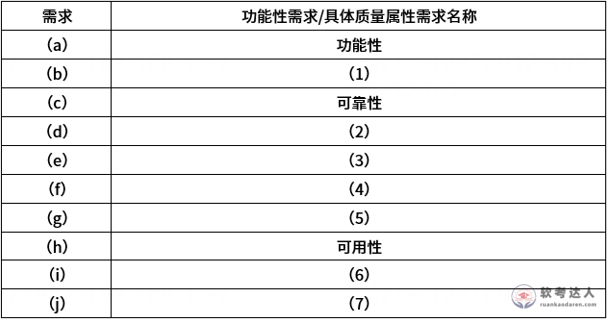

# 大语言模型智能系统-需求归类与可用性战术案例

## 原题（网站题号 95～96 合并：试题一，共25分）

**试题一（25分）**　阅读以下关于面向质量属性的软件架构设计的叙述，回答问题1和问题2。

【说明】某公司拟开发基于大语言模型的智能系统：多个大语言模型协作处理用户任务请求，任务求解状态记录在任务板中，各模型根据任务板实时状态决定是否被调用，处理后更新任务板。系统需求(a)~(j)：

(a)支持用户在任务板查看任务状态和结果，并允许多次调用大模型优化结果；(b)支持任务数据导入导出，1分钟内完成；(c)数据服务器故障时立刻切换到备份服务器并保证数据同步，确保不间断服务；(d)正常负荷下查询任务状态和结果响应时间2秒内；(e)确保用户数据和操作记录安全，防止未授权访问；(f)支持多语言接口，提供查询词自动补全和搜索关联；(g)支持扩容以容纳更多用户和任务，扩容实现应在两名运维人员情况下5天内完成；(h)部署在云服务器上，云服务器故障时1分钟内检测出故障并在1小时内恢复；(i)支持根据用户任务类型调用相应大语言模型处理；(j)可在任务板搜索历史任务和结果，搜索结果3秒内返回。

| 网站题号 | 小问 | 分值 |
|---|---|---|
| 95 | 问题1（14分）：分析需求(a)~(j)，补充表中(1)~(7)空白（需求→质量属性归类） | 14 |
| 96 | 问题2（11分）：ping/echo与心跳策略的故障检测机制及心跳更优的原因 | 11 |

## 图示（原图，未覆盖）

## 来源答案与解析（网站原文）

- 题95：（1）性能；（2）性能；（3）安全性；（4）功能性；（5）可修改性；（6）功能性；（7）性能。（解析：略；表图中(a)功能性、(c)可靠性、(h)可用性已给出）
- 题96：两策略机制+心跳更优三理由（含详细解析，见台账 analysis-96.json）。

## 核验答案（考场作答）

### 【问题1】（14分）

**考场答案**：(1)=性能（b：导入导出1分钟内）；(2)=性能（d：查询响应2秒内）；(3)=安全性（e：防未授权访问）；(4)=功能性（f：多语言接口、自动补全、搜索关联）；(5)=可修改性（g：扩容2人5天内完成——“人的工作量+时限”是可修改性/易变更性的度量）；(6)=功能性（i：按任务类型调用相应模型）；(7)=性能（j：搜索3秒内返回）。表已给：(a)功能性、(c)可靠性、(h)可用性。

**采分要点**：七空各2分（推定）。

**详细解析**：归类锚点：带时间/容量量化指标的(a)(b)(d)(j)性能；关注变更成本与人的工作量(g)可修改性；安全防护(e)安全性；业务能力清单(f)(i)功能性。(g)最易误判为性能——判断依据是“改变系统以适应新需求所花的代价（2人5天）”，属于可修改性。

**常见失分表达**：(g)归性能或可用性；(f)(i)误归性能。

**知识点链接**：[面向架构评估的质量属性](https://github.com/Goodyzhang/ruankao.skill/blob/main/materials/%E7%B3%BB%E7%BB%9F%E6%9E%B6%E6%9E%84%E8%AE%BE%E8%AE%A1%E5%B8%88/%E7%AC%94%E8%AE%B0/%E7%9F%A5%E8%AF%86%E7%82%B9/08-%E7%B3%BB%E7%BB%9F%E8%B4%A8%E9%87%8F%E5%B1%9E%E6%80%A7%E4%B8%8E%E6%9E%B6%E6%9E%84%E8%AF%84%E4%BC%B0.md)

### 【问题2】（11分）

**考场答案**：(1)机制——ping/echo策略：监控组件定期向目标发送ping请求报文并等待回应来检测故障，收到回应表明通路正常，未收到或超时则可能网络问题或目标不可达；心跳策略：节点间定期交换心跳信号确认服务状态，连续一段时间未收到某节点心跳则判定故障或失联，触发故障恢复或切换（常用于分布式系统）。(2)心跳更优的原因：①资源消耗少——心跳由被监控组件主动周期性发送简短消息，ping/echo需监控端定时发请求并等待回应，消耗更多网络流量与处理器资源（心跳用长连接，ping用短连接）；②降低网络负载——心跳消息短且发送频率较低，带宽占用少；③故障检测效率更高——心跳周期性发送，节点故障无法发心跳时监控组件立即察觉，ping/echo的检测效率受网络延迟和消息丢失影响。

**采分要点**：机制约4分＋三理由约7分（推定；结合网站给分结构）。

**详细解析**：可用性战术（ping/echo、心跳、冗余、表决等）是§8质量属性战术考点。判别核心：**谁主动**——ping/echo监控方主动探测（多一次往返等待），心跳被监控方主动上报（省资源）；本题(h)“1分钟内检测出故障”两者都满足，比较维度落在资源利用率——题干李工立场已给出方向。

**常见失分表达**：只答“心跳好”没有资源/负载/效率三维度；机制描述混淆主动方。

**知识点链接**：[可用性战术](https://github.com/Goodyzhang/ruankao.skill/blob/main/materials/%E7%B3%BB%E7%BB%9F%E6%9E%B6%E6%9E%84%E8%AE%BE%E8%AE%A1%E5%B8%88/%E7%AC%94%E8%AE%B0/%E7%9F%A5%E8%AF%86%E7%82%B9/08-%E7%B3%BB%E7%BB%9F%E8%B4%A8%E9%87%8F%E5%B1%9E%E6%80%A7%E4%B8%8E%E6%9E%B6%E6%9E%84%E8%AF%84%E4%BC%B0.md)

## 来源与身份

- 题源：软考达人·第二十二章 案例分析/第一节 案例分析，网站题号95～96（网站分类“第二十二章 案例分析”保留为来源位置，章节路由按实际考点匹配教材章（第2版20章体系）。）
- 年份/卷别未核实，按 web-bank 处理；分值加和 14+11=25 与“试题一（共25分）”一致。
- 图示：需求归类表原图已下载并实际看图核对七空行序（(a)(c)(h)已给、七空为(1)~(7)）。
