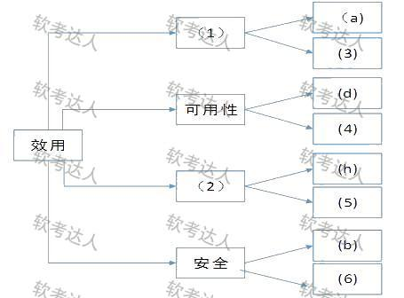
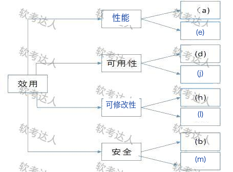

# 教务管理系统升级：效用树、三概念与等保2.0综合案例

> 来源：软考达人，第八章第一节，网站题号 144（问题1 12分＋问题2 8分＋问题3 5分，合计 25 分）。年份及原考试题号尚未核实，身份为 web-bank，可用于普通训练。本题为在线交易系统案例（本库 136 题）的校园改编版：多数条件逐字沿用，(b)(c)(h)(l) 换为校园语境，(m) 由远程调试接口改为 WAF 安全部署——改编改变了答案结构，故独立成案不与 136 合并。采分点拆分为训练推定。没有用户实际作答或错误记录。

## 共同背景（网站原文）

请详细阅读有关软件架构评估方面的说明，回答下列问题。
【说明】
某校园软件提供商拟升级目前正在使用的教务管理系统，以提高教务管理以及在线业务办理的效率和安全性。公司研发部门在需求分析的基础上，给出了新教务系统的架构设计。公司组织相关人员召开了针对架构设计的评估会议，会上用户提出的需求、架构师识别的关键质量属性场景和评估专家的意见等内容部分列举如下：
(a)在正常负载情况下，系统必须在0.5秒内响应用户的交易请求；
(b)学生在线报名之后进行在线支付，必须保证99.999%的安全性；
(c)系统升级后采用学号做为用户名；
(d)网络失效后，系统需要在2分钟内发现错误并启用备用系统；
(e)在高峰负载情况下，学生发起支付请求后系统必须在10秒内完成支付功能；
(f)系统拟采用新的加密算法，这会提高系统安全性，但同时会降低系统的性能；
(g)对交易请求处理时间的要求将影响系统数据传输协议和交易处理过程的设计；
(h)需要在30人月内为系统添加公司新购买的选课中间件；
(i)现有架构设计中的支付部分与第三方支付平台紧耦合，当系统需要支持新的支付平台时，这种设计会导致支付部分代码的修改，影响系统的可修改性；
(j)主站点断电后，需要在3秒内将访问请求重定向到备用站点；
(k)用户信息数据库授权必须保证99.999%可用；
(l)系统需要根据校方的要求对界面风格进行修改，修改工作必须在1人月内完成；
(m)系统需要部署在WAF的后面，以防止来自应用层的各种攻击。

## 问题一：效用树（12 分）

原题：在架构评估过程中，质量属性效用树(utility tree)是对系统质量属性进行识别和优先级排序的重要工具。请给出合适的质量属性，填入下图中（ ）、（ ）空白处；并选择题干描述的(a)～(m)，填入（ ）～（ ）空白处，完成该系统的效用树。

图结构：根"效用"下四条分支——(1)〔空〕→叶 (a)、(3)；可用性→叶 (d)、(4)；(2)〔空〕→叶 (h)、(5)；安全→叶 (b)、(6)。(1)(2) 填质量属性名，(3)～(6) 填题干字母。

### 考场答案

| 图中空号 | 填写 | 依据 |
|---|---|---|
| (1) | 性能 | 同分支已有叶 (a)：正常负载 0.5 秒内响应交易请求 |
| (2) | 可修改性 | 同分支已有叶 (h)：30 人月内添加选课中间件 |
| (3) | (e) | 高峰负载 10 秒内完成支付：环境＋响应度量的性能场景 |
| (4) | (j) | 主站点断电 3 秒内重定向备用站点：故障恢复的可用性场景 |
| (5) | (l) | 按校方要求修改界面风格限 1 人月：修改代价的可修改性场景 |
| (6) | (m) | 部署在 WAF 后防应用层攻击：攻击防抗的安全性场景 |

网站答案表（存档 [source-answer-tree.png](../../assets/2f12862a619f9f1d.png)）与此完全一致。等价填法：(6) 处 (k)（数据库授权 99.999% 可用）同为安全性场景，作为等价填法可接受；网站采用 (m)，WAF 防应用层攻击是更典型的安全防抗场景。(3) 处 (a)／(e) 同属性能叶可互换；(i) 虽也是可修改性，但它同时是问题二指定的风险点，为避免一字母两用优先 (l)。

[可编辑 SVG 标注稿](../../assets/9db24b2d6e3df75d.svg)。原图未改，答案图不进入实验室公开资源。

### 采分要点

训练推定每空 2 分，共 12 分。属性名与分支已有叶子互相印证：(1) 由 (a) 锁定性能，(2) 由 (h) 锁定可修改性。字母填空写场景归类依据；同分支字母不可复用。本版与 136 版的关键差异在 (6)：原版 (m) 是远程调试接口（可测试性，干扰项），本版 (m) 改为 WAF 安全部署（安全叶的正确答案）——条件改编后答案随之改变，背答案不如读条件。

### Tutor 解析：改编题先核对每个字母的归属

效用树四条分支与 136 版完全同构，解法仍是"先读现成叶子，再补同属性"。(a)→性能、(d)→可用性、(h)→可修改性、(b)→安全，四个已知叶把空属性 (1)(2) 锁定；字母空在同属性描述里挑未占用的：(e) 补性能、(j) 补可用性、(l) 补可修改性。

真正要防的是照搬旧答案：136 版第 (6) 空填 (k)（数据库授权），因为那一版的 (m) 是"远程调试接口"。本版命题人把 (m) 改成"部署在 WAF 后面防应用层攻击"——条件一换，(m) 从干扰项变成安全支的正确叶，(k) 反而退居等价备选。改编题的考点就是"条件变了，归类跟着变"。

常错表达：把 (k) 填进 (6) 之后把 (m) 当干扰项弃掉。(k) 的"99.999%可用"字样也容易把它骗进可用性支——可用性问"系统失效后多久回来"，授权可用性是安全属性；但本支已有 (b)(m) 两条更典型的安全场景，(k) 无位可补。

关联：效用树四层结构、等级保护制度基础。

## 问题二：风险、敏感点与权衡点（8 分）

原题：在架构评估过程中，需要正确识别系统的架构风险、敏感点和权衡点，并进行合理的架构决策。请用300字以内的文字给出系统架构风险、敏感点和权衡点的定义，并从题干(a)～(m)中各选出1个对系统架构风险、敏感点和权衡点最为恰当的描述。

### 考场答案（300 字内）

架构风险是架构设计中潜在的、存在问题的架构决策所带来的隐患；敏感点是为了实现某种特定质量属性，一个或多个构件所具有的特性；权衡点是影响多个质量属性、并对多个质量属性都是敏感点的属性。

对应：风险点选 (i)——支付部分与第三方平台紧耦合，支持新平台必须改代码，是已存在并将付出代价的设计隐患；敏感点选 (g)——交易处理时间要求直接决定数据传输协议与交易处理设计；权衡点选 (f)——新加密算法同时提高安全性、降低性能，一个决策牵动两个质量属性。

### 采分要点

训练推定：三个定义各 2 分（6 分），(i)(g)(f) 对应合计 2 分（各约 0.67 分），共 8 分。定义漏"潜在的/存在问题的"限定、把敏感点写成"整个系统"而非"构件特性"、权衡点漏"都是敏感点"递进层，是最常见的三处失分。字母与 136 版一致：(i) 风险、(g) 敏感、(f) 权衡。

### Tutor 解析：三步判别

先数属性：一个决策只牵动一个质量属性→敏感点；(f) 安全性升、性能降，两属性对抗→权衡点。再判稳不稳：已写进架构、未来要付代价的坏味道→风险点；(i) 的紧耦合"已存在且必然导致修改"，是典型风险句式。(m) 在本版是标准的"防御措施"（WAF 防攻击），属于安全支的正面场景，不是风险也不是敏感点——这也是改编版把 (m) 换掉的原因之一：原版干扰项变成了正向叶子，避免它在新位置与三概念混淆。

关联：四大核心概念。

## 问题三：等保 2.0 与 1.0 的区别（5 分）

原题：WAF在信息系统等级保护中起着非常重要的作用。然而随着国家对于网络信息安全的重视，等级保护即将迎来2.0时代，请用300字以内文字简要说明等保2.0与1.0的区别。

### 考场答案（300 字内）

一是覆盖范围更广：等保2.0覆盖各地区、各单位、各部门、各企业、各机构，即覆盖全社会；二是保护对象更全：从网络、信息系统扩展到云平台、物联网、工控系统、大数据、移动互联等各类新技术应用；三是可信验证升级：将可信验证列入各级别和各环节的主要功能要求；四是标准名称与法律依据更新：《信息系统安全等级保护基本要求》改为《网络安全等级保护基本要求》，与《网络安全法》保持一致。

### 采分要点

训练推定每点 1.25 分，共 5 分。四点各含一个关键词簇：全社会覆盖、新技术保护对象（云/物联/工控/大数据/移动互联）、可信验证入各级各环节、《网络安全等级保护基本要求》名称与《网络安全法》衔接。只写"要求更高、更严格"这类空泛表述不给分。

### Tutor 解析：从"对象、范围、手段、依据"四维记忆

等保 1.0 依据 GB/T 22239-2008，定级对象是传统信息系统，防护以被动防御为主；等保 2.0（GB/T 22239-2019，2019 年 12 月 1 日实施）把云、物联网、工控、大数据、移动互联全部纳入定级对象，要求可信验证贯穿各级各环节（主动防御思路），标准名从"信息系统安全"改为"网络安全"以衔接《网络安全法》。记忆抓手：范围（全社会）→对象（新技术）→手段（可信验证）→依据（网络安全法）。

WAF 在等保中的位置：应用层攻击防护属于安全计算环境/安全区域边界的防护措施，题干用它引出等级保护话题——第 (m) 条的 WAF 部署既是效用树安全叶的答案，也是问题三的话头，三问在题面上互相勾连。

关联：等级保护制度基础。

## 网站原答案与解析（存档）

网站"答案"栏：【问题1】文字仅说明"效用树主要关注性能、可修改性、可用性和安全4个方面"，配答案表图：(1)性能 (2)可修改性 (3)(e) (4)(j) (5)(l) (6)(m)；【问题2】给出三个定义并判定 (i) 风险、(g) 敏感、(f) 权衡；【问题3】给出上述四点区别。"解析"栏为"无"。来源答案表存档于 [source-answer-tree.png](../../assets/2f12862a619f9f1d.png)，与上面核验答案一致。
