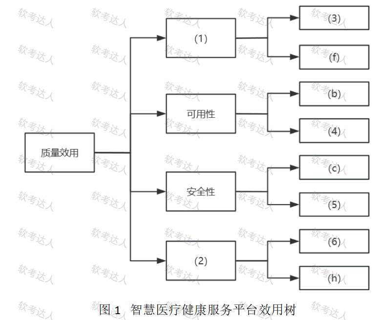
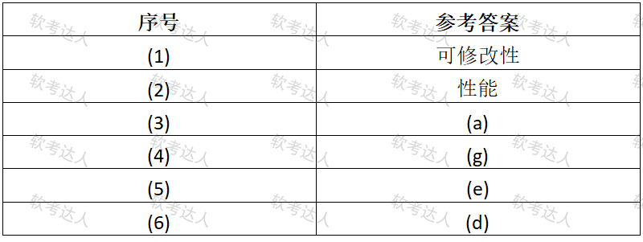

# 智慧医疗平台-效用树互操作与管道过滤器案例

## 原题（网站题号 198～200 合并：试题一，25分）

**试题一（25分）**　阅读以下关于软件架构评估的说明，回答下列问题。

【说明】某市卫健委构建市级“智慧医疗健康服务平台”（整合三甲医院、社区诊所、医保系统；统一预约挂号、在线问诊、电子病历查阅、医保结算）。关键质量属性场景：(a)医保结算模块支持省级政策变更、3人月内完成适配；(b)7×24小时不间断、全年运行≥99.99%；(c)门诊检查报告不可篡改；(d)门诊高峰（工作日8-10点）预约挂号响应<1秒；(e)电子病历存储传输加密脱敏防泄露；(f)新增“疫苗接种记录查询”最多2周完成并集成；(g)主数据库故障90秒内无缝切换备用且不丢已提交事务；(h)为第三方提供标准API、每天至少10000次调用。

| 网站题号 | 小问 | 分值 |
|---|---|---|
| 198 | 问题1（12分）：效用树填空 (1)(2)质量属性 + (3)~(6)场景序号 | 12 |
| 199 | 问题2（4分）：场景(h)还关注的另一个运行期质量属性 | 4 |
| 200 | 问题3（9分）：加密脱敏选管道-过滤器还是虚拟机风格（性能/可维护性/安全性） | 9 |

## 图示

### 题面效用树原图（未覆盖）

### 网站参考答案表（答案载体为图片，role=answer，不进公开题包）

## 来源答案与解析（网站原文）

- 题198：网站答案文字区空，答案以图片表给出：(1)可修改性、(2)性能、(3)(a)、(4)(g)、(5)(e)、(6)(d)。解析：无。
- 题199：场景(h)除性能外还关注互操作性——本软件系统与其他系统交换数据和相互调用服务的难易程度。（解析：无）
- 题200：管道-过滤器风格+性能/可维护性/安全性三维理由。（解析：无）

## 核验答案（考场作答）

### 【问题1】（12分）

**考场答案**：(1)可修改性；(2)性能；(3)=(a)（3人月适配→可修改性）；(4)=(g)（90秒切换→可用性）；(5)=(e)（加密脱敏→安全性）；(6)=(d)（响应<1秒→性能）。

**采分要点**：六空各2分（推定）。

**详细解析**：与题84/97/122/156/183同类效用树题。四分支已给叶定归属：(1)分支已给(f)→(1)=可修改性、(3)=(a)；可用性已给(b)→(4)=(g)；安全性已给(c)→(5)=(e)；(2)分支已给(h)→(2)=性能、(6)=(d)。(h)“API日调1万次”是吞吐量→性能，不是互操作性（互操作性在问题2单独考）。

**常见失分表达**：(h)误归互操作性（问题2才考互操作）；(a)3人月误归性能。

**知识点链接**：[效用树](https://github.com/Goodyzhang/ruankao.skill/blob/main/materials/%E7%B3%BB%E7%BB%9F%E6%9E%B6%E6%9E%84%E8%AE%BE%E8%AE%A1%E5%B8%88/%E7%AC%94%E8%AE%B0/%E7%9F%A5%E8%AF%86%E7%82%B9/08-%E7%B3%BB%E7%BB%9F%E8%B4%A8%E9%87%8F%E5%B1%9E%E6%80%A7%E4%B8%8E%E6%9E%B6%E6%9E%84%E8%AF%84%E4%BC%B0.md)

### 【问题2】（4分）

**考场答案**：质量属性场景(h)除性能外还关注**互操作性**——指本软件系统与其他系统交换数据和相互调用服务的难易程度。

**采分要点**：判定2分＋解释2分（推定）。

**详细解析**：“为第三方提供标准API”双重含义：调用量（性能）+与第三方系统对接（互操作性）。运行期质量属性清单（性能/安全性/可用性/易用性/互操作性）中互操作性最易被忽略。

**常见失分表达**：答成“可修改性”（3人月那条才是）；解释漏“交换数据和调用服务”。

**知识点链接**：[质量属性概念（互操作性）](https://github.com/Goodyzhang/ruankao.skill/blob/main/materials/%E7%B3%BB%E7%BB%9F%E6%9E%B6%E6%9E%84%E8%AE%BE%E8%AE%A1%E5%B8%88/%E7%AC%94%E8%AE%B0/%E7%9F%A5%E8%AF%86%E7%82%B9/08-%E7%B3%BB%E7%BB%9F%E8%B4%A8%E9%87%8F%E5%B1%9E%E6%80%A7%E4%B8%8E%E6%9E%B6%E6%9E%84%E8%AF%84%E4%BC%B0.md)

### 【问题3】（9分）

**考场答案**（300字内）：更适合采用**管道-过滤器风格**。①性能：管道-过滤器能以高效的流水线方式对数据进行多级并行处理，性能优秀；虚拟机风格需解释执行加密和脱敏指令，性能差。②可维护性：管道-过滤器中需修改加密或脱敏算法、调整处理顺序时，可单独替换某个构件或连接件，可维护性高；虚拟机风格有的算法实现需修改解释器本身，可维护性稍差。③安全性：管道-过滤器数据流清晰明了，每个过滤器只访问完成其任务所必需的数据，安全审计人员可严格审查每一个独立处理环节，安全性好；虚拟机风格解释器引擎通常存在较高复杂性，容易造成安全隐患。

**采分要点**：结论＋三维度各3分（推定）。

**详细解析**：与题185（事件驱动vs管道-过滤器）对照成趣——同一管道-过滤器，在“实时状态展示”场景输给事件驱动（流水线延迟），在“加密脱敏流水处理”场景胜过虚拟机（流水线优势）：风格选型永远以场景需求为准，两题对照背诵效果最佳。

**常见失分表达**：三维度缺一；安全性漏“最小数据访问/可审计”。

**知识点链接**：[管道-过滤器与虚拟机风格](https://github.com/Goodyzhang/ruankao.skill/blob/main/materials/%E7%B3%BB%E7%BB%9F%E6%9E%B6%E6%9E%84%E8%AE%BE%E8%AE%A1%E5%B8%88/%E7%AC%94%E8%AE%B0/%E7%9F%A5%E8%AF%86%E7%82%B9/05-%E8%BD%AF%E4%BB%B6%E5%B7%A5%E7%A8%8B%E5%9F%BA%E7%A1%80%E7%9F%A5%E8%AF%86.md)

## 来源与身份

- 题源：软考达人·第二十二章 案例分析/第一节 案例分析，网站题号198～200（网站分类“第二十二章 案例分析”保留为来源位置，章节路由按实际考点匹配教材章（第2版20章体系）。）
- 年份/卷别未核实，按 web-bank 处理；分值加和 12+4+9=25 与“试题一（25分）”一致。
- 图示：效用树题面原图（original）与参考答案表（answer角色）已下载并实际看图核对，六空与四分支归属互证一致。
