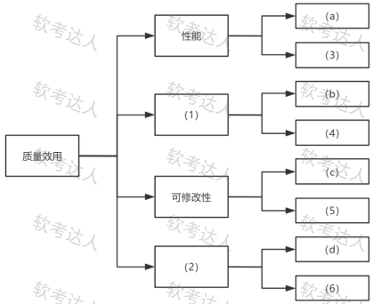
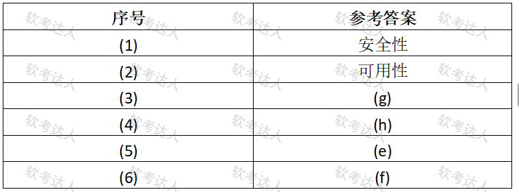

# 智慧校园平台-效用树与SAAM案例

## 原题（网站题号 156～158 合并：试题一，25分）

**试题一（25分）**　阅读以下关于软件架构评估的说明，回答下列问题。

【说明】某高校开发智慧校园综合管理平台（整合教务/后勤/安防）。关键质量属性场景：(a)支持5000并发在线用户；(b)资讯发布前三级审核；(c)支持AI考勤子系统无缝接入；(d)勒索病毒攻击后4小时内恢复数据；(e)教室预约UI适配移动端10天内完成；(f)主服务器故障5分钟内切换异地灾备；(g)选课高峰响应≤2秒；(h)师生敏感数据传输端到端加密。

| 网站题号 | 小问 | 分值 |
|---|---|---|
| 156 | 问题1（12分）：效用树填空 (1)(2)质量属性 + (3)~(6)场景序号 | 12 |
| 157 | 问题2（5分）：SAAM分析过程 | 5 |
| 158 | 问题3（8分）：场景(d)(g)的刺激源/环境/响应/响应度量四要素 | 8 |

## 图示

### 题面效用树原图（未覆盖）

### 网站参考答案表（答案载体为图片，role=answer，不进公开题包）

## 来源答案与解析（网站原文）

- 题156：网站答案文字区空，答案以图片表给出：(1)安全性、(2)可用性、(3)(g)、(4)(h)、(5)(e)、(6)(f)。解析：无。
- 题157：场景开发、架构描述、单个场景评估、场景交互评估、总体评估。（解析：无）
- 题158：场景(d)(g)四要素。（解析：无）

## 核验答案（考场作答）

### 【问题1】（12分）

**考场答案**：(1)安全性；(2)可用性；(3)=(g)（选课高峰响应≤2秒→性能）；(4)=(h)（端到端加密→安全性）；(5)=(e)（UI适配10天→可修改性）；(6)=(f)（5分钟灾备切换→可用性）。

**采分要点**：六空各2分（推定）。

**详细解析**：效用树四分支已给叶定归属：性能已给(a)→(3)=(g)；(1)分支已给(b)三级审核（安全管控）→(1)=安全性、(4)=(h)加密；可修改性已给(c)→(5)=(e)；(2)分支已给(d)勒索恢复→(2)=可用性、(6)=(f)切换。与题84/97/122同款题型，套路完全一致。

**常见失分表达**：(b)三级审核误归功能性；(d)勒索恢复误归安全性。

**知识点链接**：[效用树](https://github.com/Goodyzhang/ruankao.skill/blob/main/materials/%E7%B3%BB%E7%BB%9F%E6%9E%B6%E6%9E%84%E8%AE%BE%E8%AE%A1%E5%B8%88/%E7%AC%94%E8%AE%B0/%E7%9F%A5%E8%AF%86%E7%82%B9/08-%E7%B3%BB%E7%BB%9F%E8%B4%A8%E9%87%8F%E5%B1%9E%E6%80%A7%E4%B8%8E%E6%9E%B6%E6%9E%84%E8%AF%84%E4%BC%B0.md)

### 【问题2】（5分）

**考场答案**：SAAM分析过程：场景开发、架构描述、单个场景评估、场景交互评估、总体评估。

**采分要点**：五步各1分（推定）。

**详细解析**：SAAM五步与教程§8.2.2一致（最早形成文档并广泛应用的架构分析方法）。记忆：先场景、再描述、逐个评、看交互、最后总评。与ATAM（效用树为核心）对比记忆。

**常见失分表达**：漏“场景交互评估”；步骤顺序错。

**知识点链接**：[SAAM与ATAM对比](https://github.com/Goodyzhang/ruankao.skill/blob/main/materials/%E7%B3%BB%E7%BB%9F%E6%9E%B6%E6%9E%84%E8%AE%BE%E8%AE%A1%E5%B8%88/%E7%AC%94%E8%AE%B0/%E7%9F%A5%E8%AF%86%E7%82%B9/08-%E7%B3%BB%E7%BB%9F%E8%B4%A8%E9%87%8F%E5%B1%9E%E6%80%A7%E4%B8%8E%E6%9E%B6%E6%9E%84%E8%AF%84%E4%BC%B0.md)

### 【问题3】（8分）

**考场答案**：场景(d)：刺激源=勒索病毒软件；环境=系统未及时更新安全补丁；响应=执行数据恢复操作；响应度量=数据恢复完成时间≤4小时。场景(g)：刺激源=大量学生用户（≥5000人）；环境=开放选课高峰时段；响应=系统处理选课请求并返回结果；响应度量=请求响应时间≤2秒。

**采分要点**：两场景四要素各1分（推定）。

**详细解析**：与题86/99/124同源六要素题（本题不要求制品项）。摘句法：(d)句“勒索病毒攻击”→刺激源是病毒软件而非用户；“4小时恢复”→响应度量。(g)句“高峰时段”→环境、“≤2秒”→度量。

**常见失分表达**：(d)刺激源写成“黑客”；(g)环境漏“高峰时段”。

**知识点链接**：[质量属性场景描述](https://github.com/Goodyzhang/ruankao.skill/blob/main/materials/%E7%B3%BB%E7%BB%9F%E6%9E%B6%E6%9E%84%E8%AE%BE%E8%AE%A1%E5%B8%88/%E7%AC%94%E8%AE%B0/%E7%9F%A5%E8%AF%86%E7%82%B9/08-%E7%B3%BB%E7%BB%9F%E8%B4%A8%E9%87%8F%E5%B1%9E%E6%80%A7%E4%B8%8E%E6%9E%B6%E6%9E%84%E8%AF%84%E4%BC%B0.md)

## 来源与身份

- 题源：软考达人·第二十二章 案例分析/第一节 案例分析，网站题号156～158（网站分类“第二十二章 案例分析”保留为来源位置，章节路由按实际考点匹配教材章（第2版20章体系）。）
- 年份/卷别未核实，按 web-bank 处理；分值加和 12+5+8=25 与“试题一（25分）”一致。
- 图示：效用树题面原图（original）与参考答案表（answer角色）已下载并实际看图核对，四分支归属与八场景归类互证一致。
