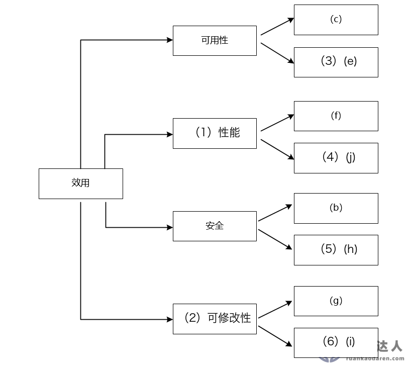

# 机器学习应用开发平台：效用树与三种架构风格综合案例

> 来源：软考达人，第八章第二节，网站题号 84，一页含问题1（9 分）＋问题2（16 分），合计 25 分。年份及原考试题号尚未核实，身份为 web-bank，可用于普通训练。采分细则为训练推定；网站解析（含完整参考答案）单独保留。没有用户实际作答或错误记录。

## 题干（网站原文）

阅读以下关于软件架构设计与评估的叙述，回答问题1和问题2。
【说明】
某公司拟开发一套机器学习应用开发平台，支持用户使用浏览器在线进行基于机器学习的智能应用开发活动。
该平台的核心应用场景是用户通过拖拽算法组件灵活定义机器学习流程，采用自助方式进行智能应用设计、实现与部署，并可以开发新算法组件加入平台中。在需求分析与架构设计阶段，公司提出的需求和质量属性描述如下：
（a）平台用户分为算法工程师、软件工程师和管理员等三种角色，不同角色的功能界面有所不同；
（b）平台应该具备数据库保护措施，能够预防核心数据库被非授权用户访问；
（c）平台支持分布式部署，当主站点断电后，应在20秒内将请求重定向到备用站点；
（d）平台支持初学者和高级用户两种界面操作模式，用户可以根据自己的情况灵活选择合适的模式；
（e）平台主站点宕机后，需要在15秒内发现错误并启用备用系统；
（f）在正常负载情况下，机器学习流程从提交到开始执行，时间间隔不大于5秒；
（g）平台支持硬件扩容与升级，能够在3人•天内完成所有部署与测试工作；
（h）平台需要对用户的所有操作过程进行详细记录，便于审计工作；
（i）平台部署后，针对界面风格的修改需要在3人•天内完成；
（j）在正常负载情况下，平台应在0.5秒内对用户的界面操作请求进行响应；
（k）平台应该与目前国内外主流的机器学习应用开发平台的界面风格保持一致；
（l）平台提供机器学习算法的远程调试功能，支持算法工程师进行远程调试。
在对平台需求、质量属性描述和架构特性进行分析的基础上，公司的架构师给出了三种候选的架构设计方案，公司目前正在组织相关专家对平台架构进行评估。

## 问题一：完成效用树（9 分）

【问题1】(9分)：在架构评估过程中，质量属性效用树（utility tree）是对系统质量属性进行识别和优先级排序的重要工具。 请将合适的质量属性名称填入图1-1中(1)、(2)空白处，并从题干中的(a)-(l)中选择合适的质量属性描述，填入(3)-(6)空白处，完成该平台的效用树。

![图1-1 原图：效用根分四支，可用性[固定叶(c)，空(3)]、(1)[固定叶(f)，空(4)]、安全[固定叶(b)，空(5)]、(2)[固定叶(g)，空(6)]](../../assets/c8ad515791211e02.png)

### 考场答案

效用树默认四大质量属性为性能、可用性、安全性和可修改性；本题可用性与安全已标出，(1)、(2) 只能在性能与可修改性中选择。

| 空号 | 填写 | 依据 |
|---|---|---|
| (1) | 性能 | 固定叶 (f)：流程从提交到开始执行 ≤5 秒 |
| (2) | 可修改性 | 固定叶 (g)：硬件扩容 3 人•天完成部署与测试 |
| (3) | (e) | 宕机 15 秒内发现错误并启用备用系统，与固定叶 (c) 断电 20 秒重定向同为故障恢复 |
| (4) | (j) | 0.5 秒内响应界面操作请求，响应时间 |
| (5) | (h) | 操作过程详细记录便于审计，与固定叶 (b) 防非授权访问同属安全性 |
| (6) | (i) | 界面风格修改 3 人•天完成，修改代价 |

[可编辑 SVG 标注稿](../../assets/b93c7b28b7116f88.svg)。原图未改，答案图不进入实验室公开资源。

### 采分要点

训练推定六空各 1.5 分。属性名 (1)(2) 与编号 (3)～(6) 必须落在各自分支下；把 (d)（两种界面模式，易用性/可变性）或 (k)（界面风格一致，互操作性）填进任何分支都不满足分支属性，不给分。

### Tutor 解析：先锁分支属性，再把剩余条目按属性"对号入座"

两个已标分支给锚：可用性分支固定叶 (c)（断电 20 秒重定向），安全分支固定叶 (b)（防非授权访问）。剩余条目扫描：(e) 宕机 15 秒启用备用与 (c) 同型→(3)；(f) 提交到执行 ≤5 秒是性能固定叶，(1) 即性能；(h) 审计记录归安全→(5)；(g) 扩容 3 人•天是修改代价固定叶，(2) 即可修改性；(j) 0.5 秒界面响应是第二个性能叶→(4)；(i) 界面修改 3 人•天是第二个可修改性叶→(6)。

易错项：(l) 远程调试属可测试性，四分支均不接收；(d) 双模式界面常被誘填可修改性，但它描述的是用户可选操作模式（易用性/可变性），且题干无修改代价量词；(a) 角色划分是功能需求。注意 (f) 与 (j) 同属性能但不冲突——一个管流程启动延迟，一个管界面响应，正好构成性能分支的两个叶子。

关联：[效用树四层结构](https://github.com/Goodyzhang/ruankao.skill/blob/main/materials/%E7%B3%BB%E7%BB%9F%E6%9E%B6%E6%9E%84%E8%AE%BE%E8%AE%A1%E5%B8%88/%E7%AC%94%E8%AE%B0/%E7%9F%A5%E8%AF%86%E7%82%B9/08-%E7%B3%BB%E7%BB%9F%E8%B4%A8%E9%87%8F%E5%B1%9E%E6%80%A7%E4%B8%8E%E6%9E%B6%E6%9E%84%E8%AF%84%E4%BC%B0.md)。

## 问题二：三种架构风格对比（16 分）

【问题2】(16分)：针对该系统的功能，赵工建议采用解释器（interpreter）架构风格，李工建议采用管道过滤器（pipe-and-filter）的架构风格，王工则建议采用隐式调用（implicit invocation）架构风格。请针对平台的核心应用场景，从机器学习流程定义的灵活性和学习算法的可扩展性两个方面对三种架构风格进行对比与分析，并指出该平台更适合采用哪种架构风格。

### 考场答案

平台核心场景是"拖拽算法定义流程＋新算法随时加入"，需要把流程和算法都当作可动态组合的构件。三种风格对比：

1. 解释器风格：流程定义灵活性高，算法可扩展性强。通过自定义流程规则与配套解释引擎，用户层面即可完全定义机器学习流程，修改已有流程或为新角色创建流程都无需修改代码；算法按输入输出格式封装为组件，解释器机制支持动态增加、删除和调用算法组件，可扩展性强。
2. 管道过滤器风格：流程定义灵活性低，算法可扩展性弱。流程被固定为过滤器与管道的静态组合，流程变化须修改过滤器或在程序层面重建流程，必须改代码；虽然算法也可按输入输出格式封装，但增加或删除组件需要停止平台重新部署，扩展性弱。
3. 隐式调用风格：流程定义灵活性和算法可扩展性一般。通过事件机制间接调用，流程可由事件触发关系组织，灵活度高于管道过滤器；但流程逻辑分散在各事件处理者中，难以支持用户自助拖拽定义；算法可封装为事件处理函数动态增删，扩展性介于两者之间。

结论：该平台需要用户自助灵活定义流程并持续加入新算法，解释器风格在流程定义灵活性与算法可扩展性两方面最优，更适合采用解释器架构风格。

### 采分要点

训练推定：每种风格"两维度×强弱判断＋机理"合计，解释器 6 分（两维度各 3）、管道过滤器 5 分（各 2.5）、隐式调用 4 分（各 2）、结论 1 分；结论须点名解释器并回扣"拖拽定义＋新算法加入"场景。三风格强弱排序（解释器＞隐式调用＞管道过滤器）写反任一维度即扣该维度分。

### Tutor 解析：两把尺子量三种风格，"自定义程度"是 hidden 变量

题干的两个维度其实是同一根轴：流程与算法的"可自定义/可替换程度"。解释器把流程变成解释引擎的输入数据（规则即数据），自定义程度最高；隐式调用把流程变成事件订阅关系（控制即连接），居中；管道过滤器把流程固化成构件拓扑（结构即流程），最低。算法扩展性同步：解释器动态装卸组件、隐式调用动态挂接事件处理者、管道过滤器增删须停机重部署。

答题时每个风格都要"判断＋机理＋场景对应"三件套，只写强弱形容词不得分。本题与会员促销案例（题83）同用解释器结论，但对比面不同：83 比"可修改性/灵活性/性能"且要承认解释器性能劣势，84 只比"灵活性/可扩展性"两维，不必展开性能，但两种题型都靠"题干目标→维度权重"收束结论。

关联：[解释器风格机理](https://github.com/Goodyzhang/ruankao.skill/blob/main/materials/%E7%B3%BB%E7%BB%9F%E6%9E%B6%E6%9E%84%E8%AE%BE%E8%AE%A1%E5%B8%88/%E7%AC%94%E8%AE%B0/%E7%9F%A5%E8%AF%86%E7%82%B9/07-%E7%B3%BB%E7%BB%9F%E6%9E%B6%E6%9E%84%E8%AE%BE%E8%AE%A1%E5%9F%BA%E7%A1%80%E7%9F%A5%E8%AF%86.md)、[管道过滤器风格](https://github.com/Goodyzhang/ruankao.skill/blob/main/materials/%E7%B3%BB%E7%BB%9F%E6%9E%B6%E6%9E%84%E8%AE%BE%E8%AE%A1%E5%B8%88/%E7%AC%94%E8%AE%B0/%E7%9F%A5%E8%AF%86%E7%82%B9/07-%E7%B3%BB%E7%BB%9F%E6%9E%B6%E6%9E%84%E8%AE%BE%E8%AE%A1%E5%9F%BA%E7%A1%80%E7%9F%A5%E8%AF%86.md)、[隐式调用风格](https://github.com/Goodyzhang/ruankao.skill/blob/main/materials/%E7%B3%BB%E7%BB%9F%E6%9E%B6%E6%9E%84%E8%AE%BE%E8%AE%A1%E5%B8%88/%E7%AC%94%E8%AE%B0/%E7%9F%A5%E8%AF%86%E7%82%B9/07-%E7%B3%BB%E7%BB%9F%E6%9E%B6%E6%9E%84%E8%AE%BE%E8%AE%A1%E5%9F%BA%E7%A1%80%E7%9F%A5%E8%AF%86.md)。

~~~mermaid
flowchart TD
 Q["核心场景：拖拽定义流程 + 新算法随时加入"] --> A["解释器：规则即数据"]
 Q --> B["隐式调用：事件订阅"]
 Q --> C["管道过滤器：静态构件拓扑"]
 A --> D["流程灵活性高 / 算法扩展性强"]
 B --> E["灵活性一般 / 扩展性一般"]
 C --> F["灵活性低 / 扩展性弱（增删须停机）"]
 D --> G["选解释器架构风格"]
 E --> G
 F --> G
~~~

## 网站原解析

### 84 问题1（网站原文摘要）

本题是架构案例中的经典题型，问题1难度低，出现的频度高，是要求必须掌握的。
首先我们需要注意的是：在架构评估中，质量效用树，默认有4大质量属性，分别为：性能、可用性、安全性和可修改性，这个条件题目一般不直接给出，需要考生掌握这个知识背景。所以（1）和（2）只能在性能和可修改性中选择。由于（f）是性能要求，所以（1）填性能，（2）为可修改性。（e）强调了系统出故障限定多长时间切换到备用系统，是典型的系统修复时间限定，属于可用性。（j）强调响应时间，应为性能。（h）强调记录操作并审计，属于安全性。（i）强调做系统修改时，时限要求，为可修改性。

【问题1解析】质量属性效用树包含性能、可用性、安全性、可修改性4类核心属性：
- （1）性能：性能关注响应/执行时间等指标，（f）"流程执行时间≤5秒"、（j）"界面响应≤0.5秒"属性能，故（1）填性能。
- （2）可修改性：可修改性关注系统修改成本，（g）"硬件扩容3人天完成"、（i）"界面风格修改3人天完成"体现修改时间，故（2）填可修改性。
- （3）（e）：可用性关注故障恢复，（e）"主站点宕机15秒内启用备用"与（c）"断电重定向备用"均属故障恢复，故（3）填（e）。
- （4）（j）：性能子项需响应时间指标，（j）"界面操作响应≤0.5秒"属性能，故（4）填（j）。
- （5）（h）：安全性关注审计/授权，（h）"记录操作便于审计"与（b）"防非授权访问"均属安全，故（5）填（h）。
- （6）（i）：可修改性子项需界面修改时间，（i）"界面风格修改3人天完成"属可修改性，故（6）填（i）。

### 84 问题2（网站原文全文）

此问考查架构风格的应用，给出3种备选风格供我们选择，其中特别强调了流程定义的灵活性和可扩展性，这里面流程定义符合我们课程中强调的"自定义"的特性，最合适的解决方案是解释器，它是自定义流程，所以最为灵活。有了结论，便可按"顺势而为"的技巧组织答题内容了。同时本题一定注意在回答时，按题目要求把场景加进来。答题描述层面可参看以下说法：
解释器：机器学习流程定义的灵活性高， 学习算法的可扩展性强。因为解释器风格可以通过自定义流程规则及配套流程解释引擎开发，做到用户层面的流程完全定义，而不需要修改代码，所以无论是修改已有的业务流程，还是要扩展不同的角色，创建新角色的流程都非常便利。 解释器按照输入输出格式将学习算法封装为组件，通过解释器机制动态增加或删除算法组件，并支持动态调用， 学习算法的可扩展性强 。
管道过滤器： 机器学习流程定义的灵活性低， 学习算法的可扩展性弱。 因为管道过滤器是把数据处理职能做成过滤器，把数据传递做成管道，此时如果流程不发生变化，是可以通过这种方式实现的，但一旦流程变化，或是扩展功能，需要对过滤器进行修改调整，或是流程在程序层面重建，此时必须修改代码完成任务。管道过滤器按照输入输出格式将学习算法封装为组件，如果需要增加或删除组件，需要停止平台并进行重新部署， 学习算法的可扩展性弱。
隐式调用： 机器学习流程定义的灵活性一般， 学习算法的可扩展性一般。 隐式调用强调的是通过间接方式进行调用，如采用事件机制，要完成某个动作时先触发事件，事件与相关动作关联，以提升灵活度，本题中可把角色执行业务的流程用事件触发。这种做法比管道过滤器强，但弱于完全自定义的解释器。 隐式调用 按照输入输出格式将学习算法封装为处理函数，支持动态增加和删除函数， 学习算法的可扩展性 一般。
经过综合比较与分析，可以看出该系统更适合使用解释器风格。

解析：
【问题2解析】三种架构风格对比：
- 解释器：流程灵活性高（支持拖拽定义流程，通过自定义规则+解释引擎实现自助设计，无需修改代码）；算法扩展性强（算法封装为组件，通过解释器动态加载/卸载，支持远程调试扩展）。
- 管道过滤器：流程灵活性低（流程由固定管道/过滤器组成，修改需调整代码，无法自助定义）；算法扩展性弱（新算法需修改过滤器/重建管道，扩展性差）。
- 隐式调用：流程灵活性中（通过事件订阅定义流程，但逻辑分散，难以支持可视化拖拽）；算法扩展性中（新算法需发布/订阅事件，弱于解释器）。

结论：平台需"拖拽定义流程+扩展新算法"，解释器架构的流程灵活性和算法扩展性最优，故更适合采用解释器架构。

## 核验记录与来源

题干 (a)～(l)、两小问分值 9＋16 与解析逐项对照；效用树原图 816×732 下载并实际查看，四分支（可用性/(1)/安全/(2)）与固定叶 (c)(f)(b)(g) 辨认一致。六空答案按固定叶反推并与网站解析一致。三种风格对比结论与教材 §7.3.2（数据流）、§7.3.5（解释器）、§7.3.6（隐式调用）机理一致。答案图在原图副本上按实测坐标填写，实际看成图核对。

- [网站小节入口](https://ruankaodaren.com/exam/#/answer/answer?type=1&id=9395)：题号 84，原文与展开解析。
- [原图资源](https://image-t.chaiding.com/ruankaodaren/2026_03_01/watermark/5be1c3a6-36dd-425a-9e17-70aa60c7200a.png)：816×732 PNG，含网站水印，本地保留原始像素。
- [教材原文](https://github.com/Goodyzhang/ruankao.skill/blob/main/materials/%E7%B3%BB%E7%BB%9F%E6%9E%B6%E6%9E%84%E8%AE%BE%E8%AE%A1%E5%B8%88/%E6%95%99%E6%9D%90/%E7%B3%BB%E7%BB%9F%E6%9E%B6%E6%9E%84%E8%AE%BE%E8%AE%A1%E5%B8%88%E6%95%99%E7%A8%8B%EF%BC%88%E7%AC%AC2%E7%89%88%EF%BC%89.md)：§7.3、§8.3。
- 来源草稿见批次目录 item-84.json。
