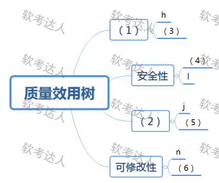
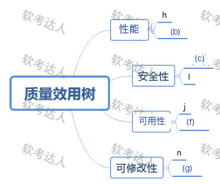

# 特种车辆管理与监控系统：效用树与三概念综合案例

> 来源：软考达人，第八章第一节，网站题号 138～140（试题一：问题1 12分＋问题2 3分＋问题3 10分，合计 25 分，合并为一整道案例）。年份及原考试题号尚未核实，身份为 web-bank，可用于普通训练。问题3网站未给答案，由教材核验作答；采分点拆分为训练推定。没有用户实际作答或错误记录。

## 共同背景（网站原文）

阅读以下关于软件架构评估的说明，回答下列问题。
【说明】
某软件公司拟为某市级公安机关开发一套特种车辆管理与监控系统，以提高特种车辆管理的效率和准确性。在系统需求分析与架构设计阶段，用户提出的部分需求和关键质量属性场景如下：
(a)系统用户分为管理员、分管领导和普通民警等三类；
(b)正常负载情况下，系统必须在0.5秒内对用户的车辆查询请求进行响应；
(c)系统能够抵御99.999%的黑客攻击；
(d)系统的用户名必须以字母开头，长度不少于5个字符；
(e)对查询请求处理时间的要求将影响系统的数据传输协议和处理过程的设计；
(f)网络失效后，系统需要在2分钟内发现并启用备用网络系统；
(g)在系统升级时，需要保证在1个月内添加一个新的消息处理中间件；
(h)查询过程中涉及到的车辆实时视频传输必须保证20帧/秒的速率，且画面具有600×480的分辨率；
(i)更改系统加密的级别将对安全性和性能产生影响；
(j)系统主站点断电后，需要在3秒内将请求重定向到备用站点；
(k)假设每秒中用户查询请求的数量是10个，处理请求的时间为30毫秒，则"在1秒内完成用户的查询请求"这一要求是可以实现的；
(l)对用户信息数据的授权访问必须保证99.999%的安全性；
(m)目前对"车辆信息实时监控"业务逻辑的描述尚未达成共识，这可能导致部分业务功能模块的重复，影响系统的可修改性；
(n)更改系统的Web界面接口必须在1周内完成；
(o)系统需要提供远程调试接口，并支持系统的远程调试。
在对系统需求和质量属性场景进行分析的基础上，系统的架构师给出了三个候选的架构设计方案。公司目前正在组织系统开发的相关人员对系统架构进行评估。

## 问题一：效用树（12 分）

原题：在架构评估过程中，质量属性效用树(utility tree)是对系统质量属性进行识别和优先级排序的重要工具。请给出合适的质量属性，填入图1中（ ）、（ ）空白处；并选择题干描述中的(a)～(o)，将恰当的序号填入（ ）～（ ）空白处，完成该系统的效用树。

图结构：根"质量效用树"下四条分支——(1)〔空〕→叶 h、(3)；安全性→叶 (4)、l；(2)〔空〕→叶 j、(5)；可修改性→叶 n、(6)。(1)(2) 填质量属性名，(3)～(6) 填题干字母。

### 考场答案

| 图中空号 | 填写 | 依据 |
|---|---|---|
| (1) | 性能 | 同分支已有叶 h：视频传输 20帧/秒、600×480 分辨率的响应度量 |
| (2) | 可用性 | 同分支已有叶 j：主站点断电 3 秒内重定向备用站点 |
| (3) | (b) | 正常负载 0.5 秒内响应查询请求：环境＋响应度量的性能场景 |
| (4) | (c) | 抵御 99.999% 黑客攻击：攻击防抗的安全性场景 |
| (5) | (f) | 网络失效 2 分钟内发现并启用备用网络：故障恢复的可用性场景 |
| (6) | (g) | 1 个月内添加新消息处理中间件：修改代价的可修改性场景 |

网站答案表（存档 [source-answer-tree.png](../../assets/a935cdbb56a4b6ca.png)）与此完全一致。等价填法：(3) 处 (k)（每秒 10 个请求×30 毫秒的可行性推算）也是性能相关，但 (k) 是"论证要求可实现"的分析句，没有独立的环境-响应度量结构，标准场景优先 (b)；(5) 处 (j) 已被该分支占用，不可复用；(6) 处 (n) 已被占用。

[可编辑 SVG 标注稿](../../assets/75d7e2942d27890f.svg)。原图未改，答案图不进入实验室公开资源。

### 采分要点

训练推定每空 2 分，共 12 分。属性名与已有叶子互相印证：(1) 由 h 的帧率/分辨率锁定性能，(2) 由 j 的断电重定向锁定可用性。字母填空写场景归类依据；同分支字母不可复用（j 已在 (2) 支上，(5) 只能选 (f)）。

### Tutor 解析：先读现成叶子，再补同属性

四条分支各挂一个已知项：h 是"每秒多少帧、多大分辨率"——性能的响应度量；j 是"断电后多久切备用"——可用性；l 是"授权访问 99.999% 安全"——安全性；n 是"改界面 1 周内完成"——可修改性。空属性沿已知叶向左锁定，字母空在同属性描述里挑未被占用的。

(b)(h) 同为性能，(c)(l) 同为安全，(f)(j) 同为可用，(g)(n) 同为可修改——这是本题的对称结构：每支恰好两条同属性叶。剩下 (a)(d) 是约束不是场景，(e)(i)(k)(m) 留给问题二，(o) 远程调试属可测试性，本树无此分支。

常错表达：把 (e) 填进性能空。(e) 说"处理时间要求影响协议与处理设计"，是性能牵引设计的敏感点句式（问题二答案），没有响应度量结构。把 (k) 填进 (3) 也站不住：(k) 是对可行性的论证，不是质量属性场景。

关联：效用树四层结构。

## 问题二：风险、敏感点与权衡点（3 分）

原题：在架构评估过程中，需要正确识别系统的架构风险、敏感点和权衡点。请从题干描述中的(a)～(o)各选出1个属于系统架构风险、敏感点和权衡点的描述。

### 考场答案

风险点选 (m)：业务逻辑描述尚未达成共识，可能导致功能模块重复，是已存在的设计隐患；敏感点选 (e)：查询处理时间要求直接决定数据传输协议与处理过程设计；权衡点选 (i)：更改加密级别同时影响安全性与性能，一个决策牵动两个质量属性。

### 采分要点

训练推定每选 1 分，共 3 分。风险点的判据是"潜在、存在问题的决策→隐患"；敏感点是"实现特定质量属性的构件特性"；权衡点是"影响多个质量属性的特性"。只写字母不给归类理由在阅卷中易被扣半。

### Tutor 解析：三步对号

先找权衡点——(i) 一字不合就排除：加密级别同时动安全与性能，两属性对抗，标准权衡句式（教材 §8.2.1 原例）。再找敏感点——(e) 只谈处理时间一个属性如何牵引协议设计，单属性敏感。剩下的 (m) 是风险：业务逻辑"尚未达成共识"+"可能导致重复"，潜在隐患的典型措辞。

(m) 易漏选：它藏在"影响系统的可修改性"前面，学生容易只看到"可修改性"三个字就以为是场景描述。(k) 看似敏感点（用数字论证性能），但它是"论证要求可实现"的推演，没有"影响设计"的牵引关系。

关联：四大核心概念。

## 问题三：四种质量属性的设计策略（10 分）

原题：该项目的四种质量属性分别用什么设计策略实现？（每种举例2个，只写名词即可）

### 考场答案

性能：增加计算资源、引入并发机制（或数据复制/缓存、资源调度如优先级队列）；可用性：Ping/Echo、心跳（或主动冗余、检测/异常）；安全性：身份认证与授权（抵御攻击）、入侵检测（或信息审计）；可修改性：软件模块泛化（信息隐藏）、限制模块间通信（或使用中介、延迟绑定）。

### 采分要点

网站未给本问答案；以下为教材口径的训练推定：四种属性各 2.5 分（属性名 0.5 分＋两个策略各 1 分），共 10 分。策略必须属于对应属性族：性能族（增加计算资源/改善资源需求/资源管理/资源调度）、可用族（Ping/Echo/心跳/主动冗余/异常检测）、安全族（抵御攻击/攻击检测/从攻击中恢复/信息审计）、可修改族（模块泛化/限制通信/使用中介/延迟绑定）。跨族借用不给分。

### Tutor 解析：按属性族背策略清单

四种属性各带一个策略族，考场上按族列举即可：性能问"资源够不够、排得妙不妙"——加资源、降需求、并发复制、队列调度；可用性问"坏了多久知道、多久顶上"——Ping/Echo 与心跳负责发现，冗余负责顶替；安全性问"挡、查、恢复、查账"四步；可修改性问"把变化关起来"——泛化收敛变化、限制通信隔离变化、中介转发变化、延迟绑定推迟变化。

本题与 137 题的问题二同族，策略清单可以互相迁移；区别只在 137 题要求展开说明、本题只写名词。网站答案表还列出抽象、运行时注册（可修改性）与进程监视器（可用性），与教材口径兼容，考场写这些同样给分。

常错表达：把"信息隐藏"写给安全性——它是可修改性策略（把变化局部化），与保密无关。把"数据复制"写给可用性——复制在性能族里是缩短访问路径的资源管理手段，可用性的冗余要写"主动/被动冗余"。

关联：质量属性—设计策略对号表。

## 网站原答案与解析（存档）

网站题号 138（问题1）："正确答案"文字栏为空，配答案表图：(1)性能 (2)可用性 (3)b (4)c (5)f (6)g；解析"无"。网站题号 139（问题2）："(m)描述的是系统架构风险；(e)描述的是敏感点；(i)描述的是权衡点。"解析"无"。网站题号 140（问题3）：文字栏为空，配策略答案表图（[存档](../../assets/1fbd61e1d57717c6.png)）：可用性=心跳、Ping/Echo、冗余、进程监视器；可修改性=抽象、信息隐藏、限制通信路径、运行时注册；性能=优先级队列、增加计算资源、减少计算开销、引入并发机制、采用资源调度等；安全性=用户认证、用户授权、追踪审计、限制访问；解析"无"。首版记录曾误判"网站未给答案"，v2 已更正；网站与教材口径一致，另列抽象、运行时注册、进程监视器已并入采分等价列表。
