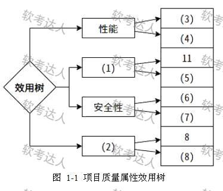
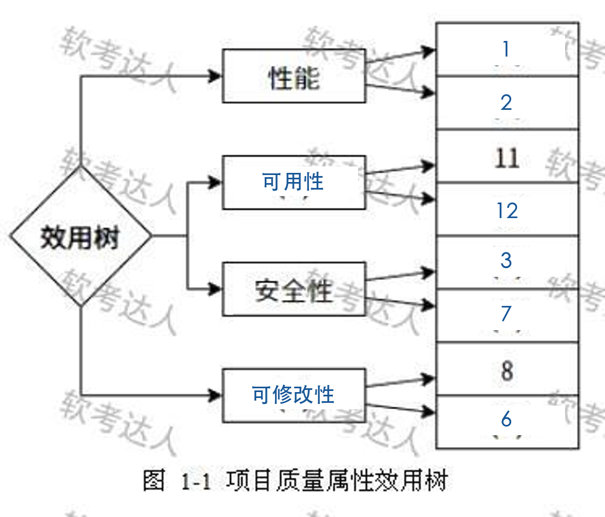

# 短视频平台扩展业务：ATAM 综合案例

> 来源：软考达人，第八章第一节，网站题号 133～135，合并为一整道案例（8＋12＋5＝25 分）。年份及原考试题号尚未核实，身份为 web-bank，可用于普通训练。采分细则为训练推定；网站解析单独保留。没有用户实际作答或错误记录。

## 共同背景（网站原文）

国内某知名互联网公司拥有庞大的用户基础，为了扩展其业务、拓宽市场范围、吸引更多受众群体，计划在原有的短视频基础业务上增加科普类短视频、系列课程及直播授课等业务。
在筹备期间，市场部门、研发中心的系统分析师和系统架构师均参与了受众分析、产品规划、需求搭建等工作。经过梳理，并获得技术总监首肯，最终确定了以下非功能需求：
1. 网络条件正常的情况下，首次加载用户程序需要在3秒内展示用户请求的视频信息，并且立即缓存3-5条视频的前15秒内容；
2. 网络条件正常的情况下，每20条评论加载及刷新时间不得超过3秒；
3. 视频及数据内容传输过程中需要地址漂移或加密传输
4. 不同的用户具有不同的身份及权限，需要在用户身份真实可信的前提下，提供可信的授权管理服务；
5. 对于用户输入有相应的输入提示，有用户数据检查，预防数据异常及非法内容；
6. 开发代码严格遵循开发规范，任何函数块不得超过80行规范；
7. 系统要能够保护数据不被非法/越权访问和篡改，要确保机密性和完整性，并提供数据审计功能；
8. 90%以上的设计问题修改时间不超过3个工作日，90%以上的开发不问修改时间不超过1个工作日；
9. 产品必须提供可跟踪任何数据库字段的工具
10. 提供数据及其缓存的备份和恢复功能，能够及时恢复和还原系统数据；
11. 系统能够7X24小时运行，全年持续运行故障停运时间累计不得超过12小时；
12. 在95%得故障中，系统最多需要30秒重启；
整体构件组装方案可调整，预留扩展点以便扩展和重组。

原文“开发不问”“95%得”“会收到”“上诉”等用字保留，分别按开发问题、95%的、会受到、上述理解。末段扩展要求没有原始编号；解析中的“13”是网站补注。

## 问题一：效用树（8 分）

问题一（8分）：如果使用体系结构权衡分析法（ATAM）对该项目架构设计进行评估，请完成下图中该项目的质量属性效用树，并填写（ ）~（ ）。

题面括号范围为空；实际题图为 (1)～(8) 八空。

### 考场答案

这是一组符合原图四条分支的填法。“空号”指图中的编号，“需求号”指题干条目。

| 图中空号 | 填写 | 依据 |
|---|---|---|
| (1) | 可用性 | 同分支已有需求 11：全年停运不超过 12 小时 |
| (2) | 可修改性 | 同分支已有需求 8：限定修改时间 |
| (3) | 1 | 首次展示不超过 3 秒 |
| (4) | 2 | 评论刷新不超过 3 秒 |
| (5) | 12 | 故障后最多 30 秒重启 |
| (6) | 3 | 传输加密保护信息 |
| (7) | 7 | 防越权、防篡改、机密性、完整性及审计 |
| (8) | 6 | 按本题口径，小函数与开发规范用于控制修改复杂度 |

安全性叶子没有细分类标题，需求 3、4、7 中任取不同的两个都符合安全性，(6)/(7) 互换成立。性能需求 1、2 互换成立；可用性空 (5) 也可用需求 10 的备份恢复。可修改性的需求 6 是间接约束，不应泛化为“所有编码规范都等于可修改性”。末段预留扩展点也是可修改性，但不要把它冒充原题已编号的 13。网站没有逐空唯一答案，训练接受这些有依据的等价填法。

[可编辑 SVG 标注稿](../../assets/aa353dcd996eb290.svg)。原图未改，答案图不进入实验室公开资源。

### 采分要点

训练推定每空 1 分，属性名称、分支关系和需求编号要对应。同分支的两个空不能重复同一需求来凑分。图中空 (7) 与题干需求 7 是两套编号，须读清位置。

### Tutor 解析：用现成叶子定位

需求 11 在问“多久不能停”，需求 8 在问“修改要花多久”。沿它们向左走，就能找到可用性与可修改性，不必先把所有名称背一遍。

性能问“多快”：首次展示和评论刷新有 3 秒上限。缓存是达到响应目标的策略，看到缓存不能直接判为可用性。可用性问“故障后多久回来”：重启和备份恢复都相关。安全性问“谁能看、谁能改、传输会不会泄密”：地址漂移、加密、身份授权、防篡改虽手段不同，保护目标属于安全性。

可修改性关注变化范围、代价和时间。需求 8 是直接的修改响应度量；代码短小是间接约束。追踪数据库字段还可能偏向可测试性或诊断支持，网站把它并入可修改性是较宽分类，训练不把它作为唯一必填。

本图省略完整效用树的细化层。标准做法为“效用根→质量属性→属性细化→具体场景”，叶子要能验证，还可按业务重要性和实现难度排序。

关联：效用树四层结构。

## 问题二：四类关注点（12 分）

问题二（12分）：随着项目推进，体系结构评估过程中采用了 ATAM 的体系结构评估方法。在架构设计中系统架构师提出：
a. 3中关于数据地址漂移或加密传输的决策，可能会增加处理时间或降低信息保密性；
b. 8中的要求可能会增加设计和开发所需时间，也可能对系统运维成本有所增加；
c. 6属于最佳实践，实际工作中可以适当放宽要求；
d. 11中系统视频存储采用现有短视频媒体云服务，当前系统的可用性会收到云服务可用性的影响。
请问什么是敏感点、权衡点、风险点和非风险点？系统架构师提出的问题都对应上诉的哪些关注点？

### 考场答案

敏感点：一个或多个构件及其关系的特性，对实现特定质量属性至关重要。权衡点：同时影响多个质量属性、构成这些属性敏感点的架构特性。风险点：存在问题或尚未充分验证、可能使优先质量目标无法满足的架构决策。非风险点：经过分析，在给定假设和场景下能够支持质量目标的架构决策。

按本题网站归类：a 权衡点；b 风险点；c 非风险点；d 风险点。a 涉及保密性与处理时间；b 提示限定修改时间带来的进度与成本隐患；c 将可适当放宽的最佳实践视为非风险；d 指出对媒体云可用性的外部依赖风险。

### 采分要点

训练推定四个定义各 2 分，a～d 分类与理由各 1 分，共 12 分。a 必须关联同一个决策与安全性、性能；d 不能宣称题干已证明云服务必然不达标。

### Tutor 解析：判断决策的作用与目标

a 改变加密方案，保密性与处理时间一起变化，因此是权衡。权衡不等于“两个方案都不好”，它描述多个质量属性共享的敏感特性。

b 指出设计开发和运维代价，提示兑现目标的隐患，网站归为风险。成本增加不自动证明架构失败，还须看预算、人员及修改时间场景。c 的判断依赖“最佳实践可适当放宽”；非风险不意味着永远安全，若放宽后违反关键要求须重新评价。

d 容易和敏感点混淆。网站明确写“风险点”：当系统依赖云服务，且该依赖不能支撑全年停运上限时，就存在架构风险。同时，“系统可用性对云服务可用性敏感”也是有效的因果分析。训练允许回答敏感点并说明依赖参数与目标影响的分析角度；不能仅凭“只有一个质量属性”得分。教材没有规定敏感点只能影响一个属性。没有原始逐点评分细则，不能伪造唯一官方判断。

~~~mermaid
flowchart LR
 D["传输加密决策"] --> S["保密性"]
 D --> P["处理时延"]
 S --> T["共同敏感特性：权衡点"]
 P --> T
 C["媒体云可用性"] --> A["系统可用性"]
 A --> R["依赖是否支持停运目标？有问题的决策形成风险"]
~~~

关联：教材 §8.2.1、§8.3.2。

## 问题三：ATAM 过程（5 分）

问题三（5分）：请用300字以内简述ATAM架构评估方法的主要过程。

### 考场答案（300 字以内）

ATAM 分四阶段：描述与介绍阶段，介绍评估方法、业务驱动及系统架构；调查与分析阶段，识别架构方法，建立并排序质量属性效用树，分析架构方法；测试阶段，由利益相关者头脑风暴提出场景并排序，用高优先级场景再次分析架构，识别风险、非风险、敏感点及权衡点；报告阶段，汇总评估结果、风险主题与关键权衡，提交报告供后续决策使用。

### 采分要点与 Tutor 解析

训练推定介绍阶段 1 分、调查分析 1.5 分、测试 1.5 分、报告 1 分。阶段名允许演示／描述介绍、报告／最终等表述，但必须说明主要活动。

两次分析架构是接力：先用效用树的优先场景分析，再让更广泛的利益相关者提出场景，发现遗漏后重新检验。这里的测试是场景评估，不是在测试环境跑单元测试；提交报告也不意味着已经实施改造。

~~~mermaid
flowchart TD
 A["介绍方法→业务驱动→架构"] --> B["识别方法→效用树→分析"]
 B --> C["头脑风暴与场景排序→再分析"]
 C --> D["汇总关注点与风险主题→报告"]
~~~

关联：ATAM 四阶段总表。

## 网站原解析

### 133

质量属性效用树分类：
性能（Performance）：（1）（2）
安全性（Security）：（3）（4）（7）
可靠性（Reliability）：（5）
可修改性（Modifiability）：（6）（8）（9）（13）
可用性（Availability）：（10）（11）（12）

本题考查ATAM（架构权衡分析方法）中的质量属性效用树。
关键修正：
- 质量属性(3)'视频及数据内容传输过程中需要地址漂移或加密传输'应归类为安全性，而非可修改性
- 质量属性(13)'整体构件组装方案可调整，预留扩展点以便扩展和重组'应归类在可修改性下
- 题干中只有12个质量属性，(13)是从上下文推断的整体架构要求

### 134

敏感点是指为了实现某种特定的质量属性，一个或多个构件所具有的特性。
权衡点是影响多个质量属性的特性，是多个质量属性的敏感点。
风险点是指架构设计中潜在的、存在问题的架构决策所带来的隐患。
非风险点是指架构设计中不会造成潜在问题的架构决策的关注点。
a.权衡点 b.风险点 c.非风险点 d.风险点
解析：无

### 135

描述和介绍阶段：描述ATAM方法，描述业务动机，描述架构
调查和分析阶段：确定架构方法，生成质量属性效用树，分析架构方法
测试阶段：讨论场景和对场景分级，分析架构方法
最终阶段：描述评估结果
解析：无

## 核验记录与来源

八空、固定叶子 11／8、三个小问和分值已逐项对照。133～135 背景一致，问题编号为 1、2、3；136 已变为电商支付“试题四”，未入库。材料核验为完整普通练习；年份与官方唯一细则未确认，不影响明确标注的训练用途。

- [网站小节入口](https://ruankaodaren.com/exam/#/answer/answer?type=1&id=9394)：题号 133～135，原文与展开解析。
- [原图资源](https://image-t.chaiding.com/ruankao/5a1e127a0429950db472cbc54fcdea4d.jpg-ruankao)：374×320 JPEG，本地保留原始像素。
- [教材原文](https://github.com/Goodyzhang/ruankao.skill/blob/main/materials/%E7%B3%BB%E7%BB%9F%E6%9E%B6%E6%9E%84%E8%AE%BE%E8%AE%A1%E5%B8%88/%E6%95%99%E6%9D%90/%E7%B3%BB%E7%BB%9F%E6%9E%B6%E6%9E%84%E8%AE%BE%E8%AE%A1%E5%B8%88%E6%95%99%E7%A8%8B%EF%BC%88%E7%AC%AC2%E7%89%88%EF%BC%89.md)：§8.2.1、§8.3、图 8-5。
- [SEI ATAM 原始报告](https://www.sei.cmu.edu/library/atam-method-for-architecture-evaluation/)：CMU/SEI-2000-TR-004，用于核对机制，不作为本题官方答案。
