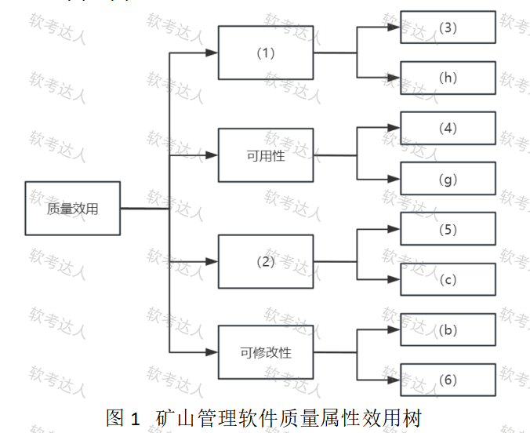
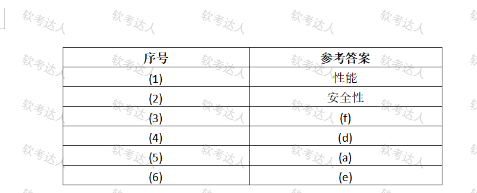

# 矿山管理软件-效用树ATAM与架构风格案例

## 原题（网站题号 183～185 合并：试题一，25分）

**试题一（25分）**　阅读以下关于软件架构评估的说明，回答下列问题。

【说明】某大型矿山企业开发矿山管理软件（提高生产效率、加强安全管理、确保数据准确完整）。关键质量属性场景：(a)核心部件与互联网隔离防入侵；(b)远程故障诊断与修复功能一个季度内完成开发；(c)敏感数据加密存储传输；(d)主服务器故障自动切换备用、切换≤3分钟；(e)支持新增矿区设备无缝集成；(f)实时展示作业终端状态延迟≤3秒；(g)个别设备故障仍能服务且更换故障设备≤1小时；(h)支持1000矿山作业终端+200管理终端并发。

| 网站题号 | 小问 | 分值 |
|---|---|---|
| 183 | 问题1（12分）：效用树填空 (1)(2)质量属性 + (3)~(6)场景序号 | 12 |
| 184 | 问题2（4分）：ATAM四个阶段 | 4 |
| 185 | 问题3（9分）：实时展示终端状态选管道-过滤器还是事件驱动（实时性/可维护性/安全性三方面） | 9 |

## 图示

### 题面效用树原图（未覆盖）

### 网站参考答案表（答案载体为图片，role=answer，不进公开题包）

## 来源答案与解析（网站原文）

- 题183：网站答案文字区空，答案以图片表给出：(1)性能、(2)安全性、(3)(f)、(4)(d)、(5)(a)、(6)(e)。解析：无。
- 题184：四阶段两种口径均可（需求收集/架构视图描述/属性模型构造和分析/架构决策与折中；或 演示/调查和分析/测试/报告）。（解析：无）
- 题185：事件驱动风格+三维度理由。（解析：无）

## 核验答案（考场作答）

### 【问题1】（12分）

**考场答案**：(1)性能；(2)安全性；(3)=(f)（实时展示延迟≤3秒→性能）；(4)=(d)（3分钟切换→可用性）；(5)=(a)（网络隔离→安全性）；(6)=(e)（无缝集成→可修改性）。

**采分要点**：六空各2分（推定）。

**详细解析**：与题84/97/122/156同款效用树，四分支已给叶定归属：性能分支已给(h)→(3)=(f)；可用性分支已给(g)→(4)=(d)；(2)分支已给(c)加密→(2)=安全性、(5)=(a)隔离；可修改性已给(b)→(6)=(e)。

**常见失分表达**：(b)季度开发误归功能性；(h)误作待填项。

**知识点链接**：[效用树](https://github.com/Goodyzhang/ruankao.skill/blob/main/materials/%E7%B3%BB%E7%BB%9F%E6%9E%B6%E6%9E%84%E8%AE%BE%E8%AE%A1%E5%B8%88/%E7%AC%94%E8%AE%B0/%E7%9F%A5%E8%AF%86%E7%82%B9/08-%E7%B3%BB%E7%BB%9F%E8%B4%A8%E9%87%8F%E5%B1%9E%E6%80%A7%E4%B8%8E%E6%9E%B6%E6%9E%84%E8%AF%84%E4%BC%B0.md)

### 【问题2】（4分）

**考场答案**：ATAM四阶段（任一口径）：口径一——①需求收集；②架构视图描述；③属性模型构造和分析；④架构决策与折中。口径二——①演示；②调查和分析；③测试；④报告。

**采分要点**：四阶段各1分（推定）；两种口径均可。

**详细解析**：与章级知识点§8.3.0 ATAM四阶段总表对应——口径一是方法活动阶段，口径二是评估实践四阶段，写任一即可。

**常见失分表达**：混搭两种口径。

**知识点链接**：[ATAM 四阶段](https://github.com/Goodyzhang/ruankao.skill/blob/main/materials/%E7%B3%BB%E7%BB%9F%E6%9E%B6%E6%9E%84%E8%AE%BE%E8%AE%A1%E5%B8%88/%E7%AC%94%E8%AE%B0/%E7%9F%A5%E8%AF%86%E7%82%B9/08-%E7%B3%BB%E7%BB%9F%E8%B4%A8%E9%87%8F%E5%B1%9E%E6%80%A7%E4%B8%8E%E6%9E%B6%E6%9E%84%E8%AF%84%E4%BC%B0.md)

### 【问题3】（9分）

**考场答案**（300字内）：更适合采用**事件驱动风格**。①实时性：事件驱动基于事件的消息传递机制，能迅速响应系统内外事件——作业终端状态变化立即触发事件，由处理该事件的服务进行状态更新和展示；管道-过滤器通过多级管道和过滤器传递处理数据，增加延迟。②可维护性：事件驱动中事件的生产者和消费者是解耦的，终端状态变化（生产者）与状态展示逻辑（消费者）不需直接通信或依赖，可维护性高；管道-过滤器可能需修改多级构件。③安全性：事件驱动中事件生产者和消费者可处在不同安全级别彼此隔离；管道-过滤器需各级紧密耦合，容易造成安全隐患。

**采分要点**：结论＋三维度各3分（推定）。

**详细解析**：架构风格选型三维度对仗：事件驱动=消息机制即时响应+生产消费者解耦+安全级别隔离；管道-过滤器=串行流水延迟+多级构件改动+紧耦合隐患。

**常见失分表达**：三维度缺一；管道-过滤器缺点只写“慢”。

**知识点链接**：[架构风格选型](https://github.com/Goodyzhang/ruankao.skill/blob/main/materials/%E7%B3%BB%E7%BB%9F%E6%9E%B6%E6%9E%84%E8%AE%BE%E8%AE%A1%E5%B8%88/%E7%AC%94%E8%AE%B0/%E7%9F%A5%E8%AF%86%E7%82%B9/08-%E7%B3%BB%E7%BB%9F%E8%B4%A8%E9%87%8F%E5%B1%9E%E6%80%A7%E4%B8%8E%E6%9E%B6%E6%9E%84%E8%AF%84%E4%BC%B0.md)

## 来源与身份

- 题源：软考达人·第二十二章 案例分析/第一节 案例分析，网站题号183～185（网站分类“第二十二章 案例分析”保留为来源位置，章节路由按实际考点匹配教材章（第2版20章体系）。）
- 年份/卷别未核实，按 web-bank 处理；分值加和 12+4+9=25 与“试题一（25分）”一致。
- 图示：效用树题面原图（original）与参考答案表（answer角色）已下载并实际看图核对，六空与四分支归属互证一致。
