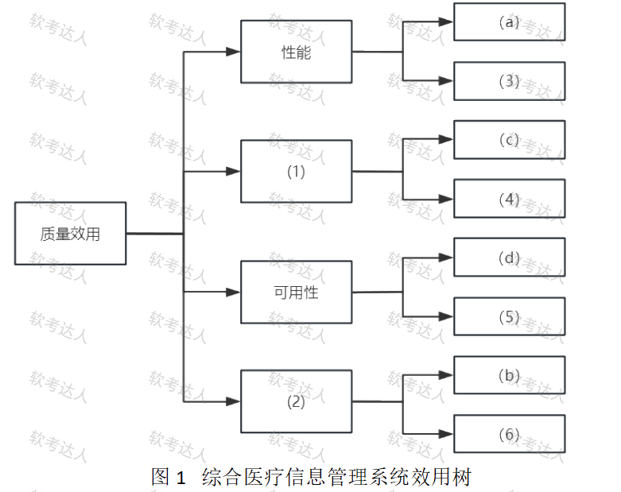
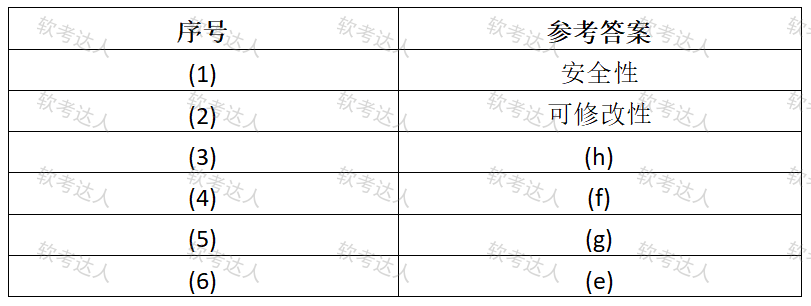

# 综合医疗MIS-效用树与质量属性分类案例

## 原题（网站题号 122～124 合并：试题一，25分）

**试题一（25分）**　阅读以下关于软件架构评估的说明，回答下列问题。

【说明】某大型医院开发综合医疗信息管理系统（提升医疗服务效率、加强患者数据管理和保护隐私）。关键质量属性场景：(a)高峰时段响应时间≤3秒；(b)更新UI适应老中青操作习惯须2周内完成；(c)用户密码遵循复杂性规则（大小写字母数字特殊字符）；(d)主数据库故障立即切换备用、切换≤5分钟；(e)支持新增子系统无缝集成；(f)准确识别并提示药物过敏信息避免医疗事故；(g)严重故障后2小时内恢复服务；(h)支持≥100门诊终端和20取药终端。

| 网站题号 | 小问 | 分值 |
|---|---|---|
| 122 | 问题1（12分）：效用树填空 (1)(2)质量属性 + (3)~(6)场景序号 | 12 |
| 123 | 问题2（4分）：四个质量属性按开发期/运行期归类 | 4 |
| 124 | 问题3（9分）：列举6要素，并在(a)中找出至少3个要素 | 9 |

## 图示

### 题面效用树原图（未覆盖）

### 网站参考答案表（答案载体为图片，role=answer，不进公开题包）

## 来源答案与解析（网站原文）

- 题122：网站答案文字区空，答案以图片表给出：(1)安全性、(2)可修改性、(3)(h)、(4)(f)、(5)(g)、(6)(e)。解析：无。
- 题123：性能、安全性、可用性属运行期；可修改性属开发期。（解析：无）
- 题124：六要素+(a)逐要素映射，答出3个即可。（解析：无）

## 核验答案（考场作答）

### 【问题1】（12分）

**考场答案**：(1)安全性；(2)可修改性；(3)=(h)（100+20终端并发→性能）；(4)=(f)（药物过敏识别避免事故→安全性）；(5)=(g)（2小时恢复→可用性）；(6)=(e)（新增子系统无缝集成→可修改性）。

**采分要点**：六空各2分（推定）。

**详细解析**：与题84/97同款效用树。性能分支已给(a)→(3)=(h)（同为吞吐/并发）；安全性分支已给(c)→(4)=(f)——注意(f)药物过敏识别是**安全性（safety，安全-无害）**口径而非信息安全，教程中安全性含“系统不引发危险状态”的含义，网站口径如此；可用性分支已给(d)→(5)=(g)；可修改性分支已给(b)→(6)=(e)。

**常见失分表达**：(f)误归可靠性/功能性；(h)误归可用性。

**知识点链接**：[面向架构评估的质量属性](https://github.com/Goodyzhang/ruankao.skill/blob/main/materials/%E7%B3%BB%E7%BB%9F%E6%9E%B6%E6%9E%84%E8%AE%BE%E8%AE%A1%E5%B8%88/%E7%AC%94%E8%AE%B0/%E7%9F%A5%E8%AF%86%E7%82%B9/08-%E7%B3%BB%E7%BB%9F%E8%B4%A8%E9%87%8F%E5%B1%9E%E6%80%A7%E4%B8%8E%E6%9E%B6%E6%9E%84%E8%AF%84%E4%BC%B0.md)

### 【问题2】（4分）

**考场答案**：性能、安全性、可用性属于**运行期**质量属性；可修改性属于**开发期**质量属性。

**采分要点**：两类各2分（推定）。

**详细解析**：运行期属性=用户使用时能感知（性能/安全性/可用性/易用性/可靠性）；开发期属性=开发与维护人员关注（可修改性/可移植性/可重用性/可测试性/易理解性）。(b)“2周完成UI改造”是变更成本→可修改性→开发期。

**常见失分表达**：把可修改性归运行期（用户不直接感知变更成本）。

**知识点链接**：[质量属性概念（开发期/运行期）](https://github.com/Goodyzhang/ruankao.skill/blob/main/materials/%E7%B3%BB%E7%BB%9F%E6%9E%B6%E6%9E%84%E8%AE%BE%E8%AE%A1%E5%B8%88/%E7%AC%94%E8%AE%B0/%E7%9F%A5%E8%AF%86%E7%82%B9/08-%E7%B3%BB%E7%BB%9F%E8%B4%A8%E9%87%8F%E5%B1%9E%E6%80%A7%E4%B8%8E%E6%9E%B6%E6%9E%84%E8%AF%84%E4%BC%B0.md)

### 【问题3】（9分）

**考场答案**：6要素：刺激源（Source）、刺激（Stimulus）、环境（Environment）、制品（Artifact）、响应（Response）、响应度量（Measurement）。场景(a)要素（答出3个即可）：刺激源=用户请求；刺激=快速挂号和就诊；环境=高峰时段；制品=系统；响应=系统响应/处理刺激；响应度量=不得超过3秒。

**采分要点**：六要素3分＋(a)要素6个各1分、答3个即满（推定）。

**详细解析**：与题49/86/99同源。摘句法：(a)句“高峰时段”=环境、“3秒”=响应度量、“挂号就诊”=刺激。注意本题刺激/刺激源的网站口径（刺激源=用户请求、刺激=挂号就诊行为）与常见“用户发起请求”表述略有差异，照网站口径记录。

**常见失分表达**：刺激与刺激源互换；环境漏“高峰”。

**知识点链接**：[质量属性场景描述](https://github.com/Goodyzhang/ruankao.skill/blob/main/materials/%E7%B3%BB%E7%BB%9F%E6%9E%B6%E6%9E%84%E8%AE%BE%E8%AE%A1%E5%B8%88/%E7%AC%94%E8%AE%B0/%E7%9F%A5%E8%AF%86%E7%82%B9/08-%E7%B3%BB%E7%BB%9F%E8%B4%A8%E9%87%8F%E5%B1%9E%E6%80%A7%E4%B8%8E%E6%9E%B6%E6%9E%84%E8%AF%84%E4%BC%B0.md)

## 来源与身份

- 题源：软考达人·第二十二章 案例分析/第一节 案例分析，网站题号122～124（网站分类“第二十二章 案例分析”保留为来源位置，章节路由按实际考点匹配教材章（第2版20章体系）。）
- 年份/卷别未核实，按 web-bank 处理；分值加和 12+4+9=25 与“试题一（25分）”一致。
- 图示：效用树题面原图（original）与参考答案表（answer角色）已下载并实际看图核对。
