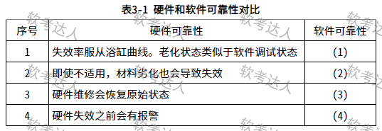
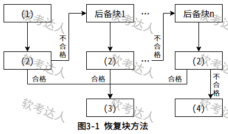
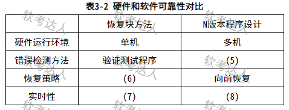
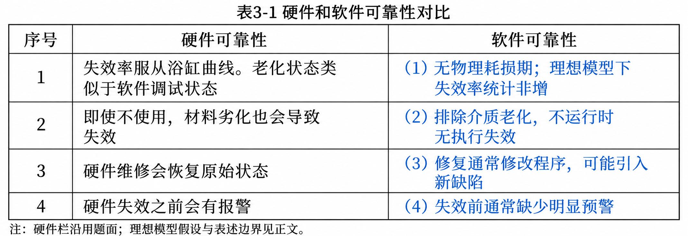
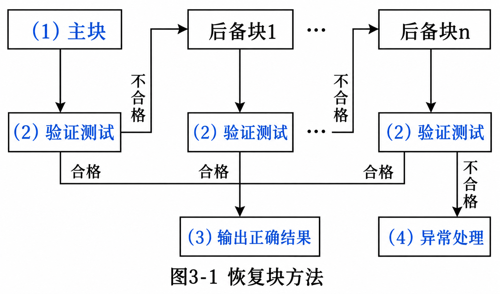
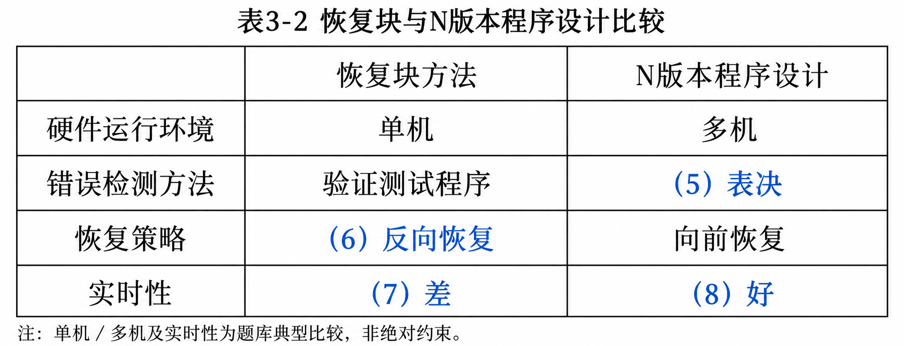

# 宇航嵌入式软件可靠性：软硬件差异、恢复块与 N 版本程序设计

## 题干（原题抄写）

> 阅读以下关于嵌入式系统可靠性设计方面的描述，回答下列问题。
>
> 【说明】某宇航公司长期从事宇航装备的研制工作，嵌入式系统的可靠性分析与设计已成为该公司产品研制中的核心工作，随着宇航装备的综合化技术发展，嵌入式软件规模发生了巨大变化，代码规模已从原来的几十万扩展到上百万，从而带来了由于软件失效而引起系统可靠性降低的隐患。公司领导非常重视软件可靠性工作，决定抽调王工程师等 5 人组建可靠性研究团队，专门研究提高本公司宇航装备的系统可靠性和软件可靠性问题，并要求在三个月内，给出本公司在系统和软件设计方面如何考虑可靠性设计的方法和规范。可靠性研究团队很快拿出了系统及硬件的可靠性提高方案，但对于软件可靠性问题始终没有研究出一种普遍认同的方法。
>
> 【问题 1】请用 200 字以内文字说明系统可靠性的定义及包含的 4 个子特性，并简要指出提高系统可靠性一般采用哪些技术？
>
> 【问题 2】王工带领的可靠性研究团队之所以没能快速取得软件可靠性问题的技术突破，其核心原因是他们没有搞懂高可靠性软件应具备的特点。软件可靠性一般致力于系统性地减少和消除对软件程序性能有不利影响的系统故障。除非被修改，否则软件系统不会随着时间的推移而发生退化。请根据你对软件可靠性的理解，给出下表所列出的硬件可靠性特征与其对应的软件可靠性特征之间的差异或相似之处，将答案写在答题纸上。
>
> 【问题 3】王工带领的可靠性研究团队在分析了大量相关资料基础上，提出软件的质量和可靠性必须在开发过程构建到软件中，也就是说，为了提高软件的可靠性，必须在需求分析、设计阶段开展软件可靠性筹划和设计。研究团队针对本公司承担的飞行控制系统制定出了一套飞控软件的可靠性设计要求。飞行控制系统是一种双余度同构型系统，输入采用了独立的两路数据通道，在系统内完成输入数据的交叉对比、表决、制导率计算，输出数据的交叉对比、表决、输出等功能，系统的监控模块实现对系统失效或失步的检测与定位。其软件的可靠性设计包括恢复块方法和 N 版本程序设计方法。请根据恢复块方法工作原理完成下图，在（ ）～（ ）中填入恰当的内容。并比较恢复块方法与 N 版本程序设计方法，将比较结果（ ）～（ ）填入下表中。

## 图（原图与答案图分开）

- **表 3-1 原题图**：
- **图 3-1 原题图**：
- **表 3-2 原题图**：
- **表 3-1 彩色答案图（已填答案，非原题图）**：
- **图 3-1 彩色答案图（已填答案，非原题图）**：
- **表 3-2 彩色答案图（已填答案，非原题图）**：

## 考场答案与采分要点

**问题 1（200字以内作答稿）**：

> 系统可靠性是系统在规定条件和规定时间内完成规定功能的能力，可用该时段内无失效运行的概率度量。按题目采用的 GB/T 16260.1—2006，子特性为成熟性、容错性、易恢复性和可靠性依从性。提高可靠性可采用冗余技术、软件容错、双机容错和集群技术，并配合故障检测、隔离与恢复。

- 判别词：“规定条件、规定时间、规定功能”缺一不可。能力称可靠性，概率指标称可靠度。
- 旧版子特性对照：成熟性（减少软件内部故障导致的失效）、容错性（故障或接口违背时仍维持规定性能水平）、易恢复性（失效后重新建立规定性能水平并恢复受影响数据）、可靠性依从性（遵循与可靠性有关的标准、约定或法规）。
- **标准口径**：本题参考答案明确引用 GB/T 16260.1—2006，按其四项作答；该标准已于 2017-05-01 废止、由 GB/T 25000.10—2016 替代——引用旧版是保留题源语境，不写为现行标准。

**问题 2 表 3-1 转录与可用填空**：

| 序号 | 原图硬件栏 | 软件栏建议填写 |
|---|---|---|
| 1 | 失效率服从浴缸曲线。老化状态类似于软件调试状态 | 无物理耗损期；在参考答案的理想化模型下，失效率在统计上非增 |
| 2 | 即使不适用，材料劣化也会导致失效 | 排除存储介质老化等影响，不运行的软件不因放置而发生执行失效 |
| 3 | 硬件维修会恢复原始状态 | 软件缺陷修复通常修改程序，可能引入新缺陷，不能简单视为恢复原始状态 |
| 4 | 硬件失效之前会有报警 | 软件失效前通常缺少明显预警，潜在缺陷在特定条件下被触发 |

- 第 2 行“即使不适用”照录原图（应理解为“即使不使用”）；第 1 行“老化状态类似于软件调试状态”按原图保存但不能照此推导。
- **“软件不老化”的边界**：指没有材料磨损；长期运行仍可能因内存泄漏、状态累积、计数器溢出等出现性能退化（软件老化），不等同于硬件物理老化。

**问题 3 图 3-1 填空**：(1) 主块；(2) 验证测试（图中三个 (2) 均填相同内容）；(3) 输出正确结果；(4) 异常处理。
- 顺序推演：进入恢复块前先保存状态建立恢复点（原图省略，理解时必须补上）；主块验证合格则输出；不合格恢复到先前保存的状态再执行后备块 1（不能沿用被失败执行污染的状态）；后备块耗尽仍未通过则异常处理。
- 这里的验证测试指运行中的接受性检查，不是开发阶段的单元测试。

**表 3-2 填空**：(5) 表决；(6) 反向恢复；(7) 差；(8) 好。

| 比较维度 | 恢复块方法 | N 版本程序设计 |
|---|---|---|
| 硬件运行环境（题库典型配置） | 单机 | 多机 |
| 错误检测方法 | 验证测试程序 | (5) 表决 |
| 恢复策略 | (6) 反向恢复 | 前向恢复 |
| 实时性（题库相对比较） | (7) 差 | (8) 好 |

- 检测依据不同：恢复块将结果与接受准则比较；N 版本将多个实现结果按表决规则比较。
- 恢复方向不同：恢复块回到恢复点改用替代实现（反向恢复）；N 版本通过表决选取结果继续执行（前向恢复，常表现为错误屏蔽）。
- 时间代价：恢复块付出多次执行、验证和回滚开销；并行 N 版本承担版本执行、同步和表决开销。顺序重试的最坏执行时间通常长于并行版本计算加表决。
- 配置不是定义：单机／多机是题库典型实现，核心是多种实现、执行组织与结果判定方式。
- 结合双余度飞控再辨析：双通道同构冗余可帮助检测不一致，但不等于 N 版本软件多样性；N 版本目标是减少共同失效，但共同的需求错误、算法缺陷和表决器问题仍可能使多个版本同时出错。

## 知识点链接

- [09-软件可靠性基础知识（容错设计技术）](https://github.com/Goodyzhang/ruankao.skill/blob/main/materials/%E7%B3%BB%E7%BB%9F%E6%9E%B6%E6%9E%84%E8%AE%BE%E8%AE%A1%E5%B8%88/%E7%AC%94%E8%AE%B0/%E7%9F%A5%E8%AF%86%E7%82%B9/09-%E8%BD%AF%E4%BB%B6%E5%8F%AF%E9%9D%A0%E6%80%A7%E5%9F%BA%E7%A1%80%E7%9F%A5%E8%AF%86.md)

## 核验状态与来源

- 核验状态：`pending`（年份未核实）。来源条目附完整性校验：三小问及三张原图均保留，表 3-1 四项对照、恢复块四种空位、表 3-2 四个空位均已核对；问题 1 作答稿 137 字符符合 200 字限制。
- 来源核验（原条目）：国家标准平台 GB/T 16260.1—2006 状态；NASA 软件可靠性工程说明、N 版本编程与表决说明、独立版本共同失效研究。
- 实验室可用性：**暂不可导出**——来源身份（年份）未核实。
