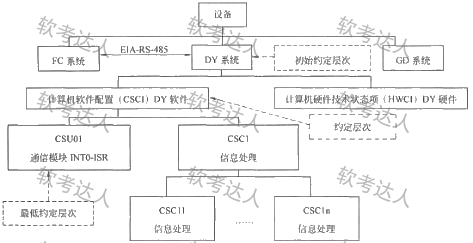
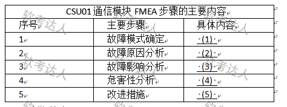
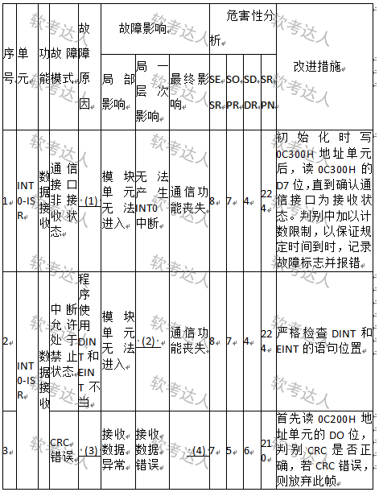
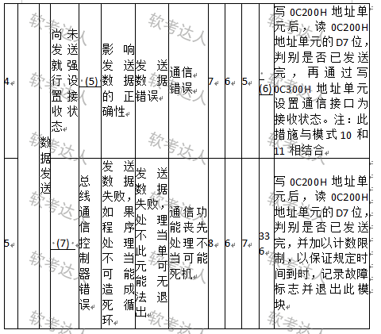

# 嵌入式通信软件-FMEA分析案例

## 原题（网站题号 31～33 合并：试题三，25分）

**试题三（25分）**　阅读以下有关嵌入式软件FMEA方法和相关案例的说明，回答问题。

【说明】故障(失效)模型影响分析FMEA是分析产品所有可能的故障模式及其可能产生的影响，并按每个故障模式产生影响的严重程度及其发生概率予以分类的一种归纳分析方法，近年广泛用于安全关键系统的嵌入式软件可靠性分析。某软件公司承担通信软件开发项目，项目由FC系统、DY系统和GD系统组成，DY系统(TMS320C25S)软件负责按通信协议完成与FC系统的通信。王工认为此项目是安全关键系统，安全等级应为II类(致命的)，应开展软件FMEA分析。

| 网站题号 | 小问 | 分值 |
|---|---|---|
| 31 | 问题1（8分）：FMEA主要活动三个空＋四类细分四个空 | 8 |
| 32 | 问题2（10分）：针对CSU01通信模块描述实施FMEA的具体内容，填表（ ）～（5） | 10 |
| 33 | 问题3（7分）：填写CSU01通信模块软件FMECA表(局部)（ ）～（7）；SRPN=SESR×SOPR×SDDR | 7 |

## 图示（原图，未覆盖）

## 来源答案与解析（网站原文）

- 题31：主要活动三项+四类细分，解析含SESR/SOPR/SDDR评估参数说明。
- 题32：五空答案+详细答题思路（输入/输出操作定位、故障原因三方面、分层影响链、RPN方法；故障模式5的SRPN=336应重点关注）。
- 题33：七空答案。（解析：无）

## 核验答案（考场作答）

### 【问题1】（8分）

**考场答案**：主要活动：（1）找出产品/过程中潜在的故障模式；（2）根据相应的评价体系对找出的潜在故障模式进行风险量化评估；（3）列出故障起因/机理，寻找预防或改进措施。四类细分：（4）设计FMEA、（5）过程FMEA、（6）使用FMEA、（7）服务FMEA。

**采分要点**：三项活动3分＋四类4分＋概念定位1分（推定）。

**详细解析**：三项活动是“找→评→治”链条：找故障模式（广度）、风险量化（SESR严酷度×SOPR概率×SDDR检测难度，即RPN三因子）、列机理定措施（深度）。四类按生命周期阶段记：设计→过程（制造）→使用→服务。软考常考“研制初期进行”与“安全性关键系统必做”两个定位词。

**常见失分表达**：三项活动漏“风险量化评估”中间步；四类漏“使用FMEA”；把FMEA与FMECA混写（FMECA是FMEA+危害性分析CA）。

**知识点链接**：[软件可靠性基础知识（FMEA/FMECA）](https://github.com/Goodyzhang/ruankao.skill/blob/main/materials/%E7%B3%BB%E7%BB%9F%E6%9E%B6%E6%9E%84%E8%AE%BE%E8%AE%A1%E5%B8%88/%E7%AC%94%E8%AE%B0/%E7%9F%A5%E8%AF%86%E7%82%B9/09-%E8%BD%AF%E4%BB%B6%E5%8F%AF%E9%9D%A0%E6%80%A7%E5%9F%BA%E7%A1%80%E7%9F%A5%E8%AF%86.md)

### 【问题2】（10分）

**考场答案**：（1）根据通信协议，按接收数据功能和发送数据功能分别确定故障模式；（2）故障原因分为总线通信控制器原因、对方发送的原因和自身程序的原因；（3）针对每个故障模式分析其对本模块直至整个DY系统造成的影响；（4）采用风险优先数RPN方法进行该通信模块的危害性分析；（5）根据故障模式、原因、影响及危害性分析结果，综合考虑故障影响及SRPN值，对每个故障模式制定相应的改进措施。

**采分要点**：五空各2分（推定），对应FMEA五步骤。

**详细解析**：答题法是“步骤名→本题化具体化”：题干给了CSU01收发机制（INT0中断、缓冲区、外部CRC），逐个映射——收/发两类故障模式；控制器/对方/自身三类原因；影响链INT0-ISR→DY软件→DY系统；RPN量化；按SRPN排序改进。网站解析强调影响数据交换的失效主要在输入(接收)/输出(发送)操作上，这是审题锚点。

**常见失分表达**：空(1)只写“确定故障模式”没有按收/发功能分解；空(4)漏“RPN方法”名称；空(5)没有“综合考虑SRPN”。

**知识点链接**：[软件可靠性基础知识（FMEA实施步骤）](https://github.com/Goodyzhang/ruankao.skill/blob/main/materials/%E7%B3%BB%E7%BB%9F%E6%9E%B6%E6%9E%84%E8%AE%BE%E8%AE%A1%E5%B8%88/%E7%AC%94%E8%AE%B0/%E7%9F%A5%E8%AF%86%E7%82%B9/09-%E8%BD%AF%E4%BB%B6%E5%8F%AF%E9%9D%A0%E6%80%A7%E5%9F%BA%E7%A1%80%E7%9F%A5%E8%AF%86.md)

### 【问题3】（7分）

**考场答案**：（1）程序写0C300H地址单元不当；（2）无法响应INT0中断；（3）线路误码；（4）通信错误；（5）程序控制错误；（6）210（=7×6×5）；（7）数据发送始终不成功。

**采分要点**：七空各1分（推定）；空(6)须乘法正确。

**详细解析**：FMECA表填空法是“行列定位+上下游一致”：故障原因列写诱因（写地址不当/线路误码/程序控制错误），最终影响列写系统级后果（通信功能丧失/通信错误），中间列按层次传递。SRPN=SESR×SOPR×SDDR直接乘；行4为7×6×5=210。行5的SRPN=336最高，是解析强调的设计关注点——填表题的最后一空常考“数值+判断”联动。

**常见失分表达**：空(2)填“局部影响”层级的内容（应填“无法响应INT0中断”这一最终影响）；空(6)只写公式不算数；空(7)漏“始终”语义。

**知识点链接**：[软件可靠性基础知识（FMECA与SRPN）](https://github.com/Goodyzhang/ruankao.skill/blob/main/materials/%E7%B3%BB%E7%BB%9F%E6%9E%B6%E6%9E%84%E8%AE%BE%E8%AE%A1%E5%B8%88/%E7%AC%94%E8%AE%B0/%E7%9F%A5%E8%AF%86%E7%82%B9/09-%E8%BD%AF%E4%BB%B6%E5%8F%AF%E9%9D%A0%E6%80%A7%E5%9F%BA%E7%A1%80%E7%9F%A5%E8%AF%86.md)

## 来源与身份

- 题源：软考达人·第二十二章 案例分析/第一节 案例分析，网站题号31～33（网站分类“第二十二章 案例分析”保留为来源位置，章节路由按实际考点匹配教材章（第2版20章体系）。）
- 年份/卷别未核实，按 web-bank 处理；分值加和 8+10+7=25 与“试题三（25分）”一致。
- 图示：四张原图（约定层次图、FMEA步骤表、FMECA表两张局部）均已下载并实际看图核对空位。
