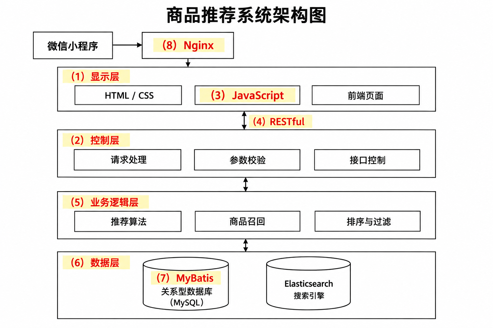

# Elasticsearch 分词商品推荐系统与 RESTful 前后端分离（题库第六节题目 29）

## 题干（原题抄写）

> Web Elasticsearch 分词的商品推荐系统（微信小程序接入）。
>
> **问题 1**：说明 Standard、Simple、Whitespace、Keyword 分词器的特点差异。
>
> **问题 2**：根据架构图填写 8 个空（题干标注 14 分）。
>
> **问题 3**：说明 RESTful 架构如何实现前后端分离。

## 图

- **架构图（答案示意重绘——依据页面题图和公开整理版答案重绘的学习示意图，不宣称逐像素复原原图）**：

## 考场答案与采分要点

**问题 1（分词器差异）**：
- **Standard**：按 Unicode 单词边界切分，默认会小写化并去除多数标点；题库口径下中文通常被拆为单字，但不具备中文语义分词能力。
- **Simple**：遇非字母字符切分，丢弃非字母并转为小写。
- **Whitespace**：只按空白字符切分，保留大小写、标点和数字。
- **Keyword**：不切分，将整个输入视为单一词项，适合精确匹配字段。

**问题 2（架构图填空，参照同题公开整理版补齐）**：（1）显示层；（2）控制层；（3）JavaScript；（4）RESTful；（5）业务逻辑层；（6）数据层；（7）MyBatis；（8）Nginx。参见[同题公开整理版](https://jishuzhan.net/article/2041681427436208129)。

**问题 3（RESTful 与前后端分离）**：URI 标识资源，客户端以标准 HTTP 方法（GET、POST、PUT、DELETE 等）表达操作，服务端返回 JSON 等表示；前端负责界面和交互，后端负责业务逻辑及数据访问，双方按统一接口契约独立开发、部署和维护。RESTful 的无状态等约束有助于多端复用接口，但前后端分离仍依赖清晰的职责边界与接口契约。

## 易错点

- Standard 与 Simple 都会转小写，区别在于 Standard 按 Unicode 单词边界处理、Simple 只保留字母；Whitespace 保留标点和大小写；Keyword 完整保留输入。依据：[Elastic Analyzer reference](https://www.elastic.co/docs/reference/text-analysis/analyzer-reference)。

## 知识点链接

- [10-软件架构的演化和维护（大型网站技术）](https://github.com/Goodyzhang/ruankao.skill/blob/main/materials/%E7%B3%BB%E7%BB%9F%E6%9E%B6%E6%9E%84%E8%AE%BE%E8%AE%A1%E5%B8%88/%E7%AC%94%E8%AE%B0/%E7%9F%A5%E8%AF%86%E7%82%B9/10-%E8%BD%AF%E4%BB%B6%E6%9E%B6%E6%9E%84%E7%9A%84%E6%BC%94%E5%8C%96%E5%92%8C%E7%BB%B4%E6%8A%A4.md)
- [13-层次式架构设计理论与实践（前后端分层，交叉引用）](https://github.com/Goodyzhang/ruankao.skill/blob/main/materials/%E7%B3%BB%E7%BB%9F%E6%9E%B6%E6%9E%84%E8%AE%BE%E8%AE%A1%E5%B8%88/%E7%AC%94%E8%AE%B0/%E7%9F%A5%E8%AF%86%E7%82%B9/13-%E5%B1%82%E6%AC%A1%E5%BC%8F%E6%9E%B6%E6%9E%84%E8%AE%BE%E8%AE%A1%E7%90%86%E8%AE%BA%E4%B8%8E%E5%AE%9E%E8%B7%B5.md)

## 核验状态与来源

- 核验状态：`pending`（web-bank，年份未提供；**第 2 问答案采用同题公开整理版，非页面解析**，来源与不确定性已标注）。
- 实验室可用性：**暂不可导出**——web-bank 身份未核实；现有图为重绘答案图，缺原题图。
