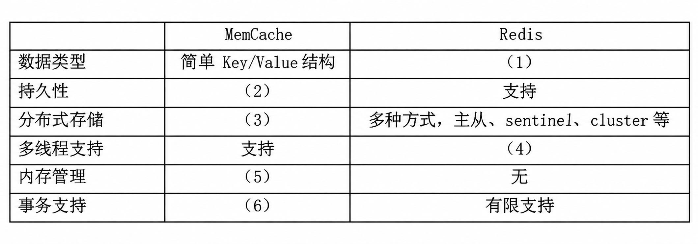
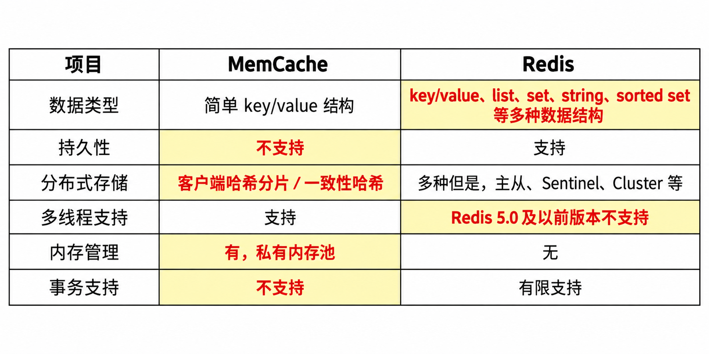

# 分布式数据库缓存设计：Memcached 与 Redis（题库第六节题目 19、27、28，9+8+8＝25 分）

## 题干（原题抄写）

> 阅读以下关于分布式数据库缓存设计的叙述，在答题纸上回答问题 1 至问题 3。
>
> **说明**：某企业是为城市高端用户提供高品质蔬菜生鲜服务的初创企业。创业初期为快速开展业务，企业采用轻量型开发架构（脚本语言 + 关系型数据库）研制业务系统。业务开展后，用户数和业务数量迅速增长，原有数据库服务器已不能满足高并发要求。张工建议重新开发系统，采用新的服务器和数据架构，以解决当前问题并支持日后扩展。李工认为该方案周期长、投入大，建议在尽量少改动的前提下，用 MemCache 缓解数据库压力。刘工认为该方案有数据可靠性和一致性问题，宕机时容易丢失交易数据，建议用 Redis。经讨论，企业最终采用刘工的方案。
>
> **问题 1（9 分）**：说明分布式数据库缓存的基本概念；补全表 4-1 中 MemCache 和 Redis 比较的空格（1）～（6）。
>
> **问题 2（8 分）**：说明李工方案的数据可靠性和一致性问题；说明 Redis 与原关系数据库的基本数据同步方案。
>
> **问题 3（8 分）**：给出 Redis 分布式存储的两种常见方案，以及 Redis 集群切片的常见方式。

## 图

- **表 4-1 MemCache_Redis 对比表·原表图（未填答案）**：
- **表 4-1·含答案图（去水印并按题目 27 参考答案填色——已填答案图，非原题图）**：

## 考场答案与采分要点

**问题 1**：分布式数据库缓存是在应用与关系数据库之间增加独立缓存层，把热点数据暂存在更快的缓存中，减少数据库直接访问并降低响应时间。

**表格空格参考答案（题目 27、28）**：
- **（1）** Redis 支持丰富数据结构（String、List、Set、Hash、Sorted Set 等）；
- **（2）** MemCache 不支持持久化；
- **（3）** MemCache 分布式存储通常由客户端哈希分片／一致性哈希实现；
- **（4）** 题库口径为 Redis 5.0 及以前版本不支持多线程处理请求（Redis 6 起可用 I/O 线程处理网络读写，核心命令执行仍以单线程为主）；
- **（5）** MemCache 使用 slab 分配机制（题目 27 表述为私有内存池）；
- **（6）** MemCache 不支持事务。
- ⚠️ **来源内部矛盾（保真保留）**：题目 19 自身的解析曾把“弱支持，只能保证事务中的每个操作连续执行”放在（6）附近，和表格列位置及问题 2 的说法冲突；题目 27、28 的明确答案支持（6）填“不支持”。

**问题 2**：
- **可靠性**：题库按缓存仅驻留内存的简化场景指出宕机或重启可能丢失缓存数据。
- **一致性**：关系库与缓存是两个独立存储，分别写入并非原子事务，可能出现缓存旧值或两侧状态不一致。Redis 也不能自动替代关系数据库成为权威交易存储。
- **基本同步（Cache-Aside）**：读先查 Redis，未命中再读关系库并回填缓存；写先提交关系库，再删除或更新 Redis 缓存，并为失败重试、过期和并发更新设计补偿。题库参考答案描述为“写原数据库后同步更新 Redis”。

**问题 3**：Redis 高可用／分布式部署可见**主从复制、Sentinel 与 Cluster**（题库称三种常见方案）。严格区分：Sentinel 负责主观下线检测、故障转移与通知，本身不是数据分片方式；Redis Cluster 通过**哈希槽**实现分片，而非一致性哈希。常见路由实现包括客户端分片、Twemproxy／Codis 等代理，以及 Redis Cluster 客户端与服务端重定向协作。

## 解析与易错点

- 答题分开写“缓存丢失”和“缓存与关系库数据不一致”；不能笼统地把启用 Redis 等同于事务数据可靠。
- Redis 事务命令会串行执行，但不提供关系数据库式回滚，与题库所称“有限支持”相符。
- 题目 28 正文提到 Redis 将不常用 value 交换到磁盘——这是历史 Redis VM 描述，官方文档已标为弃用，不应当作现代 Redis 默认内存管理机制；实际内存上限结合 `maxmemory` 与淘汰策略理解。

## 知识点链接

- [缓存架构、数据库同步与 Redis 分片](https://github.com/Goodyzhang/ruankao.skill/blob/main/materials/%E7%B3%BB%E7%BB%9F%E6%9E%B6%E6%9E%84%E8%AE%BE%E8%AE%A1%E5%B8%88/%E7%AC%94%E8%AE%B0/%E7%9F%A5%E8%AF%86%E7%82%B9/10-%E8%BD%AF%E4%BB%B6%E6%9E%B6%E6%9E%84%E7%9A%84%E6%BC%94%E5%8C%96%E5%92%8C%E7%BB%B4%E6%8A%A4.md)

## 核验状态与来源

- 核验状态：`pending`（web-bank，年份未提供；表 4-1（6）归属来源内部矛盾已标注）。
- 实验室可用性：**暂不可导出**——web-bank 身份未核实。
