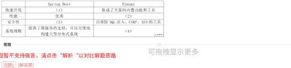

# 在线教育平台：后端框架对比、负载均衡与中间件（题目 249–251，8+10+7＝25 分）

## 题干与材料摘要

平台同时面向学生与教师，覆盖教学活动及其管理，要求承受并发访问并保障业务数据。后续问题围绕后端框架、负载分配和相关 Web 技术展开。

- **框架对比表截图（原表截图）**：

## 小问与答案

**第 249 题／问题 1：后端框架对比（8 分）**——从开发效率、性能、安全和规模四个维度填补 Spring Boot 与 Django 对比表。
- 网站填空口径（摘要）：① Spring Boot 通过自动配置及依赖管理简化开发；② 题库将 Django 的相对性能评为较弱；③ 题库认为 Spring Boot 要另行实现防护或依靠 WAF；④ 题库将 Django 定位于较小站点，对大型分布式应用作负面评价。
- 解题方法：每个空先定位“行维度＋列框架”，再填写同一层次的能力描述。不要把编程语言、架构模式或部署产品填入能力空格。
- **证据边界（保真保留）**：以上是当前网页显示的参考答案，未据此做现代版本的技术选型验证。实际工程中，性能受负载、I/O、数据库与部署方式影响；不能单凭此表得出“某框架只能开发小系统”的结论。

**第 250 题／问题 2：负载均衡技术及取舍（10 分）**——300 字以内列出负载均衡技术，说明优点和缺点。
- 网站答案要点：重定向、DNS、NAT、反向代理、混合型五类。
- 自主表述：重定向由客户端转向目标服务器，转发压力小，但增加交互并需避免循环；DNS 分流部署简便，缓存使故障切换不够及时；NAT 对应用透明，但进出流量汇聚可能限制吞吐；反向代理可按请求特征分配流量并结合缓存，但代理本身有资源开销和可用性要求；混合方案可分层兼顾地域与实例调度，代价是配置、监控及故障定位更复杂。
- 解题方法：沿一次请求的路径回答“谁作分配决定、流量是否经过它、它如何知道目标可用”。不要只列轮询、加权、最少连接等算法，因为本题按实现技术分类。

**第 251 题／问题 3：中间件类型与产品（7 分）**——列出可用于教育平台的中间件并给出具体产品，网页注明答出七类即可。

| 类型 | 页面给出的产品示例 | 本案例如何联系用途 |
|---|---|---|
| Web 服务 | Nginx、Apache | 承接 Web 请求或静态资源 |
| 缓存 | Redis、Memcached | 缓存热点课程信息，减少重复读取 |
| 消息队列 | RabbitMQ、Kafka | 将非即时处理任务与请求解耦 |
| API 网关 | Tyk | 统一管理 API 入口 |
| 数据访问连接管理 | HikariCP | 复用数据库连接 |
| 分布式事务 | Seata | 处理适用场景下的跨服务事务协调 |
| 负载均衡 | Nginx、HAProxy | 把访问分配到服务实例 |
| 监控及展示 | Prometheus、Grafana | 观察指标与服务运行状态 |

- 解题方法：按“类型—产品—用途”成组回答，优先选择七种不同职责。缓存不能替代成绩数据的可靠存储，消息异步处理也要符合考试提交的确认语义。

## 知识点链接

- [负载均衡与大型网站架构](https://github.com/Goodyzhang/ruankao.skill/blob/main/materials/%E7%B3%BB%E7%BB%9F%E6%9E%B6%E6%9E%84%E8%AE%BE%E8%AE%A1%E5%B8%88/%E7%AC%94%E8%AE%B0/%E7%9F%A5%E8%AF%86%E7%82%B9/10-%E8%BD%AF%E4%BB%B6%E6%9E%B6%E6%9E%84%E7%9A%84%E6%BC%94%E5%8C%96%E5%92%8C%E7%BB%B4%E6%8A%A4.md)
- [13-层次式架构设计理论与实践（交叉引用）](https://github.com/Goodyzhang/ruankao.skill/blob/main/materials/%E7%B3%BB%E7%BB%9F%E6%9E%B6%E6%9E%84%E8%AE%BE%E8%AE%A1%E5%B8%88/%E7%AC%94%E8%AE%B0/%E7%9F%A5%E8%AF%86%E7%82%B9/13-%E5%B1%82%E6%AC%A1%E5%BC%8F%E6%9E%B6%E6%9E%84%E8%AE%BE%E8%AE%A1%E7%90%86%E8%AE%BA%E4%B8%8E%E5%AE%9E%E8%B7%B5.md)

## 核验状态与来源

- 核验状态：`pending`（web-bank，未核实年份；249 题框架对比为题库口径，证据边界已标注）。
- 实验室可用性：**暂不可导出**——web-bank 身份未核实。
