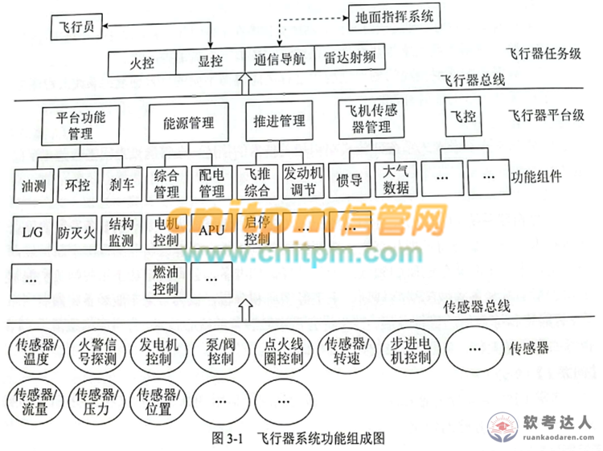
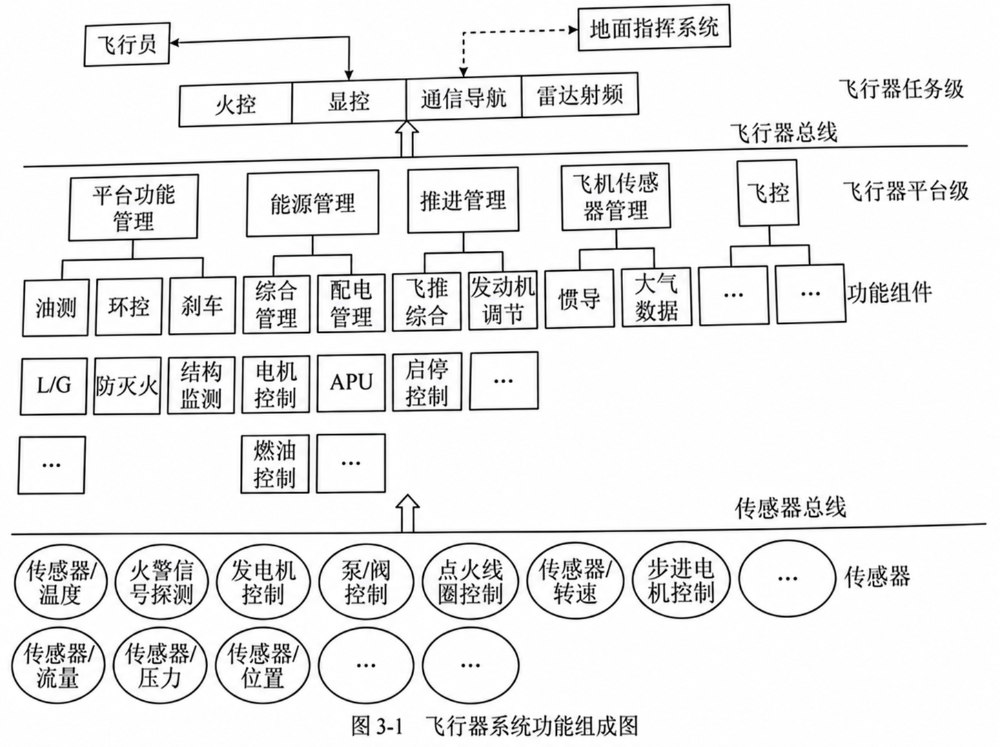

# 航空器 CPS 分层设计：感知/网络/控制功能映射与安全威胁

## 题干（原题抄写）

> 阅读关于嵌入式系统开放式架构相关技术的描述并回答问题1～3。某公司长期研制嵌入式系统，计划进入宇航装备领域。王工认为未来装备将向网络化、智能化、综合化发展，CPS 会成为核心技术，公司应基于 CPS 进行技术储备。
>
> **问题1（9分）**：CPS 通常分为感知层、网络层和控制层。用300字以内说明 CPS 的定义及各层含义。
>
> **问题2（10分）**：结合图3-1，将以下功能映射到 CPS 层，或指出不属于任何一层：1.飞行传感器管理；2.步进电机控制；3.显控；4.发电机控制；5.环控；6.配电管理；7.转速传感器；8.传感器总线；9.飞行员；10.火警信号探测。
>
> **问题3（6分）**：用100字以内说明 CPS 系统三类安全威胁，并为每类至少举两个例子。

## 图（原图与可编辑副本分开）

- **原题图**：
- **去水印副本（可编辑稿，非原图）**：

## 考场答案与采分要点

**问题 1（300字以内作答稿）**：CPS（信息物理系统）是深度融合计算、通信与控制，使信息世界和物理世界形成感知、分析、决策、执行闭环的智能系统。感知层由传感器和执行器组成，负责采集物理状态并执行指令；网络层负责各设备间的数据通信；控制层分析感知数据、形成决策并协调物理过程。

**问题 2（功能分层映射）**：

| 层级 | 功能编号与名称 |
|---|---|
| 感知层 | 2 步进电机控制；4 发电机控制；7 转速传感器；10 火警信号探测 |
| 网络层 | 8 传感器总线 |
| 控制层 | 1 飞行传感器管理；3 显控；5 环控；6 配电管理 |
| 不属于上述 CPS 层 | 9 飞行员（人机交互参与者） |

**问题 3（100字以内作答稿）**：感知层：传感器数据伪造、节点物理捕获；网络层：通信窃听、重放或拒绝服务；控制层：恶意代码注入、未授权控制。

## 解析与易错点

- 传感器和执行器直接接触物理对象，归感知层；总线负责通信，归网络层；子系统管理与协同逻辑归控制层。飞行员参与人机协同，但属于系统外部操作者。
- 安全威胁也应按被攻击对象所在层归类。

## 知识点链接

- [CPS 概念与闭环](https://github.com/Goodyzhang/ruankao.skill/blob/main/materials/%E7%B3%BB%E7%BB%9F%E6%9E%B6%E6%9E%84%E8%AE%BE%E8%AE%A1%E5%B8%88/%E7%AC%94%E8%AE%B0/%E7%9F%A5%E8%AF%86%E7%82%B9/11-%E6%9C%AA%E6%9D%A5%E4%BF%A1%E6%81%AF%E7%BB%BC%E5%90%88%E6%8A%80%E6%9C%AF.md)
- [CPS 分层与航空器功能映射](https://github.com/Goodyzhang/ruankao.skill/blob/main/materials/%E7%B3%BB%E7%BB%9F%E6%9E%B6%E6%9E%84%E8%AE%BE%E8%AE%A1%E5%B8%88/%E7%AC%94%E8%AE%B0/%E7%9F%A5%E8%AF%86%E7%82%B9/11-%E6%9C%AA%E6%9D%A5%E4%BF%A1%E6%81%AF%E7%BB%BC%E5%90%88%E6%8A%80%E6%9C%AF.md)

## 核验状态与来源

- 核验状态：`pending`（年份和原试卷编号未提供；归入第 11 章）。
- 实验室可用性：**暂不可导出**——来源身份未核实。
